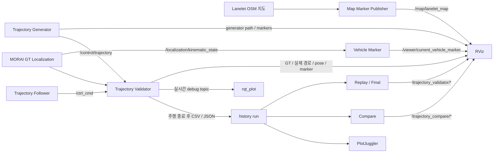
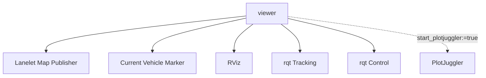
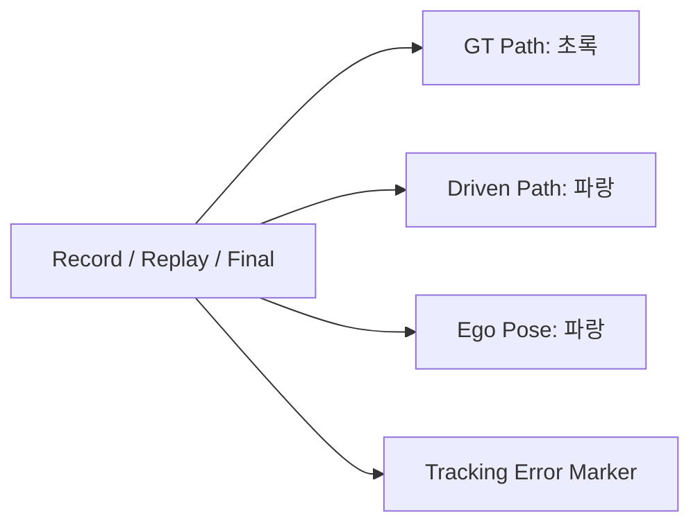
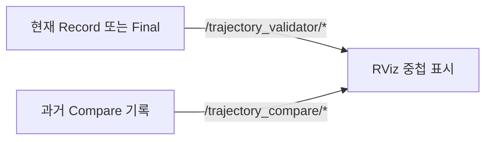
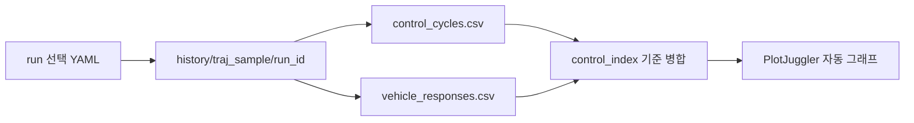

# Viewer: 처음 사용하는 사람을 위한 안내

## Viewer가 무엇인가요?

Viewer는 차량 제어 시스템의 **상태를 눈으로 확인하는 프로그램 모음**이다. Viewer를 실행하면
다음 질문에 답할 수 있다.

- 지도에서 차량이 현재 어디에 있는가?
- 생성한 주행 경로가 차선 위에 올바르게 놓였는가?
- 차량이 기준 경로를 실제로 잘 따라갔는가?
- 목표 속도와 실제 속도가 얼마나 다른가?
- 조향 명령을 보낸 뒤 차량이 실제로 반응했는가?
- 이번 주행과 이전 주행의 결과가 어떻게 다른가?

Viewer에는 세 가지 화면이 있다.

| 화면 | 쉽게 말하면 | 확인하는 내용 |
| --- | --- | --- |
| RViz | 위에서 내려다보는 지도 화면 | 지도, 차량 위치, 기준 경로, 실제 주행 경로 |
| rqt_plot | 현재 값이 움직이는 실시간 그래프 | 속도, 조향, 횡방향 오차 |
| PlotJuggler | 저장된 주행을 다시 보는 분석 그래프 | 주행 전체 구간의 명령, 반응, 오차 |

Viewer는 차량을 움직이는 프로그램이 아니다. 경로를 만들거나 제어 명령을 보내거나 기록을
저장하지도 않는다. 다른 프로그램이 만든 결과를 보여주기만 하므로 Viewer를 먼저 실행해도
안전하다. 아직 데이터가 없다면 빈 화면으로 기다리다가 데이터가 들어오면 자동으로 표시한다.

패키지 위치:

```text
base_ws/src/control/view
```

MORAI 연결부터 제어·기록까지의 전체 실행 순서는
[`docs/how_to_launch_control_pipeline.md`](../../../../docs/how_to_launch_control_pipeline.md)를
참고한다.

## 처음 사용할 때: 5분 빠른 시작

### 1단계: ROS와 MORAI 데이터를 준비합니다

Viewer가 차량을 표시하려면 최소한 다음 두 프로그램이 먼저 실행되어야 한다.

```bash
# 터미널 1: ROS Master
roscore

# 터미널 2: MORAI UDP 연결
roslaunch sensor_interface morai_udp_interface.launch

# 터미널 3: MORAI 차량 위치를 ROS 위치로 변환
roslaunch bringup localization_morai_gt.launch
```

MORAI에서는 Ego UDP Network가 Connect 상태여야 한다. 경로 없이 차량과 지도만 확인하려면
여기까지 준비하면 된다.

### 2단계: Viewer를 실행합니다

새 터미널에서 workspace를 적용하고 Viewer를 실행한다.

```bash
source /opt/ros/noetic/setup.bash
source /home/graygorrila/AjouNice2026/base_ws/devel/setup.bash
roslaunch viewer viewer.launch
```

Alias가 적용된 개발 환경에서는 한 단어로 실행할 수 있다.

```bash
viewer
```

정상적으로 실행되면 다음 세 창이 열린다.

1. RViz 한 개: 지도와 차량·경로 표시
2. Tracking rqt_plot 한 개: 경로 추종 오차 표시
3. Control rqt_plot 한 개: 속도와 조향 비교

PlotJuggler는 저장된 기록을 선택해서 보는 별도 기능이므로 기본 `viewer` 실행에는 포함되지
않는다.

### 3단계: RViz에서 차량을 찾습니다

RViz에 다음 항목이 보이면 Viewer의 기본 연결은 정상이다.

```text
회색/흰색 차선 지도
        +
파란색 차량 메시
```

차량 화살표는 `/localization/kinematic_state`의 현재 위치다. 차량이 보이지 않으면 경로나
Validator보다 localization부터 확인한다.

```bash
rostopic hz /localization/kinematic_state
rostopic hz /viewer/current_vehicle_marker
```

두 topic 모두 주기가 출력되어야 한다.

### 4단계: 경로를 표시합니다

Trajectory Publisher를 실행한다.

```bash
roslaunch trajectory_generator trajectory_publisher.launch
```

Alias를 사용하면 다음과 같다.

```bash
traj_pub
```

RViz에 초록색 Generator Path가 나타난다. 이것은 차량이 실제로 지나간 경로가 아니라
**앞으로 추종해야 할 기준 경로**다.

### 5단계: 현재 주행을 관찰합니다

Validator를 먼저 실행하고 Follower를 나중에 실행한다.

```bash
# 터미널 1: 기록 대기
roslaunch trajectory_validator record.launch

# 터미널 2: 차량 제어 시작
roslaunch trajectory_follower pp_pi.launch
```

주행이 시작되면 RViz에는 실제 차량 궤적이 누적되고, rqt_plot에는 속도·조향·오차 그래프가
그려진다.

## 처음 화면을 볼 때 알아야 할 색상

| RViz 표시 | 기본 색상 | 의미 |
| --- | --- | --- |
| Generator Path | 초록색 | Trajectory Generator가 현재 발행하는 기준 경로 |
| Current Vehicle Marker | 파란색 | Localization이 알려주는 현재 차량 위치 |
| Validator GT Path | 초록색 | 해당 기록에서 차량이 추종해야 했던 경로 |
| Driven Path | 파란색 | 현재 또는 Replay 차량이 실제로 이동한 경로 |
| Validator Ego Pose | 노란색 | 현재 또는 Replay 순간의 차량 자세 |
| Compare GT Path | 빨간색 | 비교 대상으로 선택한 과거 기준 경로 |
| Compare Driven Path | 빨간색 | 비교 대상으로 선택한 과거 실주행 경로 |

초록색은 “가야 할 경로”, 파란색은 “현재 차량 거동”, 빨간색은 “비교값”으로 이해하면
된다.

## 상황별로 어떤 명령을 사용하나요?

### 지도와 현재 차량만 보고 싶습니다

```bash
viewer_rviz
```

Alias 없는 명령:

```bash
roslaunch viewer viewer_rviz.launch
```

Localization이 실행 중이어야 차량이 보인다. Validator와 Follower는 필요하지 않다.

### 현재 주행을 지도와 그래프로 보고 싶습니다

```bash
viewer
```

이후 `traj_pub`, `traj_val`, `traj_fol` 순서로 실행한다. RViz에서는 공간 경로를 보고,
rqt_plot에서는 현재 수치를 본다.

### 방금 저장한 주행 경로 전체를 보고 싶습니다

먼저 `trajectory_validator/config/history_run.yaml`에서 기록을 선택한다.

```yaml
traj_sample: "200889_200258_20kph"
run_id: "0719_172905_pp_pi"
```

그다음 전체 경로를 즉시 표시한다.

```bash
traj_val_final
```

Alias 없는 명령:

```bash
roslaunch trajectory_validator history.launch mode:=final
```

### 저장된 주행을 당시 속도로 다시 보고 싶습니다

```bash
traj_val_replay
```

Alias 없는 명령:

```bash
roslaunch trajectory_validator history.launch mode:=replay
```

Replay는 차량 pose와 경로를 기록 당시 시간 순서대로 보여준다.

### 현재 결과와 이전 주행 경로를 겹쳐 보고 싶습니다

`trajectory_validator/config/compare_run.yaml`에서 과거 기록을 선택한 다음 실행한다.

```bash
traj_val_compare
```

Alias 없는 명령:

```bash
roslaunch trajectory_validator history.launch mode:=compare
```

Compare 경로는 별도 색상과 `/trajectory_compare/*` topic을 사용하므로 현재 경로를 덮지 않는다.

### 저장된 주행의 전체 그래프를 보고 싶습니다

Compare 기록을 분석하려면:

```bash
viewer_plot
```

Replay/Final용 History 기록을 분석하려면:

```bash
traj_val_plot
```

두 명령 모두 PlotJuggler를 열지만 선택하는 YAML이 다르다.

## 화면이 비어 있어도 정상인 경우

Viewer는 데이터를 직접 만들지 않기 때문에 다음 상황에서는 일부 화면이 비어 있는 것이
정상이다.

| 보이지 않는 항목 | 필요한 프로그램·데이터 |
| --- | --- |
| 지도 | Lanelet map publisher 또는 `viewer start_map:=true` |
| 현재 차량 | `localization_morai_gt`와 `/localization/kinematic_state` |
| Generator Path | `traj_pub` |
| 현재 실제 주행 궤적 | `traj_val`이 실제 기록 중이어야 함 |
| rqt_plot 곡선 | Validator debug topic이 발행 중이어야 함 |
| Replay/Final 경로 | `history_run.yaml` 선택 후 해당 명령 실행 |
| Compare 경로 | `compare_run.yaml` 선택 후 `traj_val_compare` 실행 |
| PlotJuggler 곡선 | 선택한 run에 schema-v3 CSV가 있어야 함 |

## 가장 간단한 문제 확인 순서

```text
MORAI가 실행 중인가?
        ↓
/Ego_topic이 들어오는가?
        ↓
/localization/kinematic_state가 들어오는가?
        ↓
파란색 차량 Marker가 발행되는가?
        ↓
/control/trajectory가 들어오는가?
        ↓
Validator debug topic이 들어오는가?
```

확인 명령:

```bash
rostopic hz /Ego_topic
rostopic hz /localization/kinematic_state
rostopic hz /viewer/current_vehicle_marker
rostopic hz /control/trajectory
rostopic hz /trajectory_validator/debug
```

여기까지가 처음 사용하는 사람이 알아야 할 기본 사용법이다. 아래 내용은 topic, 색상, launch
옵션과 내부 데이터 흐름을 더 자세히 설명한다.

## 1. 전체 데이터 흐름



흐름을 사용 목적 기준으로 줄이면 다음과 같다.

```text
실시간 공간 확인 ──> RViz
실시간 수치 확인 ──> rqt_plot
저장 기록 전체 분석 ──> PlotJuggler
```

## 2. 기능 구성

| 기능 | 입력 | 보여주는 내용 | 주 사용 시점 |
| --- | --- | --- | --- |
| Lanelet Map | OSM 파일 | K-City 차선 지도 | 항상 |
| Vehicle Marker | `/localization/kinematic_state` | 현재 차량 위치와 방향 | localization 실행 중 |
| RViz | 지도·경로·pose·marker topic | 차량과 여러 경로의 공간 관계 | 실시간·Replay·Compare |
| rqt_plot | `/trajectory_validator/debug/*` | 현재 오차와 명령/실제값 | Record 또는 Replay 중 |
| PlotJuggler | History CSV | 저장된 주행 전체 시간 그래프 | 주행 종료 후 분석 |

## 3. 전체 Viewer 실행

단축어:

```bash
viewer
```

Alias 없는 실제 명령어:

```bash
roslaunch viewer viewer.launch
```

기본 실행 구성은 다음과 같다.



PlotJuggler는 기본값이 `false`라서 `viewer`만 실행했을 때는 열리지 않는다. 필요할 때
`viewer_plot` 또는 `traj_val_plot`으로 따로 실행한다.

## 4. RViz 기능

단축어:

```bash
viewer_rviz
```

Alias 없는 실제 명령어:

```bash
roslaunch viewer viewer_rviz.launch
```

RViz는 “차량이 지도와 경로 위에서 어디에 있는가”를 확인한다. Fixed Frame은 `map`이다.

### 4.1 Lanelet 지도

```text
OSM 파일
   └─> lanelet2_osm_marker_publisher
         └─> /map/lanelet_map
               └─> RViz: K-City Lanelet Map
```

기본 지도는 K-City Lanelet v44다. 지도 publisher는 시작할 때 OSM 파일을 읽어 MarkerArray로
변환하고 latch 발행한다. RViz가 매 frame마다 OSM 파일을 다시 읽는 구조가 아니다.

이미 지도 publisher가 실행 중이면 중복 실행하지 않는다.

```bash
roslaunch viewer viewer.launch start_map:=false
```

다른 지도를 지정할 수도 있다.

```bash
roslaunch viewer viewer.launch map_file:=/absolute/path/map.osm
```

### 4.2 현재 차량 위치

```text
/localization/kinematic_state
   └─> current_vehicle_marker.py
         └─> /viewer/current_vehicle_marker
               └─> RViz IONIQ 5 차량 메시
```

Validator 실행 여부와 관계없이 localization 값만으로 차량을 표시한다. 기본은
`ioniq5` 패키지의 실차 크기 메시를 사용하며, `base_link` rear-axle 원점 보정을 적용한다.

차량이 보이지 않으면 다음 순서로 확인한다.

```bash
rostopic hz /localization/kinematic_state
rosnode list | grep current_vehicle_marker
rostopic hz /viewer/current_vehicle_marker
rosrun tf tf_echo map base_link
```

### 4.3 Generator 경로

| RViz Display | Topic | 의미 |
| --- | --- | --- |
| Generator Path | `/control/debug/generator/path` | 현재 publish 중인 기준 trajectory 형상 |
| Generator Markers | `/control/debug/generator/markers` | 시작·종료점과 경로 보조 정보 |

이 화면으로 YAML anchor를 바꿔 생성한 경로가 차선 위에 정상적으로 놓였는지 확인한다.
`traj_gen`으로 YAML에서 trajectory CSV를 생성·선택한 뒤 `traj_pub`으로 발행한다.

### 4.4 현재 Record·Replay·Final 경로



| RViz Display | Topic | 의미 |
| --- | --- | --- |
| Validator GT Path | `/trajectory_validator/gt_path` | 추종해야 하는 기준 경로 |
| Driven Path | `/trajectory_validator/ego_path` | 차량이 실제로 이동한 경로 |
| Validator Ego Pose | `/trajectory_validator/ego_pose` | 현재 또는 재생 중 차량 pose |
| Tracking Error | `/trajectory_validator/markers` | 기준점과 차량 사이 오차 표시 |

- Record: 실제 차량 경로가 주행 중 누적된다.
- Replay: 저장된 주행이 당시 시간 순서대로 다시 나타난다.
- Final: 저장된 전체 기준·실제 경로가 즉시 나타난다.

Replay와 Final이 읽을 기록은 `trajectory_validator/config/history_run.yaml`에서 선택한다.

### 4.5 Compare 경로



| RViz Display | Topic | 색상·의미 |
| --- | --- | --- |
| Compare GT Path | `/trajectory_compare/gt_path` | 빨간색 과거 기준 경로 |
| Compare Driven Path | `/trajectory_compare/ego_path` | 빨간색 과거 실주행 경로 |
| Compare Final Pose | `/trajectory_compare/ego_pose` | 빨간색 과거 최종 pose |

Compare는 `/trajectory_validator/*`와 다른 namespace를 사용하므로 현재 주행 경로를 덮지 않고
동시에 겹쳐 볼 수 있다. 비교 기록은
`trajectory_validator/config/compare_run.yaml`에서 선택한다.

### 4.6 TF Display

TF Display는 기본 비활성화다. `map -> morai_map -> base_link`처럼 원점 간 거리가 큰 TF의
연결선을 RViz가 그리면 긴 선이 차량 이동에 따라 곡선처럼 보일 수 있기 때문이다. TF 발행
자체가 멈춘 것은 아니며, 필요할 때 RViz Displays에서 직접 활성화한다.

### 4.7 Software rendering

ROS Noetic RViz/OGRE와 일부 NVIDIA 드라이버 조합에서 발생하는 OpenGL shader segfault를
피하기 위해 기본적으로 software rendering을 사용한다. GPU 렌더링 시험 시에만 끈다.

```bash
roslaunch viewer viewer.launch software_rendering:=0
```

## 5. rqt_plot 기능

단축어:

```bash
viewer_rqt
```

Alias 없는 실제 명령어:

```bash
roslaunch viewer viewer_rqt.launch
```

rqt_plot은 “현재 제어가 어떻게 동작하고 있는가”를 시간축으로 확인한다. 실행 이후 수신한
실시간 topic만 표시하며, 과거 전체 구간 분석 도구는 아니다.

### 5.1 Tracking 그래프

```text
오차
 ^      lateral error
 |    /\      /\
 |___/  \____/  \________> 시간
 |       heading error
```

| Curve | 단위 | 의미 |
| --- | --- | --- |
| `lateral_error_m` | m | 차량이 기준 경로에서 좌우로 벗어난 거리 |
| `heading_error_rad` | rad | 차량 방향과 기준 경로 방향 차이 |
| `velocity_error_mps` | m/s | 실제 속도와 목표 속도의 차이 |

Topic은 모두 `/trajectory_validator/debug/` 아래에 있다.

### 5.2 Control 그래프

```text
속도
 ^       목표 속도 ─────────────
 |      / 실제 속도 ────────────
 |_____/________________________> 시간

조향
 ^    명령 조향  /\/\
 |    실제 조향   /\/\   ← 두 곡선의 지연·차이 확인
 |________________________________> 시간
```

| Curve | 단위 | 의미 |
| --- | --- | --- |
| `target_velocity_mps` | m/s | trajectory가 요구하는 목표 속도 |
| `ego_velocity_mps` | m/s | 정규화된 실제 차량 속도 |
| `cmd_steering_rad` | rad | Follower가 생성한 조향 명령 |
| `actual_steering_rad` | rad | MORAI에서 수신한 실제 조향 상태 |

Validator Record 또는 Replay가 debug topic을 발행하기 전에는 빈 그래프가 정상이다.

## 6. PlotJuggler 기능

PlotJuggler는 “이미 끝난 주행 전체에서 기준값과 실제값이 어떻게 달랐는가”를 분석한다.
곡선 색은 RViz와 같이 기준·명령·GT는 초록색, 차량의 실제 거동은 파란색,
오차·비교값은 빨간색 계열로 표시한다.
실시간 ROS topic이 아니라 schema-v3 History의 `control_cycles.csv`와
`vehicle_responses.csv`를 읽는다.



### 6.1 Compare 기록 분석

단축어:

```bash
viewer_plot
```

Alias 없는 실제 명령어:

```bash
roslaunch viewer viewer_plotjuggler.launch
```

선택 기준은 `trajectory_validator/config/compare_run.yaml`이다.

### 6.2 Replay·Final 기록 분석

단축어:

```bash
traj_val_plot
```

Alias 없는 실제 명령어:

```bash
roslaunch viewer viewer_plotjuggler.launch \
  config_file:=$(rospack find trajectory_validator)/config/history_run.yaml
```

선택 기준은 `trajectory_validator/config/history_run.yaml`이다.

### 6.3 자동 생성 그래프

| 그래프 | 주요 Curve | 판단 목적 |
| --- | --- | --- |
| Velocity | 목표·실제·속도 오차 | 종방향 추종 성능 |
| Steering | 명령·실제·조향 오차 | 조향 응답과 지연 |
| Tracking errors | lateral·longitudinal·heading | 위치 및 자세 추종 성능 |
| Matched GT / Ego yaw | 기준 yaw·차량 yaw | 방향 추종 성능 |
| Command to vehicle response | 속도·조향·횡오차 변화 | 명령 이후 실제 차량 반응 |

그래프의 시간축은 `elapsed_time_s`이며 주행 시작을 0초로 사용하는 전체 기록 시간이다.

### 6.4 기록 파일 구조

```text
trajectory_validator/history/
└── <traj_sample>/
    └── <run_id>/
        ├── gt.csv
        ├── control_cycles.csv
        ├── vehicle_responses.csv
        └── metadata.json
```

PlotJuggler가 아무것도 표시하지 않으면 선택 YAML의 `traj_sample`, `run_id`와 두 schema-v3
CSV 파일 존재 여부를 먼저 확인한다.

## 7. 도구별 차이

| 질문 | 사용할 도구 |
| --- | --- |
| 차량이 지도와 경로 위 어디에 있는가? | RViz |
| 현재 횡오차·속도·조향 명령은 어떤가? | rqt_plot |
| 저장된 주행 전체의 오차가 언제 커졌는가? | PlotJuggler |
| 현재 주행과 과거 주행의 공간 경로가 어떻게 다른가? | RViz Compare |
| 명령 후 차량 반응이 얼마나 늦거나 작았는가? | PlotJuggler |

## 8. 실행 명령 요약

| 단축어 | Alias 없는 실제 명령어 | 실행 기능 | 선택 데이터 |
| --- | --- | --- | --- |
| `viewer` | `roslaunch viewer viewer.launch` | RViz + rqt_plot | 실시간 topic |
| `viewer_rviz` | `roslaunch viewer viewer_rviz.launch` | RViz | 실시간·Replay·Compare topic |
| `viewer_rqt` | `roslaunch viewer viewer_rqt.launch` | rqt_plot | 실시간 Validator debug |
| `viewer_plot` | `roslaunch viewer viewer_plotjuggler.launch` | PlotJuggler | `compare_run.yaml` |
| `traj_val_plot` | config 인자를 추가한 PlotJuggler launch | PlotJuggler | `history_run.yaml` |

## 9. 선택 실행 옵션

RViz만 실행:

```bash
roslaunch viewer viewer.launch start_rviz:=true start_rqt:=false
```

rqt만 실행:

```bash
roslaunch viewer viewer.launch start_rviz:=false start_rqt:=true
```

PlotJuggler까지 통합 실행:

```bash
roslaunch viewer viewer.launch start_plotjuggler:=true
```

PlotJuggler와 ROS 플러그인이 없다면 다음 패키지를 설치한다.

```bash
sudo apt install ros-noetic-plotjuggler ros-noetic-plotjuggler-ros
```
