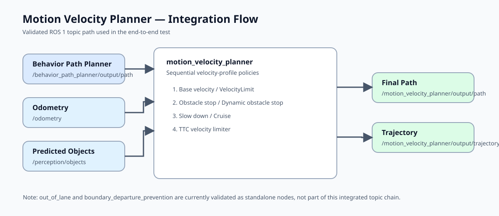
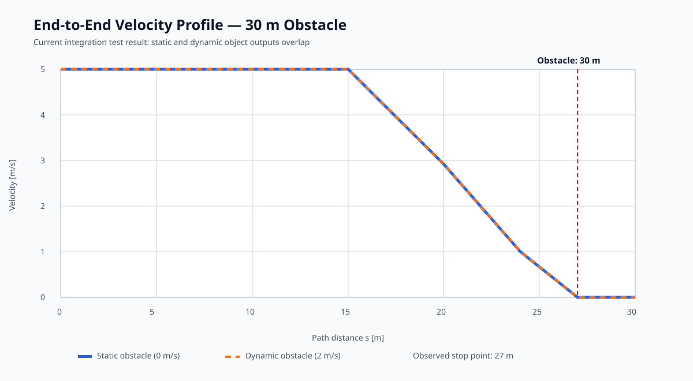

# Motion Velocity Planner Validation Materials

## 1. Integration architecture

## 2. End-to-end velocity profile

The profile is based on the executed 30 m obstacle integration test:

- Input path: 1 m spacing, 8 m/s initial velocity
- Planner base velocity: 5 m/s
- Static obstacle: 30 m, 0 m/s
- Dynamic obstacle: 30 m, 2 m/s
- Observed output: both cases stop at 27 m

The overlapping profiles are intentional evidence of the current integration gap: the integrated node still reads `ObjectClassification.confidence`, whereas the ROS message provides `probability`. As a result, its static/dynamic classification branches are inactive and the generic slow-down policy determines the stop point.

## 3. RViz capture guide

Use this layout to produce the companion RViz screenshot.

| Display | Topic | Suggested style |
|---|---|---|
| Input path | `/behavior_path_planner/output/path` | Thin blue line |
| Final path | `/motion_velocity_planner/output/path` | Thick green-to-red line by point velocity |
| Obstacles | `/perception/objects` | Orange bounding boxes |
| Ego pose | `/odometry` | Blue vehicle arrow |

For the validation screenshot, place a 30 m object on the reference path and capture the final path from approximately 16 m onward: the color should transition from green to yellow and red near the observed stop point.

## Slide-ready summary

| Item | Result |
|---|---|
| Individual module checks | Completed |
| End-to-end static-obstacle output | Stops at 27 m |
| End-to-end dynamic-obstacle output | Also stops at 27 m |
| Remaining integration issue | Dynamic classification must use `probability` in `motion_velocity_planner.py` |
