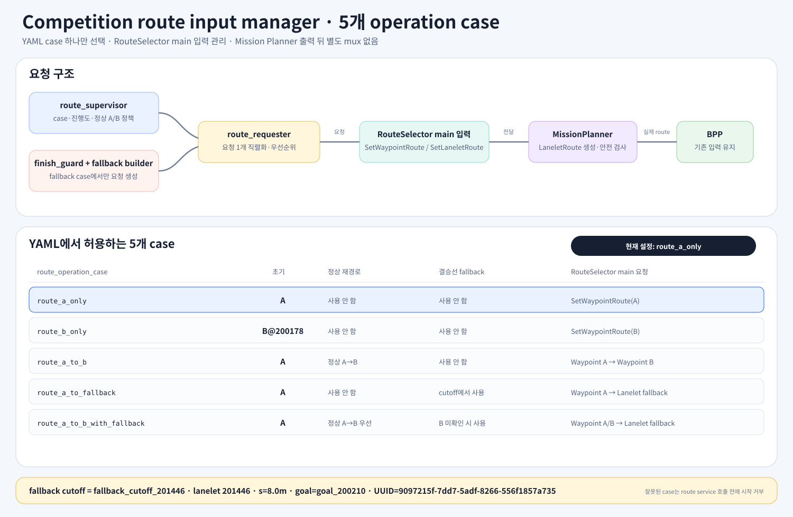
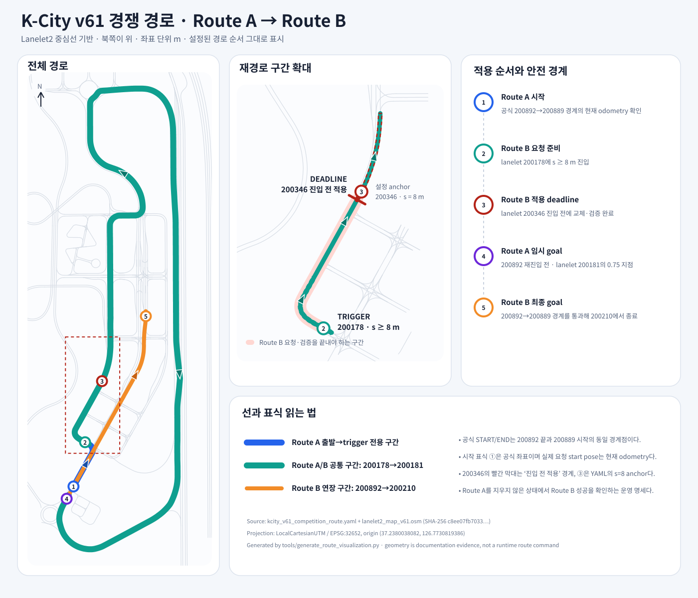
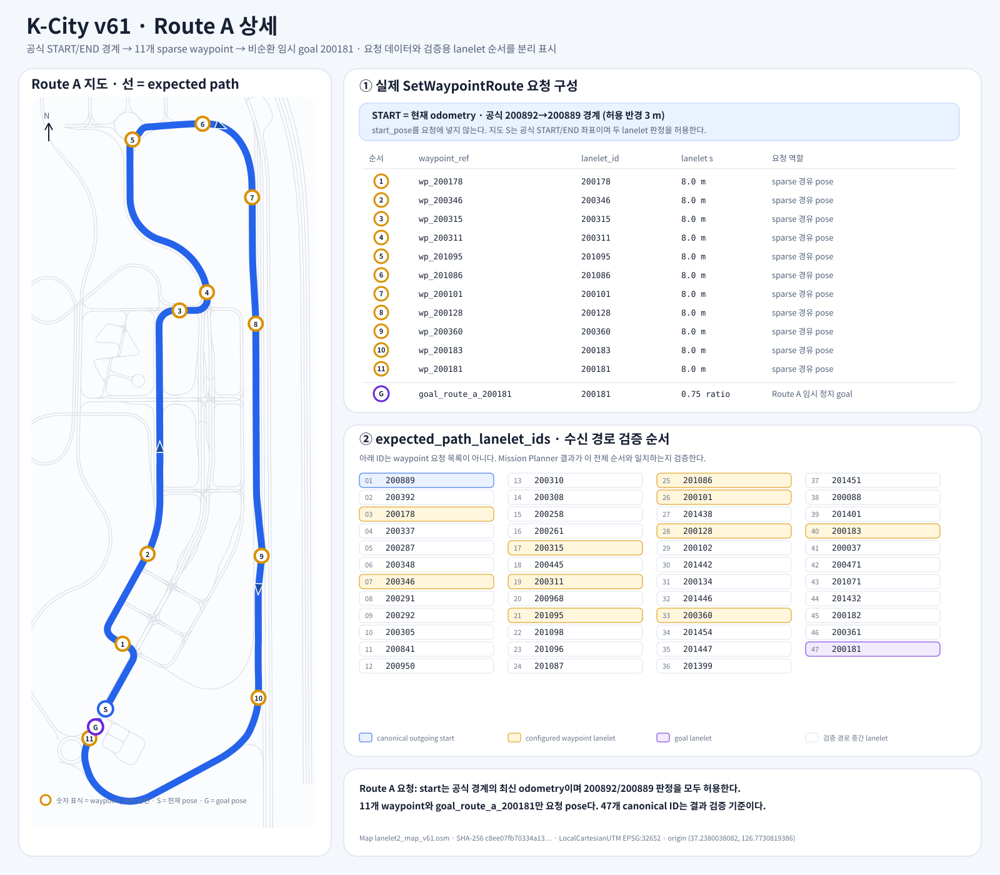
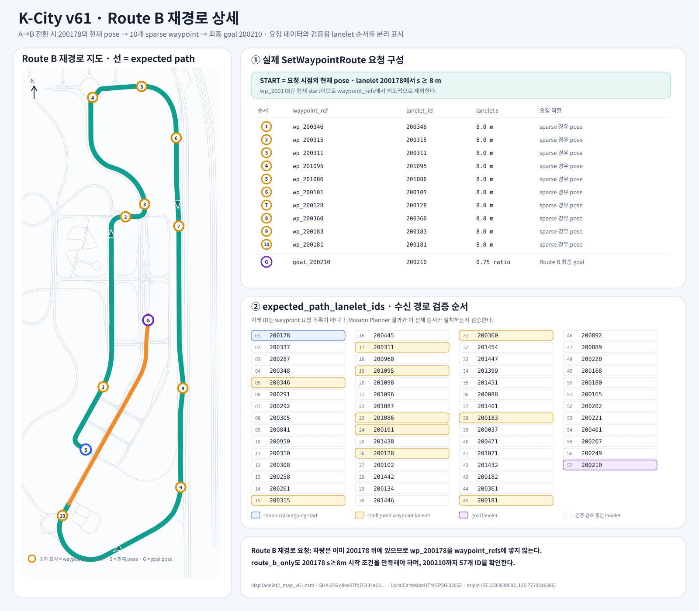
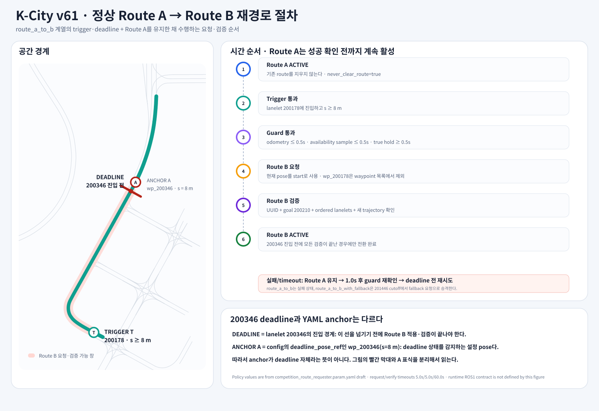

# competition_route_requester

K-City v61 대회 경로를 요청하기 위한 AjouNice 전용 planning addon이다.

현재 패키지는 **명세와 경로 데이터만 보관한다**. 실행 노드, launch 파일 및 ROS 메시지·서비스 의존성은 아직 포함하지 않는다. `autoware_mission_planner_universe`의 `RouteSelector`와 `MissionPlanner`가 ROS1으로 포팅되고 실제 인터페이스가 고정된 뒤 구현한다.

패키지 전체는 competition route input manager를 담지만, 향후 실행 node의 책임은 분리한다. `route_requester`는 RouteSelector main 요청 gateway이고 `route_supervisor`가 Route A/B 정책과 정상 재경로 상태 기계를 소유한다. finish guard와 fallback request builder는 독립 boolean으로 켜지 않고 선택한 operation case에 따라 필요한 경우에만 동작한다.

이 addon은 Mission Planner가 발행한 route 뒤에 별도 mux를 붙이지 않는다. 정상 Route A/B는 `SetWaypointRoute`, fallback은 명시적인 lanelet segment를 담은 `SetLaneletRoute`로 RouteSelector main 입력에 전달한다. 실제 `LaneletRoute` 생성과 BPP 전달은 기존 RouteSelector/MissionPlanner 흐름을 그대로 사용한다.

YAML의 `route_operation_case`는 `route_a_only`, `route_b_only`, `route_a_to_b`, `route_a_to_fallback`, `route_a_to_b_with_fallback` 중 하나만 허용한다. launch 파일은 case 인자를 받지 않고 공통 YAML을 로드한다. case는 주행 중 변경하지 않으며 YAML 수정 후 전체 launch를 다시 시작한다. 각 case의 동작은 [`docs/SPEC.md`](docs/SPEC.md#41-yaml-only-operation-case-원칙)에 정의한다.

## 현재 포함 범위

- [`docs/SPEC.md`](docs/SPEC.md): requester 동작 명세와 구현 시작 조건
- [`docs/assets/kcity_v61_route_a_b.svg`](docs/assets/kcity_v61_route_a_b.svg): v61 OSM 중심선에서 생성한 Route A/B 및 재경로 deadline 도식
- [`docs/assets/kcity_v61_operation_cases.svg`](docs/assets/kcity_v61_operation_cases.svg): 5개 operation case와 RouteSelector 입력 관리자 구조
- [`docs/assets/kcity_v61_route_a_detail.svg`](docs/assets/kcity_v61_route_a_detail.svg): Route A 요청 waypoint와 검증 lanelet 전체 순서
- [`docs/assets/kcity_v61_route_b_detail.svg`](docs/assets/kcity_v61_route_b_detail.svg): `200178`에서 시작하는 Route B 재경로 요청과 검증 lanelet 전체 순서
- [`docs/assets/kcity_v61_reroute_process.svg`](docs/assets/kcity_v61_reroute_process.svg): trigger, guard, 요청·검증, deadline 절차
- [`config/kcity_v61_competition_route.yaml`](config/kcity_v61_competition_route.yaml): K-City v61 Route A/B 정의
- [`config/competition_route_requester.param.yaml`](config/competition_route_requester.param.yaml): 기존 동작 파라미터 초안

`competition_route_requester.param.yaml`은 ROS2 파라미터 문법과 임시 인터페이스 이름을 포함한다. ROS1 런타임에서 로드하지 않는다.

## 디렉터리 소유권

- `base_ws/src/planning`: upstream Autoware Universe ROS1 포팅 코드
- `base_ws/src/planning_addons`: AjouNice 대회 전용 추가 기능

이 패키지는 upstream 포팅 코드를 수정하지 않고 RouteSelector의 main route 입력을 이용하는 addon으로 구현한다.

## 경로 시각화



다섯 operation case 모두 RouteSelector의 main 입력을 사용한다. 정상 Route A/B는 `SetWaypointRoute`, fallback은 `SetLaneletRoute` 요청이며 Mission Planner 출력 이후에는 별도 mux를 두지 않는다. fallback은 `wp_200360`의 s 8 m에서 시작해 goal `200210`까지 이어지는 27개 lanelet suffix로 고정한다.



도식은 `config/kcity_v61_competition_route.yaml`의 `expected_path_lanelet_ids`를 순서대로 읽고, SHA-256가 고정된 `lanelet2_map_v61.osm`의 실제 중심선을 투영해 만든다. 공식 START/END는 `200892` 끝과 `200889` 시작의 경계다. 파란색은 Route A의 출발 전용 구간, 청록색은 `200178`부터 `200181`까지 Route A/B 공통 구간, 주황색은 Route B가 `200892`로 재진입해 최종 goal `200210`까지 진행하는 연장 구간이다. 확대도에서 trigger는 `200178`의 s 8 m, deadline은 `200346` 진입 전이다.

### Route A 상세



지도 위 숫자 `1`–`11`은 `route_a.waypoint_refs`의 요청 순서다. 오른쪽 위 표는 실제 요청에 들어가는 waypoint와 goal을, 아래 표는 수신 경로 검증에 사용하는 47개 canonical `expected_path_lanelet_ids`를 나타낸다. 시작점은 공식 `200892`→`200889` 경계의 현재 odometry이고, Route A는 loop 방지를 위해 `200892` 재진입 전 `200181`의 0.75 지점에서 끝난다.

### Route B 재경로 상세



지도 위 숫자 `1`–`10`은 `route_b.waypoint_refs`의 요청 순서다. Route B 요청 시 차량이 lanelet `200178`의 s 8 m 이상에 있으므로 `wp_200178`은 waypoint 요청에서 의도적으로 제외한다. 결과 검증 순서는 현재 start인 `200178`부터 시작하며 최종 goal `200210`까지 57개 lanelet을 확인한다. `route_b_only`도 공식 START/END가 아니라 이 시작 조건에서 시험한다.

### 재경로 지점과 절차



재경로는 `200178`의 s 8 m 이상에서 준비하고, 최신 odometry와 reroute availability의 age 및 0.5초 hold 조건을 통과한 뒤 요청한다. Route B UUID, goal, 전체 lanelet 순서와 새 trajectory가 검증될 때까지 Route A를 유지하며 `ClearRoute`를 호출하지 않는다. 적용 deadline은 lanelet `200346` 진입 전이고, `wp_200346`의 s 8 m pose는 deadline 감지 anchor이므로 둘을 같은 위치로 해석하지 않는다.

OSM과 projector 파일이 있는 저장소 루트에서 다음 명령으로 SVG 5개를 다시 생성하고 입력 hash·경로 연속성·설정 pose·fallback suffix·operation case를 검증할 수 있다.

```bash
python3 base_ws/src/planning_addons/competition_route_requester/tools/generate_route_visualization.py
```

생성 도구는 문서 전용이며 ROS를 import하거나 경로를 요청하지 않는다. `PyYAML`과 `pyproj`가 필요하다.
