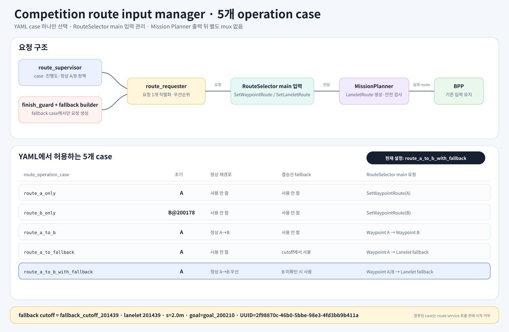
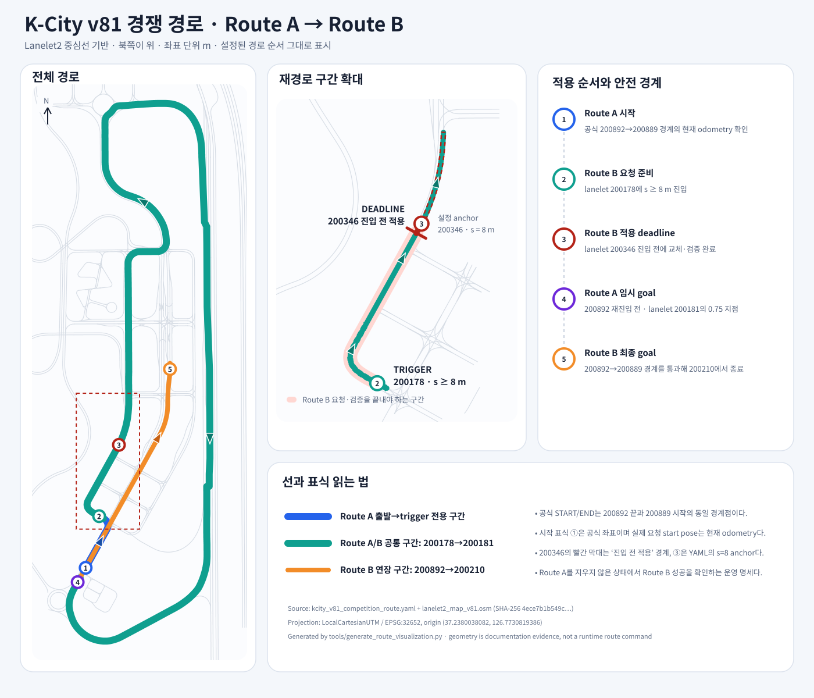
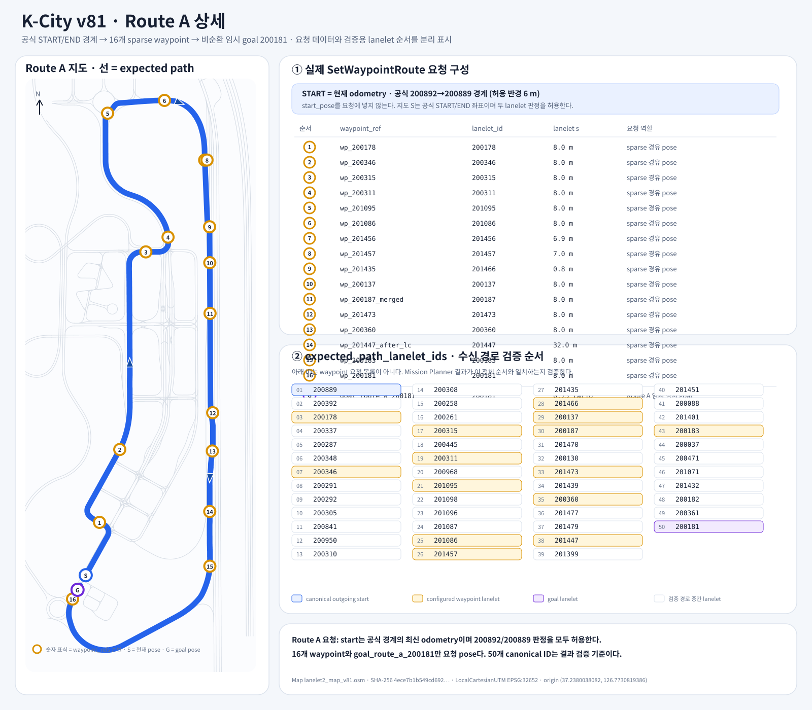
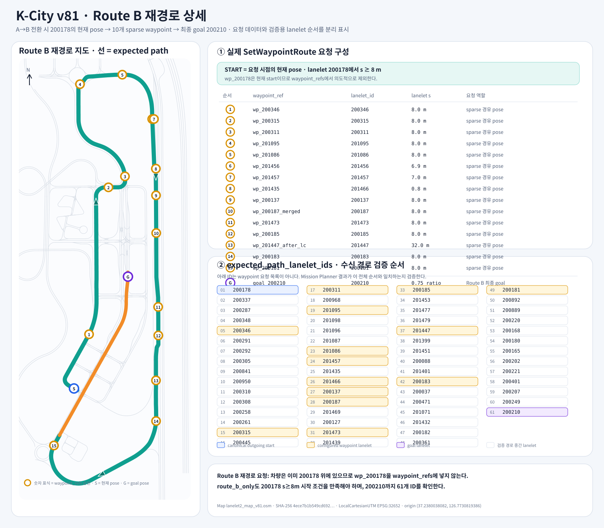
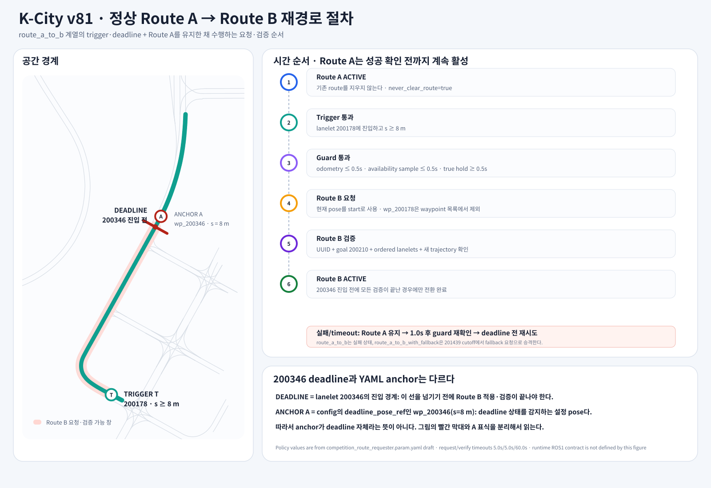

# Competition Route Requester 명세

## 1. 상태

- 문서 상태: 정책 원본 + 아래 ROS1 구현 계약 revision 1
- 패키지 상태: gateway/supervisor/finish_guard 실행 코드 및 launch 구현
- 실제 주행 승인: 미완료. 이동 중 A→B/fallback 및 base 입력 계약 검증 필요

### ROS1 구현 계약 revision 1

이 단락은 아래의 구현 전 임시 인터페이스 표현보다 우선한다.

- gateway: `/planning/set_waypoint_route` (`autoware_internal_planning_msgs/SetWaypointRoute`), `/planning/mission_planning/mission_planner/set_preferred_primitive` (`autoware_planning_msgs/SetPreferredPrimitive`), `/planning/set_lanelet_route` (`autoware_planning_msgs/SetLaneletRoute`).
- 출력 관찰: `/planning/mission_planning/route` (`autoware_planning_msgs/LaneletRoute`), `/planning/route_state` (`autoware_planning_msgs/RouteState`).
- YAML은 ROS1 flat 구조이며 5개 case 중 하나만 startup에 고정한다.
- 초기 A는 canonical 51개 또는 incoming 200892를 포함한 52개만 허용한다.
- 이동 중 B 재시도는 200346 이전 현재 시작 lanelet에 해당하는 canonical B의 정확한 suffix를 허용한다. 이미 지난 lanelet을 첫 segment로 강제하지 않으며 중간 생략/순서 변경은 허용하지 않는다.
- 서비스 거부와 결과 불명확을 구별한다. transport timeout, 응답 성공 후 route/trajectory 검증 실패는 `RECONCILIATION_REQUIRED`. 이때 Route A 유지로 단정하거나 자동 clear/retry하지 않는다.
- 성공 증거는 route UUID/goal/순서, 응답 및 route 확인 이후 timestamp의 3개 새 trajectory와 validator 20개 flag다. Route UUID가 없는 trajectory의 완전한 인과성 또는 주행 안전 인증은 아니다.
- 자동 운용 기본값은 A-only. 전체 planning과 실제 입력으로 승인되기 전에는 controller를 연결하지 않는다.

이 명세는 requester의 동작과 안전 조건을 먼저 고정한다. ROS1 서비스명, 메시지 타입, 토픽명 및 launch 구성은 upstream 포팅 결과를 확인한 뒤 확정한다.

## 2. 목적과 범위

`competition_route_requester`는 K-City v81 대회 주행을 위해 Route A/B 요청, 정상 전환 정책, 독립 감시 및 결승선 fallback을 단계적으로 검증하는 AjouNice 전용 addon이다.

패키지 이름은 requester이지만 실행 책임은 하나의 거대한 requester node에 모으지 않는다. `route_requester`는 현재 차량 위치와 sparse waypoint, goal을 `SetWaypointRoute` 요청으로 전달하는 저수준 실행기이고, `route_supervisor`가 Route A/B 상태와 정상 전환 정책을 소유한다. fallback component는 별도로 격리한다.

정상 동작과 fallback 모두 addon이 `LaneletRoute`를 직접 발행하지 않는다. addon은 RouteSelector의 main 입력에 넣을 `SetWaypointRoute` 또는 `SetLaneletRoute` 요청을 관리하고, 실제 `LaneletRoute` 생성과 발행은 항상 Mission Planner에 맡긴다. 정확한 ROS1 message/service 이름은 포팅본 계약을 확인한 뒤 고정한다.

다음 기능은 범위 밖이다.

- Mission Planner 알고리즘 변경
- RouteSelector 재구현
- Behavior Path Planner 변경
- Lanelet map 적재 및 projector/TF 구성
- upstream ROS2 알고리즘의 임의 수정

## 3. upstream 기준과 의존성

포팅 기준은 Autoware Universe 0.51.0의 고정 소스 경계다.

- Autoware Universe commit: `d4d260983d357e1b2b34291d91933f9f4b53bf94`
- 대상 package: `autoware_mission_planner_universe`
- 대상 component: `RouteSelector`, `MissionPlanner`, `DefaultPlanner`

ROS2 upstream에서 `RouteSelector`는 별도 패키지가 아니라 `autoware_mission_planner_universe` 내부 component다. 정상 경로와 MRM 경로 각각에 Mission Planner와 같은 요청 인터페이스를 제공하고, 현재 MRM 상태에 따라 요청과 결과를 분배한다.

참고용 ROS2 정상 경로 서비스는 다음과 같다.

```text
/planning/mission_planning/route_selector/main/set_waypoint_route
```

이 이름과 ROS2 서비스 타입은 ROS1 런타임 계약이 아니다. 포팅본에서 namespace, remap 및 메시지 변환 결과를 확인한 뒤 확정한다.

## 4. 논리 데이터 흐름

```text
route_supervisor --정상 A/B 요청-------------------┐
                                                  v
finish_guard -> fallback_request_builder -> route_requester
                                                  |
                         한 번에 하나의 요청 직렬화/우선순위 선택
                                                  |
                                                  v
            RouteSelector main SetWaypointRoute/SetLaneletRoute 입력
                                                  |
                                                  v
                                           MissionPlanner
                                                  |
                                          실제 LaneletRoute
                                                  |
                                                  v
                                      Behavior Path Planner
```

각 component의 책임은 다음과 같다.

- `route_requester`: supervisor/guard가 만든 요청 중 한 번에 하나만 선택해 RouteSelector main 서비스로 전달하고 응답을 돌려주는 단일 gateway
- `route_supervisor`: 초기 Route A 요청, 현재 진행도와 Route A/B 적용 상태 판단, 정상 Route B 전환 및 재시도 정책
- `finish_guard`: supervisor와 독립적으로 결승선 통과 가능성을 감시하고 fallback 요청 생성을 지시
- `fallback_request_builder`: 현재 위치 이후의 사전 검증 lanelet segment와 결승선 이후 goal을 가진 `SetLaneletRoute` 요청 준비

따라서 `route_requester`는 route supervisor가 아니다. supervisor와 guard가 정책을 결정하고 requester는 요청을 실행한다. 여기서 선택하는 것은 Mission Planner 출력 route가 아니라 Mission Planner로 들어갈 route request다. requester는 RouteSelector의 main 입력만 사용하며 MRM 입력을 호출하지 않는다.

RouteSelector는 main/MRM 요청을 하나의 Mission Planner로 전달하고 Mission Planner의 route/state를 현재 선택된 인터페이스로 돌려주는 upstream component다. competition addon은 이 구조 뒤에 별도 route mux를 추가하지 않는다. Behavior Path Planner와 controller 사이에도 addon을 삽입하지 않는다.

### 4.1 YAML-only operation case 원칙

주행 동작의 단일 기준은 `config/competition_route_requester.param.yaml`의 `route_operation_case`다. launch 파일은 동작 선택 인자를 받지 않는다. launch는 이 YAML을 그대로 로드하고 고정된 전체 node graph를 실행하며, 각 node는 선택된 case에서 자신에게 할당된 역할만 수행한다.

case 변경 절차는 `YAML 수정 -> 전체 launch 재시작`으로 고정한다. 주행 중 rosparam 변경이나 별도 launch argument로 case를 바꾸지 않는다.

운영 기본 case는 `route_a_to_b_with_fallback`이고 `auto_request_initial_route=true`다. planner session이 시작되면 map, route state, operation mode와 최신 odometry를 기다린 뒤 현재 lanelet/arc로 초기 요청을 선택한다. 공식 S부터 `200178` s 8 m 전까지는 Route A, `200178` s 8 m부터 `200346` 진입 전까지는 Route B를 요청한다. 허용 구간 밖에서는 route를 요청하지 않는다. 이전 session의 route가 RouteSelector에 남아 있어도 이를 채택하지 않고 새 `SetWaypointRoute` 요청으로 교체하며 `ClearRoute`는 호출하지 않는다. 새 route stamp와 새 trajectory/validator를 확인해야 startup generation이 검증된다.

RViz `Route Status` 패널은 gateway 상태의 `verified_active`를 읽는 전용 표시기다. Route A 또는 Route B가 검증되면 해당 표시등만 켜지고, fallback이 활성화됐거나 새 route를 아직 검증 중이면 두 표시등 모두 꺼진다. RViz에서는 route 요청을 보내지 않는다.

독립적인 `enable_*` boolean은 두지 않는다. 기능 간 의존성이 있는데 boolean을 독립적으로 두면 32개 조합이 생기고 의미 없거나 안전하지 않은 조합을 모두 검증해야 하기 때문이다. 허용되는 동작은 아래 5개 case로 제한한다.

| `route_operation_case` | 초기 route | 정상 A→B | 결승선 fallback | 시험 목적 |
|---|---|---:|---:|---|
| `route_a_only` | S–1 구간 A | off | off | Route A 단독 요청·주행 검증 |
| `route_b_only` | 1–deadline 구간 B | off | off | `200178` s≥8m 이후 Route B 단독 검증 |
| `route_a_to_b` | 위치 기반 A/B | on | off | 정상 A→B 재경로만 검증 |
| `route_a_to_fallback` | S–1 구간 A | off | on | 정상 Route B 요청 없이 fallback만 검증 |
| `route_a_to_b_with_fallback` | 위치 기반 A/B | on | on | 정상 A→B를 시도하고 실패 시 fallback 인계 검증 |

`route_a_to_fallback`에서는 hard cutoff 전까지 Route A를 유지하고, cutoff에서 명시적 lanelet segment를 담은 fallback `SetLaneletRoute`를 RouteSelector main 입력으로 보낸다. `route_a_to_b_with_fallback`에서는 먼저 정상 Route B `SetWaypointRoute`를 시도하며, 결승선 통과 가능한 Route B가 확인되지 않은 경우에만 같은 fallback 요청으로 승격한다.

목록에 없는 case는 시작 전에 거부한다. 각 case에서 필요하지 않은 finish guard 또는 fallback builder 로직은 서비스 호출이나 요청 생성을 하지 않는다.

#### case 입력 검증 계약

1. YAML을 읽은 직후 ROS subscriber, timer 및 route service 요청을 활성화하기 전에 `route_operation_case`를 검증한다.
2. 값은 대소문자를 구분한 exact string match로 비교한다.
3. 허용값은 표에 기록된 5개뿐이며 별칭, 빈 문자열 및 자동 기본값 대체를 허용하지 않는다.
4. 허용되지 않은 값이면 fatal 오류에 입력값과 허용값 목록을 남기고 route 서비스를 한 번도 호출하지 않은 채 시작을 중단한다.
5. 실행 중 parameter 변경을 감지해 case를 전환하지 않는다. 변경하려면 YAML을 수정하고 전체 launch를 다시 시작한다.

## 5. 경로 정의

경로 데이터의 단일 기준은 `config/kcity_v81_competition_route.yaml`이다.

- map version: 73
- map SHA-256: `0efa7cb3dfd249d5eb78c2e2552590037eb3b8725c58ebd433656e2d53a34610`
- 공식 START/END: `200892` 끝과 `200889` 시작의 경계
- Route A UUID: `b41167dc-7d5c-5348-911c-f8bb09c3f10b`
- Route A 임시 goal: `200181` 길이의 0.75 지점
- Route B UUID: `3f4a58cf-2782-5548-a6f2-11648fa92944`
- Route B 최종 goal: `200210`
- Route B 준비 지점: `200178`, lanelet s 8 m 이상
- Route B 적용 deadline: `200346` 도달 전
- fallback UUID: `515dba0f-59b6-5ca9-9ce5-e09a3fef6900`
- fallback hard cutoff: 합류 lanelet `201439`, lanelet s 2.0 m
- fallback 요청: `SetLaneletRoute`, `201441`부터 goal `200210`까지의 27개 비순환 suffix

start pose는 요청에 넣지 않는다. Mission Planner가 `/localization/kinematic_state`에 대응하는 ROS1 포팅 입력에서 현재 차량 위치를 취득한다.

공식 START/END의 MORAI 좌표 `(-131.689797551, -428.331022938, 28.543960282)`를 고정 TF로 변환하면 map 좌표 `(-0.130667331, 117.580315248, 28.543960282)`가 된다. 이 점은 v81에서 `200892` 중심선 끝과 `200889` 중심선 시작에 1 cm 이내로 동시에 일치한다. 따라서 requester의 start 검증은 `200892`와 `200889`를 모두 허용하되, 대회 진행 방향의 canonical 첫 lanelet은 `200889`로 둔다.

MORAI sample scene JSON의 Ego pose는 공식 좌표와 동일하지 않다. sample pose는 공식점보다 수평으로 약 0.422 m 진행한 `200889` 내부에 있고, 높이는 약 0.339 m 높으며 yaw는 약 1.217도 크다.

Route B 요청 시 차량은 이미 `200178`의 s 8 m 이상에 있어야 하므로 waypoint 목록에서는 `200178`을 제외한다. 이 조건은 A→B 재경로뿐 아니라 `route_b_only`에도 적용한다. 공식 START/END에서 Route B 전체를 한 번에 요청하면 `200889`를 재방문하는 loop가 생기므로 `route_b_only`를 공식 출발점에서 사용하지 않는다.

#### Operation case와 RouteSelector 입력 구조



이 그림은 다섯 operation case와 addon의 위치를 나타낸다. addon은 Mission Planner 출력 뒤에 route mux를 추가하지 않으며, 정상 A/B는 `SetWaypointRoute`, fallback은 `SetLaneletRoute`로 RouteSelector main 입력에 전달한다.

### 5.1 경로 및 재경로 구간 도식



도식의 선은 `config/kcity_v81_competition_route.yaml`에 기록된 lanelet 순서를 v81 OSM 중심선에 그대로 대응한 결과다.

- 파란색: 공식 START/END 경계에서 trigger 전까지의 Route A 전용 구간
- 청록색: `200178`부터 Route A 임시 goal이 있는 `200181`까지 Route A/B 공통 구간
- 주황색: Route B가 `200892`로 재진입한 뒤 최종 goal `200210`까지 진행하는 연장 구간
- 확대도의 분홍색 띠: `200178`의 s 8 m trigger 이후 Route B 요청과 검증을 끝내야 하는 구간
- 빨간색 deadline 막대: Route B가 적용되어야 하는 `200346` 진입 전 경계
- 빨간색 ③ 표식: YAML의 `deadline_pose_ref`인 `wp_200346`, 즉 `200346`의 s 8 m 감지 anchor

공식 START/END는 `200892`와 `200889`의 공용 경계다. 시작 표식은 이 공식 좌표를 표시하며 실제 route 요청의 start pose는 현재 odometry다. Route A는 `200892`로 재진입하기 전 `200181`에서 끝나므로 start가 어느 쪽 lanelet으로 판정되어도 loop를 만들지 않는다.

#### Route A 요청과 검증 경로

고주로에서는 waypoint planner가 병렬 lanelet을 포함한 segment를 만든 뒤 `SetPreferredPrimitive`로 최종 선호 lanelet을 지정한다. v81의 최종 선호 순서는 `201457 → 201435 → 201466 → 200137 → 201444 → 201469 → 200127 → 201473 → 201439 → 200185 → 201453 → 201476 → 201448 → 201447 → 201399`이다.

Mission Planner가 발행하는 route segment의 `primitives`는 `/planning/mission_planning/route_marker`에 표시되는 주행 가능 후보이며 BPP가 사용하는 실제 route 정보다. K-City v81에서는 평행 구간 `200127/200130/200134`와 `201473/201474/201475`를 LC 후보로 구성한다. 병목에서는 `[200185,200360]`, `[201476,201477]`을 후보로 유지한다. 중앙 분할 전 segment `[201448,201479]`은 `201448`, 분할 후 segment `[201478,201447]`은 `201447`을 선호해 중앙 부근의 오른쪽 LC를 표현한다.



- 지도 숫자 `1`–`11`: `route_a.waypoint_refs`의 실제 요청 순서
- `S`: 공식 `200892`→`200889` 경계의 현재 odometry이며 별도 start pose를 요청에 넣지 않음
- `G`: `goal_route_a_200181`, lanelet `200181` 길이의 0.75 지점
- 오른쪽 위 표: 요청 payload를 구성하는 16개 waypoint와 goal
- 오른쪽 아래 표: 선호 차선 적용 뒤 수신 경로 순서를 검증하는 51개 canonical `expected_path_lanelet_ids`

검증용 51개 lanelet ID는 sparse waypoint 요청 목록이 아니다. Mission Planner가 계산한 병렬 route segment에 `SetPreferredPrimitive`를 적용한 뒤 전체 선호 lanelet 순서가 예상 경로와 같은지 판정하기 위한 기준이다. 공식 start가 정확한 lanelet 경계이므로 planner가 incoming `200892`를 첫 lanelet으로 포함하면 `[200892] + canonical 51개 경로`도 허용한다.

#### Route B 재경로 요청과 검증 경로



- `S`: 요청 시점의 현재 pose, lanelet `200178`의 s 8 m 이상
- 지도 숫자 `1`–`10`: `route_b.waypoint_refs`의 실제 요청 순서
- `wp_200178`: 차량의 현재 start이므로 waypoint 요청에서 의도적으로 제외
- `G`: `goal_200210`, lanelet `200210` 길이의 0.75 지점
- 오른쪽 아래 표: 현재 start `200178`부터 goal `200210`까지 수신 경로를 검증하는 61개 lanelet 순서
- `route_b_only`도 동일한 시작 조건과 요청·검증 데이터를 사용한다.

#### 재경로 trigger와 적용 절차



1. Route A를 활성 상태로 유지하고 기존 route를 지우지 않는다.
2. lanelet `200178`에서 s 8 m 이상 진입했는지 확인한다.
3. odometry와 reroute availability가 각각 0.5초 이내 최신 값이고, availability가 0.5초 연속 true인지 확인한다.
4. 현재 pose를 start로 사용해 Route B를 요청한다.
5. waypoint 결과의 UUID, goal, 병렬 segment 구성을 확인한 뒤 `SetPreferredPrimitive`로 고주로 선호 차선을 적용한다.
6. Route B UUID, goal `200210`, 최종 선호 lanelet 순서 및 새 trajectory를 검증한다.
7. lanelet `200346` 진입 전 검증이 끝난 경우에만 Route B 적용 완료로 판단한다.

실패나 timeout에서는 Route A를 유지하고 1초 뒤 guard부터 재확인한다. `deadline_pose_ref`인 `wp_200346`은 lanelet `200346`의 s 8 m 감지 anchor다. 실제 적용 deadline은 `200346` 진입 전이므로 도식에서 진입 막대와 s 8 m anchor를 분리했다.

## 6. 상태 기계

```text
VALIDATE_OPERATION_CASE
  -> WAIT_FOR_STACK
  -> WAIT_FOR_FRESH_ODOMETRY
  -> case 분기

route_a_only:
  REQUEST_ROUTE_A -> VERIFY_ROUTE_A -> ROUTE_A_ACTIVE

route_b_only:
  REQUEST_ROUTE_B_FROM_CURRENT_ODOM -> VERIFY_ROUTE_B -> ROUTE_B_ACTIVE

route_a_to_b:
  REQUEST_ROUTE_A -> ROUTE_A_ACTIVE
  -> ARM_ROUTE_B_AT_200178 -> REQUEST_ROUTE_B -> VERIFY_ROUTE_B
  -> ROUTE_B_ACTIVE 또는 REROUTE_FAILED

route_a_to_fallback:
  REQUEST_ROUTE_A -> ROUTE_A_ACTIVE
  -> WAIT_FOR_FALLBACK_CUTOFF -> REQUEST_FALLBACK_LANELET_ROUTE
  -> VERIFY_FINISH_CAPABLE_ROUTE -> FINISH_ROUTE_ACTIVE

route_a_to_b_with_fallback:
  REQUEST_ROUTE_A -> ROUTE_A_ACTIVE
  -> ARM_ROUTE_B_AT_200178 -> REQUEST_ROUTE_B -> VERIFY_ROUTE_B
  -> 성공: ROUTE_B_ACTIVE
  -> cutoff까지 미확인: REQUEST_FALLBACK_LANELET_ROUTE
  -> VERIFY_FINISH_CAPABLE_ROUTE -> FINISH_ROUTE_ACTIVE
```

위 상태 기계는 `route_supervisor`가 소유한다. `route_requester`는 `IDLE -> REQUEST_IN_FLIGHT -> RESPONSE`의 단순 실행 상태만 가지며 주행 구간이나 fallback 정책을 판단하지 않는다.

### 6.1 Route A

1. map, localization, RouteSelector 및 Mission Planner 준비를 확인한다.
2. 최신 odometry가 공식 S부터 `200178` s 8 m 전까지의 시작 구간인지 확인한다.
3. 현재 pose를 start로 사용해 Route A를 요청한다.
4. 서비스 응답만으로 성공 처리하지 않는다.
5. 요청 UUID를 가진 route publication과 새 trajectory 생성을 확인한 뒤 `ROUTE_A_ACTIVE`로 전환한다.
6. planner startup에서는 기존 route를 채택하지 않고 새 요청으로 교체하며, 실패하면 설정된 간격으로 재시도한다.
7. 이미 이 gateway가 Route A를 검증한 상태의 수동 재요청은 공식 start pose 6 m 이내, 최신 odometry, 속도 0.1 m/s 이하에서만 허용한다.
8. 재요청은 기존 route를 clear하지 않으며 요청 시각 이후의 route stamp와 새 trajectory/validator 연속 3개를 확인해 generation을 갱신한다.

### 6.2 Route B

1. planner startup이 `200178` s 8 m 이후부터 `200346` 진입 전이면 Route B를 초기 route로 요청한다. Route A 주행 중에도 같은 구간에서 Route B를 준비한다.
2. 최신 reroute availability가 연속 hold time 동안 true인지 확인한다.
3. 현재 pose를 start로 사용해 Route B를 요청한다.
4. waypoint 결과의 UUID, goal, 병렬 segment 구성을 확인한 뒤 `SetPreferredPrimitive`로 고주로 선호 차선을 적용한다.
5. Route B UUID, goal, 최종 선호 lanelet 순서 및 새 trajectory를 검증한다.
6. 검증이 끝난 경우에만 Route B가 활성화됐다고 판단한다.
7. 실패하면 Route A를 유지한 채 조건을 다시 확인하고 deadline 전까지 재시도한다.

### 6.3 결승선 fallback

1. fallback을 포함한 두 case에서만 finish guard를 활성화한다.
2. 현재 선택 route가 결승선 이후 goal `200210`까지 이어지는지 UUID, goal 및 lanelet suffix로 판정한다.
3. `route_a_to_fallback`에서는 정상 Route B waypoint 요청을 하지 않고 합류 lanelet `201439`의 s 2.0 m hard cutoff에서 fallback을 시작한다.
4. `route_a_to_b_with_fallback`에서는 Route B 적용을 먼저 시도하고, `200130` cutoff까지 결승선 통과 가능한 Route B가 확인되지 않은 경우에만 fallback으로 승격한다.
5. fallback builder는 `fallback_route.expected_path_lanelet_ids`의 27개 segment와 goal `200210`을 가진 `SetLaneletRoute` 요청을 만든다. `201441` s 9.142493 m는 v72의 `200130` s 50.376946 m와 같은 물리 좌표로, Mission의 최소 안전거리 30 m를 유지한다.
6. requester는 진행 중인 정상 요청과 fallback 요청을 동시에 보내지 않으며 fallback 요청에 우선권을 준다.
7. fallback 요청도 RouteSelector main 입력과 Mission Planner의 reroute availability 및 safety 검사를 그대로 통과해야 한다.
8. Mission Planner가 발행한 새 route와 trajectory가 검증된 뒤에만 `FINISH_ROUTE_ACTIVE`로 판단한다.

requester의 trajectory age 상한은 canonical Planning Validator latency checker와 같은 1.0초다. requester는 validator 20개 flag와 연속 3개 새 출력을 추가로 요구한다. 실제 제어 송신단의 0.5초 source-age 안전정지는 별도이며 완화하지 않는다.

## 7. 안전 불변 조건

- requester는 `ClearRoute`를 호출하지 않는다.
- 같은 Route A의 수동 갱신은 현재 gateway의 VERIFIED A, 공식 start 6 m 이내 및 정차 조건에서만 허용한다.
- Route B의 요청과 검증이 성공하기 전에는 Route A를 유지한다.
- Route A는 공식 start lanelet인 `200892`로 재진입하지 않고 `200181`에서 끝나야 한다.
- 오래된 odometry 또는 오래된 reroute availability로 요청하지 않는다.
- 서로 다른 route에는 서로 다른 고정 UUID를 사용한다.
- 수신 route의 UUID와 goal만이 아니라 예상 lanelet 순서도 확인한다.
- route 교체 후 새 trajectory가 확인되어야 성공으로 처리한다.
- Route B는 `200346` 도달 전에 적용되어야 한다.
- 최종 goal `200210`은 결승선 이후에 있어야 한다.
- 대회 production에서는 `route_a_to_b_with_fallback` case를 사용한다.
- fallback이 없는 `route_a_to_b`에서 Route B가 적용되지 못하면 명시적인 `REROUTE_FAILED`로 전환한다.
- fallback이 있는 두 case에서는 cutoff까지 결승선 통과 route가 확인되지 않으면 fallback 요청으로 승격한다.

## 8. 파라미터 초안의 취급

`config/competition_route_requester.param.yaml`은 기존에 정리한 동작 정책을 보존하기 위한 초안이다.

현재 확정 가능한 값은 다음과 같다.

- YAML-only `route_operation_case`와 5개 허용 case
- Route A only, Route B only, A-to-B, A-to-fallback, A-to-B-with-fallback 선택
- 자동 Route A 요청 여부
- odometry/reroute availability 최대 age
- reroute availability hold time
- 서비스 및 검증 timeout
- 재시도 간격과 횟수
- 새 trajectory 검증 여부
- `never_clear_route`

다음 항목은 ROS1 포팅 전까지 확정하지 않는다.

- ROS1 parameter 구조
- RouteSelector service 이름과 service type
- route/state/trajectory topic 이름과 message type
- operation mode topic과 사용 조건
- reroute availability topic과 message type
- ROS2 QoS의 ROS1 queue/latch 대응

## 9. 구현 시작 게이트

다음 조건이 모두 충족된 뒤 requester 코드를 작성한다.

1. ROS1 `RouteSelector`와 `MissionPlanner`가 `base_ws/src/planning`에 들어온다.
2. main `SetWaypointRoute` 요청이 ROS1에서 빌드되고 수동 호출된다.
3. canonical route/state 출력과 Route UUID 전달 규칙이 확인된다.
4. reroute availability 및 trajectory 계약이 실제 포팅 checkout에서 확인된다.
5. Route A를 유지한 상태에서 Route B 요청이 가능한지 통합 시험으로 확인된다.
6. 확인된 인터페이스에 맞춰 파라미터 YAML을 ROS1 형식으로 다시 작성한다.

## 10. 구현 후 인수 조건

- Catkin build와 package test가 통과한다.
- 잘못된 map SHA에서 route 요청을 거부한다.
- stale odometry와 stale reroute availability에서 요청을 거부한다.
- Route A가 예상 lanelet 순서와 UUID로 설정된다.
- `200178`의 trigger 전에는 Route B를 요청하지 않는다.
- reroute availability가 false인 동안 Route B를 요청하지 않는다.
- Route B 실패 시 Route A가 계속 유지된다.
- requester 실행 중 `ClearRoute` 호출이 한 번도 발생하지 않는다.
- Route B가 `200346` 전에 적용되고 최종 goal이 `200210`으로 검증된다.
- 선택된 case에서 사용하지 않는 reroute/fallback 로직이 서비스 호출이나 요청 생성을 하지 않는다.
- 정의되지 않은 `route_operation_case`는 주행 시작 전에 거부된다.
- 각 operation case가 표에 정의된 route 요청만 수행한다.
- `route_a_to_fallback`에서 정상 rerouting 없이 fallback SetLaneletRoute 요청 인계가 검증된다.
- launch 파일에는 operation case argument가 없고 동일한 YAML만 로드한다.
- addon이 Mission Planner 출력 route나 BPP/controller 데이터 경로에 별도 publisher/mux를 삽입하지 않는다.
