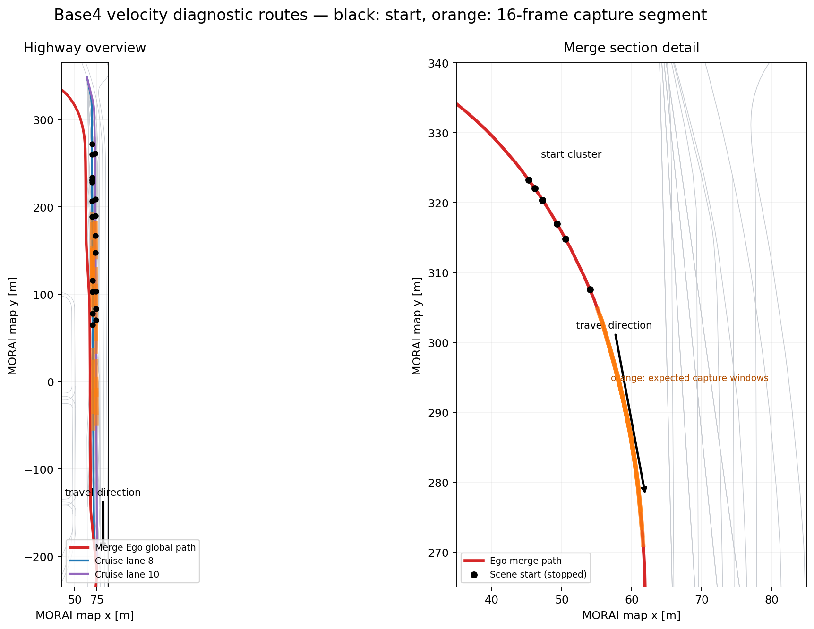

# Base4 고주로 velocity 진단 28-scene pilot

상태: `PREPARED`, 2026-09-22.

## 목적

현재 Base4 학습 clip의 차량 속도가 주로 40/50 km/h에 몰려 있어, 모델이 입력의 시간
차이를 사용하는 대신 12--13 m/s 부근 상수를 출력하는지 먼저 분리한다. 이 pilot은
production 데이터가 아니며 사용자가 각 scene의 속도를 엄격히 맞출 필요도 없다.

- 총 28 scene: 합류 7, 합류 후 순항 21.
- NPC 요청 속도: 10/20/30/40/50/60/70 km/h 자동 순환.
- scene당 LiDAR-paced 16 frame.
- 성공한 scene만 gated rosbag으로 저장.
- 요청 속도는 정답으로 간주하지 않는다. 수집 후 `/Object_topic`의 실제 운동과
  BBox-center 미분 속도로 달성 분포를 다시 audit한다.
- 내부 split은 train 23 / val 5이고 test는 없다. 이 pilot의 목적은 최종 성능 발표가
  아니라 velocity head가 서로 다른 속도 bin을 구분하는지 확인하는 것이다.

기존 `mission` profile은 바꾸지 않았다. 새 분포는 생성기의
`--profile velocity-diagnostic`을 명시할 때만 적용된다.

## 준비된 경로

```text
experiment root:
  /home/luv/morai_cap/experiments/260922_base4_velocity_diagnostic

runtime manifest:
  /home/luv/morai_cap/experiments/260922_base4_velocity_diagnostic/source/manifests/base4_temporal_highway_vd28_runtime.json

runtime metadata:
  /home/luv/morai_cap/experiments/260922_base4_velocity_diagnostic/runtime

rosbag output:
  /home/luv/AjouNice2026/rosbags/datasets/base4_temporal/260922_velocity_diagnostic_pilot

MR scenario directory:
  /home/luv/MoraiLauncher_Lin/MoraiLauncher_Lin_Data/SaveFile/Scenario/R_KR_PR_K-city_2025
```

생성·설치와 runner `--dry-run` 검증은 완료되어 있다. 재생성할 필요가 없다.

## Ego는 누가 운전하는가

이번 pilot에서는 **사용자가 Ego를 직접 운전하지 않는다.** Terminal 7의 runner가 scene을
load한 뒤 AV External Control을 선택하고 `/ctrl_cmd`를 발행해 가속·조향·종료까지
자동 수행한다. 키보드, 게임패드, MORAI 수동 throttle/steering을 섞으면 의도한 속도와
frame 간격이 깨지므로 해당 scene은 무효다.

scene 하나의 순서는 다음과 같다.

1. runner가 scenario를 load한다. Ego 초기 속도는 항상 0 km/h다.
2. rosbridge 재연결과 `/Ego_topic` heartbeat를 기다린다.
3. 시작점에서 0.75 m 이상 흘러가기 전에 AV External Control과 첫 조향 명령을
   준비한다. 이를 넘으면 잘못된 scene으로 실패시킨다.
4. 준비된 waypoint를 따라 차선을 유지하며 목표속도까지 가속한다.
5. 거리·Ego 속도·NPC 위치 조건을 모두 만족하면 16-frame clip을 LiDAR pace로
   기록한다. 따라서 사용자가 초시계로 녹화 시작 시점을 맞출 필요가 없다.
6. 마지막 frame 뒤 현재 scene을 끝내고 다음 scene을 자동 load한다.

화면에서 해야 할 일은 주행 조작이 아니라 다음 이상 유무를 관찰하는 것이다.

- 시작 직후 차선을 가로질러 직진하지 않고 첫 곡률부터 waypoint를 따라가는가.
- 합류 scene은 램프 곡선을 따라 본선으로 자연스럽게 진입하는가.
- 순항 scene은 정해진 한 차로를 유지하는가.
- 충돌하거나 차선을 벗어나면 수동으로 복구하지 말고 runner의 timeout/실패 기록을
  남긴다.
- runner가 완전히 멈췄을 때만 Terminal 7을 `Ctrl-C`하고, recorder는 마지막 snapshot이
  닫힌 뒤 종료한다.

정상이라면 전체 28개는 대략 15--30분 범위지만, MORAI의 scene reload/reconnect 시간과
실패 timeout에 따라 늘어날 수 있다.

## 경로·속도·종료 조건



그림은 현재 MGeo link와 실제 생성된 waypoint를 직접 그린 것이다. 검은 점은 정지 상태
시작점, 주황색은 16-frame capture 예상 구간이다. 빨간 경로는 공식
`configs/global_path/2026_molit_comp_global_path.txt`에서 가져온 합류 Ego 경로다.

### 합류 7개 공통 계약

- Ego는 지도 좌표 약 `(45--54, 307--323)`의 진입 램프에서 정지 상태로 시작한다.
- 공식 global path의 진행 방향대로 남동쪽 곡선을 따라가며 본선으로 합류한다.
- Ego 목표속도는 50/54/58 km/h 중 하나이며 항상 대회 합류 제한 59 km/h 미만이다.
- 시작 후 약 17--24 m에서 capture gate가 열리고, 이후 약 19--23 m 동안 16 frame을
  기록한다. 즉 정상 scene은 시작점부터 약 36--46 m 주행하면 수집이 끝난다.
- NPC는 본선 내부 lane 6/8/10 중 하나에서 주행한다. Ego가 직접 lane을 고르는 것이
  아니며 램프 waypoint만 따라간다.
- 180 m는 capture 거리가 아니라 실패 방지를 위한 최대 허용 이동거리다. 보통 그 전에
  scene이 끝난다.

### 합류 후 순항 21개 공통 계약

- 진행 방향은 지도 y가 감소하는 남쪽 방향이다.
- 내부 lane ID 6은 오른쪽, 8은 가운데, 10은 왼쪽의 일반 주행 차로다. 더 왼쪽의
  버스전용차로는 Ego와 NPC 모두 사용하지 않는다.
- 이번 `front_overtake` 진단에서는 Ego가 lane 8 또는 10을 **그대로 유지**한다. 실제
  차선 변경 추월은 하지 않고, 오른쪽 인접 차로의 느린 NPC를 종방향으로 지나친다.
- Ego는 70/85/100 km/h까지 자동 가속한다. 시작 후 80 m가 지나고 목표속도의 85% 이상,
  0.5초 동안 가속도 1.5 m/s² 이하인 안정 상태가 되어야 capture가 시작된다.
- 이후 목표속도에 따라 약 27/33/39 m 동안 16 frame을 기록한다. 따라서 정상 scene은
  시작점부터 약 107/113/119 m 진행하면 끝난다.
- 260 m는 capture 실패 시에도 무한 주행하지 않기 위한 상한이다.

시간보다 거리 gate를 기준으로 하므로 PC/MORAI가 느려져도 사용자가 출발 타이밍을
조정하지 않는다. 목표속도 도달이 늦으면 capture도 자동으로 늦어진다.

## 28개 scene별 자동 주행표

`Ego target/min`은 목표속도와 capture가 허용되는 최소 속도다. `start→end`는 시작부터
마지막 frame까지의 예상 이동거리이며 실제 NPC gate에 따라 조금 늦어질 수 있다.

| Scene | Split | 시작 XY / yaw | Ego 경로·차로 | Ego target/min (km/h) | NPC lane / target (km/h) | capture arm | start→end |
|---|---|---|---|---:|---:|---:|---:|
| `b4vd28ddmc001` | train | `(46.1,322.0) / -55.5°` | 합류 global path | `58 / 51.0` | `6 / 10` | 20.0 m | 42.6 m |
| `b4vd28ddmc002` | train | `(50.6,314.8) / -61.5°` | 합류 global path | `58 / 51.0` | `8 / 20` | 20.7 m | 43.3 m |
| `b4vd28ddmc003` | train | `(47.3,320.4) / -57.5°` | 합류 global path | `54 / 47.5` | `10 / 30` | 17.1 m | 38.1 m |
| `b4vd28ddmc004` | train | `(47.3,320.4) / -57.5°` | 합류 global path | `54 / 47.5` | `6 / 40` | 22.6 m | 43.6 m |
| `b4vd28ddmc005` | train | `(49.3,317.0) / -60.1°` | 합류 global path | `50 / 44.0` | `8 / 50` | 23.6 m | 43.0 m |
| `b4vd28ddmc006` | train | `(54.0,307.6) / -66.8°` | 합류 global path | `54 / 47.5` | `10 / 60` | 16.7 m | 37.7 m |
| `b4vd28ddmc007` | val | `(45.3,323.3) / -53.7°` | 합류 global path | `54 / 47.5` | `6 / 70` | 22.2 m | 43.2 m |
| `b4vd28ddhc001` | train | `(69.7,228.1) / -89.5°` | lane 8 유지 | `70 / 59.5` | `6 / 10` | 80 m | 107.2 m |
| `b4vd28ddhc002` | train | `(73.1,261.1) / -89.4°` | lane 10 유지 | `85 / 72.2` | `8 / 20` | 80 m | 113.1 m |
| `b4vd28ddhc003` | train | `(70.5,78.2) / -89.7°` | lane 8 유지 | `85 / 72.2` | `6 / 30` | 80 m | 113.1 m |
| `b4vd28ddhc004` | train | `(70.6,65.2) / -89.7°` | lane 8 유지 | `100 / 85.0` | `6 / 40` | 80 m | 118.9 m |
| `b4vd28ddhc005` | train | `(74.0,70.7) / -89.7°` | lane 10 유지 | `100 / 85.0` | `6 / 50` | 80 m | 118.9 m |
| `b4vd28ddhc006` | train | `(69.6,260.2) / -89.7°` | lane 8 유지 | `100 / 85.0` | `6 / 60` | 80 m | 118.9 m |
| `b4vd28ddhc007` | train | `(70.3,116.1) / -89.7°` | lane 8 유지 | `85 / 72.2` | `6 / 70` | 80 m | 113.1 m |
| `b4vd28ddhc008` | train | `(74.0,83.2) / -89.7°` | lane 10 유지 | `100 / 85.0` | `8 / 10` | 80 m | 118.9 m |
| `b4vd28ddhc009` | train | `(69.5,272.2) / -89.8°` | lane 8 유지 | `70 / 59.5` | `6 / 20` | 80 m | 107.2 m |
| `b4vd28ddhc010` | train | `(70.3,103.1) / -89.7°` | lane 8 유지 | `85 / 72.2` | `6 / 30` | 80 m | 113.1 m |
| `b4vd28ddhc011` | train | `(73.6,147.6) / -89.8°` | lane 10 유지 | `85 / 72.2` | `6 / 40` | 80 m | 113.1 m |
| `b4vd28ddhc012` | train | `(73.1,261.1) / -89.4°` | lane 10 유지 | `100 / 85.0` | `8 / 50` | 80 m | 118.9 m |
| `b4vd28ddhc013` | train | `(69.7,231.1) / -89.7°` | lane 8 유지 | `100 / 85.0` | `6 / 60` | 80 m | 118.9 m |
| `b4vd28ddhc014` | train | `(73.3,209.1) / -89.7°` | lane 10 유지 | `100 / 85.0` | `8 / 70` | 80 m | 118.9 m |
| `b4vd28ddhc015` | train | `(69.9,189.1) / -89.7°` | lane 8 유지 | `85 / 72.2` | `6 / 10` | 80 m | 113.1 m |
| `b4vd28ddhc016` | train | `(73.5,167.1) / -89.9°` | lane 10 유지 | `100 / 85.0` | `8 / 20` | 80 m | 118.9 m |
| `b4vd28ddhc017` | train | `(73.4,190.1) / -89.7°` | lane 10 유지 | `70 / 59.5` | `6 / 30` | 80 m | 107.2 m |
| `b4vd28ddhc018` | val | `(69.7,230.6) / -89.5°` | lane 8 유지 | `85 / 72.2` | `6 / 40` | 80 m | 113.1 m |
| `b4vd28ddhc019` | val | `(69.7,233.6) / -89.9°` | lane 8 유지 | `85 / 72.2` | `6 / 50` | 80 m | 113.1 m |
| `b4vd28ddhc020` | val | `(69.9,206.6) / -89.8°` | lane 8 유지 | `100 / 85.0` | `6 / 60` | 80 m | 118.9 m |
| `b4vd28ddhc021` | val | `(73.8,103.6) / -89.6°` | lane 10 유지 | `100 / 85.0` | `6 / 70` | 80 m | 118.9 m |

이 표의 NPC 속도는 scenario 요청값이다. 실제 학습 GT에는 요청값을 복사하지 않고,
수집된 `/Object_topic`과 연속 BBox center에서 계산한 달성 속도를 사용한다.

## 실행 순서

모든 터미널은 각각 따로 유지한다. alias나 단일 통합 shell script를 사용하지 않는다.

### Terminal 1 — roscore

```bash
source /opt/ros/noetic/setup.bash
source ~/AjouNice2026/base_ws/install_aw149/setup.bash
export ROS_MASTER_URI=http://localhost:11311
roscore -p 11311
```

### Terminal 2 — rosbridge

```bash
source /opt/ros/noetic/setup.bash
source ~/AjouNice2026/base_ws/install_aw149/setup.bash
export ROS_MASTER_URI=http://localhost:11311
roslaunch rosbridge_server rosbridge_websocket.launch
```

### Terminal 3 — sensor-only UDP

```bash
cd ~/AjouNice2026
source /opt/ros/noetic/setup.bash
source base_ws/install_aw149/setup.bash
export AJOUNICE_ROOT="$PWD"
export ROS_MASTER_URI=http://localhost:11311
rosparam set /use_sim_time false

roslaunch sensor_interface morai_udp_interface.launch \
  sensor_config:="$PWD/configs/sensors/Sensor_competition_local.json" \
  enable_ego_network:=false \
  enable_control:=false
```

`udp` alias는 사용하지 않는다. rosbridge와 UDP에서 `/Ego_topic` 또는 `/Object_topic`을
중복 발행하면 이 실험은 무효다.

### Terminal 4 — MR

```bash
cd ~/MoraiLauncher_Lin
bash ./MORAISim.sh
```

MR GUI에서 다음만 연결한다.

1. Sensor Network: `Sensor_competition_local.json`.
2. Ego Network: `25.S4.MolitComp03/ss_ego_minimal_hybrid.json`.
3. Simulator Network는 별도로 연결하지 않는다.
4. 생성된 scenario를 GUI에서 수동 load하지 않는다. Terminal 7 runner가 load한다.

### Terminal 5 — 사전 검사

```bash
cd ~/AjouNice2026
source /opt/ros/noetic/setup.bash
source base_ws/install_aw149/setup.bash
export ROS_MASTER_URI=http://localhost:11311

python3 dataset/morai_od/scripts/check_base3_online_runtime.py \
  --gt-transport ros

rostopic info /sensor/lidar1
rostopic info /Ego_topic
rostopic info /Object_topic
rostopic info /ScenarioLoad
rostopic info /ctrl_cmd
```

정상 계약은 LiDAR publisher가 UDP receiver 하나이고, Ego/Object publisher가 rosbridge
하나인 상태다. `check_base3_online_runtime.py`가 실패하면 녹화를 시작하지 않는다.

### Terminal 6 — gated rosbag recorder

Runner보다 먼저 실행하고 계속 켜 둔다.

```bash
cd ~/AjouNice2026
source /opt/ros/noetic/setup.bash
source base_ws/install_aw149/setup.bash
export AJOUNICE_ROOT="$PWD"
export ROS_MASTER_URI=http://localhost:11311

RUN_TAG="$(date +%y%m%d_%H%M%S)_veldiag28" \
dataset/morai_od/scripts/record_base4_temporal_gated_bag.sh \
  "$PWD/rosbags/datasets/base4_temporal/260922_velocity_diagnostic_pilot"
```

`Base4 gated recorder ready.`가 출력된 다음 Terminal 7을 시작한다.

### Terminal 7 — 28-scene runner

```bash
cd ~/AjouNice2026
source /opt/ros/noetic/setup.bash
source base_ws/install_aw149/setup.bash
export AJOUNICE_ROOT="$PWD"
export ROS_MASTER_URI=http://localhost:11311

EXP=/home/luv/morai_cap/experiments/260922_base4_velocity_diagnostic
mkdir -p "$EXP/logs"

python3 -u dataset/morai_od/scripts/ros_scenario_autocapture_poc.py \
  --manifest "$EXP/source/manifests/base4_temporal_highway_vd28_runtime.json" \
  --capture-dir "$EXP/runtime" \
  --no-timestamp-prefix \
  --morai-scenario-dir /home/luv/MoraiLauncher_Lin/MoraiLauncher_Lin_Data/SaveFile/Scenario/R_KR_PR_K-city_2025 \
  --motion-mode rolling-grouped \
  --online-bag-only \
  --scenario-load-attempts 3 \
  --capture-timeout-sec 30 \
  --continue-on-scene-error \
  |& tee "$EXP/logs/runner_$(date +%y%m%d_%H%M%S).log"
```

일부 scene 실패는 허용한다. 이 첫 pilot에서는 실패 scene을 즉시 손으로 복구하기보다
성공 scene의 속도 범위가 충분한지 먼저 본다.

### Terminal 8 — 선택 사항: 진행 상황

Runner가 첫 summary를 만든 뒤 실행한다.

```bash
cd ~/AjouNice2026
source /opt/ros/noetic/setup.bash
source base_ws/install_aw149/setup.bash

EXP=/home/luv/morai_cap/experiments/260922_base4_velocity_diagnostic

python3 dataset/morai_od/scripts/monitor_ros_capture_progress_v2.py \
  --run-dir "$EXP/runtime" \
  --manifest "$EXP/source/manifests/base4_temporal_highway_vd28_runtime.json" \
  --milestone-scenes 7
```

## 종료

1. Terminal 7에서 `auto-capture complete`를 확인한다.
2. Terminal 6 recorder를 `Ctrl-C`로 종료한다.
3. 그 뒤에만 MR과 나머지 터미널을 종료한다.
4. 다음 두 명령의 결과를 확인한다.

```bash
find ~/AjouNice2026/rosbags/datasets/base4_temporal/260922_velocity_diagnostic_pilot \
  -maxdepth 1 -type f -name '*.bag' -printf '%f %s bytes\n' | sort

du -sh \
  ~/AjouNice2026/rosbags/datasets/base4_temporal/260922_velocity_diagnostic_pilot \
  /home/luv/morai_cap/experiments/260922_base4_velocity_diagnostic/runtime
```

수집 직후 판단할 항목은 성공 scene 수, scene-marker와 bag의 1:1 대응, 실제 NPC 속도
bin, 연속 16-frame 간격, collision/stall 여부다. 이를 통과하기 전에는 학습 dataset으로
변환하거나 기존 Base4와 합치지 않는다.

## 2026-09-22 실제 수집 결과

이번 pilot은 MR의 ROS Ego Network와 UDP Sensor Network를 함께 사용해 자동 수행했다.

- 요청: 28 scene, scene당 16 trigger frame
- 유효 완료: 25 scene / 400 trigger frame
- 자동 폐기: 합류 3 scene
  - `b4vd28ddmc001`: 10 km/h NPC가 capture gate 뒤로 이탈
  - `b4vd28ddmc002`: 20 km/h NPC가 11번째 frame 전에 longitudinal -40 m gate 이탈
  - `b4vd28ddmc007`: 70 km/h NPC가 capture gate 앞으로 이탈
- gated bag: 25개, 총 1,261,160,416 bytes
- bag 경로:
  `rosbags/datasets/base4_temporal/260922_velocity_diagnostic_pilot`
- runtime 결과:
  `/home/luv/morai_cap/experiments/260922_base4_velocity_diagnostic/runtime`
- bag audit:
  `/home/luv/morai_cap/experiments/260922_base4_velocity_diagnostic/audit_bags.json`

`audit_base3_online_bag.py`의 topic/marker/timestamp 검사는 오류와 경고 없이 통과했다.
유효 capture window의 센서 범위는 다음과 같았다.

- LiDAR: 약 11.4--13.0 Hz, 총 793 frame
- 카메라 4대: 약 30 Hz
- Ego/Object: 약 47--50 Hz
- camera-to-LiDAR nearest age: p50 약 1--3 ms, p95 약 26--27 ms
- 25개 bag 모두 vehicle NPC 존재 확인
- 실제 NPC 속도 bin: 10/20/70 km/h 각 3 scene, 30/40/50/60 km/h 각 4 scene

400개 metadata frame 중 vehicle이 Ego 반경 30 m 안에 있는 frame은 326개(81.5%)였다.
순항 scene은 대체로 유효했지만 합류 성공 scene 중 50/60 km/h NPC는 capture 동안
longitudinal 44--57 m에 있어 현재 `+-30 m` 학습 범위 밖이었다. 따라서 실패 scene을
단순히 actor gate만 넓혀 채우지 않는다. 다음 합류 수집에서는 NPC spawn 위치/지연을
상대속도별로 다시 계산하고, **capture gate 자체를 학습 유효 범위와 일치**시킨 뒤
10/20/50/60/70 km/h 조합을 재검증한다.

이 결과는 temporal 수집 파이프라인과 순항 속도 bin 검증용 pilot으로는 유효하지만,
그 자체를 완성된 Base4 학습 corpus 또는 독립 test set으로 간주하지 않는다.
