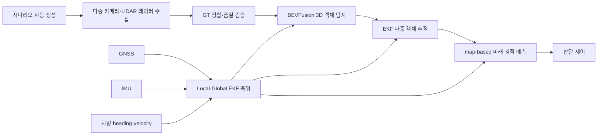

# 환경 인지 및 측위 연구보고서

> 문서 상태: 연구보고서 초안
> 대상 시스템: AjouNice 자율주행 환경 인지·측위 시스템
> 작성 범위: 데이터셋 구축, 3차원 객체 탐지·추적, 미래 궤적 예측, 측위

## 1. 연구 개요

본 연구의 목표는 MORAI K-City 환경에서 카메라·LiDAR·GNSS·IMU를 이용해 주변 객체를
안정적으로 인지하고, 객체의 미래 이동을 예측하며, 자율주행 차량의 위치와 자세를
실시간으로 제공하는 것이다.

연구는 단일 모델의 정확도 향상에 한정하지 않았다. 데이터 생성부터 모델 학습, 실제
센서 스트림 기반 평가, 객체 추적, 지도 기반 미래 궤적 예측, 측위 결과의 제어기 전달까지
전체 파이프라인을 하나의 시스템으로 설계하고 검증했다.



### 1.1 핵심 연구 성과

| 구분 | 핵심 성과 |
|---|---|
| 데이터셋 구축 | 시나리오 설계부터 수집·검증·재수집까지 자동화하여 Base3-Static 10,902 frame 구축 |
| 데이터 품질 | 29,545개 LiDAR GT box를 실제 point와 교차 검증하고 sparse GT 학습 정책 수립 |
| 실환경 적응 | 실제 UDP 센서 스트림을 rosbag으로 수집하고 LiDAR 시각 기준 GT 정합 데이터셋 구축 |
| 객체 탐지 | 4-camera+LiDAR BEVFusion을 3-class Vehicle/Pedestrian/Obstacle 검출기로 학습 |
| 도메인 보강 | 고주로 rosbag fine-tuning으로 Vehicle AP `0.6708 → 0.7187` 달성 |
| 객체 추적 | CTRV-EKF의 위치 관측 잡음을 실험적으로 조정하고 안정적인 속도·궤적 출력 확보 |
| 미래 예측 | Lanelet 연결성을 이용한 3초 Map-CV 다중 경로 예측 구현 |
| 측위 | GNSS 양자화를 고려한 Q/R 튜닝으로 횡 frame jump p95를 `5.432 → 1.444 cm`로 감소 |
| 실시간성 | 측위 50 Hz, BEVFusion 약 12.5–12.8 Hz 처리 용량을 확인하고 latest-only 실시간 구조 적용 |

---

# [환경 인지 로직] 데이터셋 구축 (Dataset Building)

## 2. 개요

3차원 객체 탐지 모델은 실제 대회 환경의 도로 구조, 객체 종류, 거리, 방향, 가림 및 센서
특성을 충분히 포함한 학습 데이터가 필요하다. 공개 데이터셋만으로는 MORAI K-City의 센서
구성 및 대회 미션 분포를 직접 반영하기 어렵기 때문에, 대회 환경에 맞는 전용 데이터셋을
직접 설계하고 구축했다.

데이터셋 구축은 다음 두 단계로 진행했다.

1. **Base3-Static:** 다양한 객체와 도로 구간을 대량으로 확보하는 general-domain 데이터셋
2. **Base3-Online:** 실제 추론과 동일한 UDP→ROS 센서 경로를 기록해 sensor-domain 차이를 보강하는 데이터셋

핵심 전략은 사람이 데이터 분포와 안전 조건을 설계하고, 반복적인 시나리오 생성·주행·캡처·
검증·재시도는 소프트웨어가 자동으로 수행하도록 분리한 것이다.

## 3. 자동화 데이터 수집 시스템

### 3.1 전체 수집 절차

```text
미션·객체 분포 설계
  → 시나리오 JSON 자동 생성
  → MORAI ScenarioLoad
  → Ego 경로 추종 및 capture gate 확인
  → 카메라 4대 + LiDAR + 객체 GT 저장
  → frame/scene metadata 생성
  → artifact·동기화·GT quality validator
  → 실패 scene 자동 분리 및 동일 quota 재수집
  → Train/Validation/Test scene 단위 분할
```

단순히 객체를 무작위로 배치하지 않고 다음 조건을 동시에 통제했다.

- 대회 경로 및 도로 유형: 일반 도로, 고주로, 합류, taper, 로터리, 횡단보도
- 객체 class와 asset 종류
- Ego 기준 전·후·좌·우 위치와 거리
- 주·야간 및 환경 조건
- 객체 간 충돌과 Ego swept path 간 안전거리
- 배경 오검출 학습을 위한 sparse/empty scene
- Train/Validation/Test 간 scene leakage 방지

### 3.2 자동 검증 및 복구

각 scene은 센서 파일 존재 여부만 확인하는 수준을 넘어 다음 항목을 검증했다.

- 목표 frame 수와 카메라·LiDAR artifact 완전성
- Ego 및 객체 상태 timestamp age
- 정적 객체의 실제 이동 여부
- 객체의 point-in-box 및 LiDAR point 수
- 알려지지 않은 asset과 비정상적인 BBox
- split별 class·공간 quota 유지
- 시나리오 로드 실패, 충돌 및 spawn 누락 여부

검증에 실패한 scene은 전체 batch를 다시 수집하지 않고, 같은 family·split·공간 quota를
유지하는 replacement scene으로 보충했다. 이 방식으로 대량 수집의 효율과 데이터 분포의
재현성을 동시에 확보했다.

## 4. Base3-Static 대규모 데이터셋

### 4.1 데이터 구성

Base3-Static은 MORAI의 동기 센서 캡처 기능인 `SaveSensorData`를 이용해 구축한
4-camera+LiDAR 기반 single-frame 학습 데이터셋이다. 자동화 프로그램이 각 scene의
주행 조건이 만족되는 시점에 캡처를 요청하고, 저장된 센서 artifact와 annotation을 즉시
검증하도록 구성했다.

| 항목 | 결과 |
|---|---:|
| 최종 clip | 3,634 |
| 최종 frame | 10,902 |
| 기본 Train/Val/Test clip | 2,334 / 500 / 500 |
| 움직이는 보행자 보강 | 300 clip / 900 frame |
| 최초 primary 수집 성공률 | 99.64% |
| 최종 artifact error | 0 |
| 기본 원본 capture 용량 | 45.11 GiB |

기본 10,002 frame은 다음 목표 비율로 구성했다.

| Family | Clip | 비율 |
|---|---:|---:|
| 정차 차량 | 1,334 | 40% |
| 정적 장애물 | 1,000 | 30% |
| 정지 보행자 | 500 | 15% |
| sparse/empty background | 500 | 15% |

여기에 실주행에서 관측되는 보행 자세를 반영하기 위해 걷기·뛰기 보행자 900 frame을
추가했다. 보행 방향은 좌→우와 우→좌를 균등하게 구성했고, 보행 속도는 실제 캡처 기준
`1.115–2.772 m/s` 범위를 포함했다.

### 4.2 객체 및 공간 다양성

| Class | Asset 종류 |
|---|---:|
| Vehicle | 43종 |
| Pedestrian | 22종 |
| Obstacle | 10종 |
| 합계 | 75종 |

고주로는 합류 진입로, 합류 차선, 본선, 4→3차로 taper, 분기 및 taper 이후 구간을
분리해 구성했다. 로터리는 접근·진입·순환·이탈을 각각 표본화했고, 일반 도로 및
횡단보도에는 class별 위치와 방위를 분산했다.

또한 객체가 존재하는 positive scene만 수집하면 배경을 객체로 오검출할 가능성이
커지므로, sparse/empty scene을 명시적으로 포함해 도로 시설물과 배경에 대한
hard-negative를 학습하도록 했다.

### 4.3 LiDAR GT 품질 관리

30 m 이내의 LiDAR GT 29,545개를 실제 XYZI point와 교차 검증했다.

| Class | GT box | 5 point 이상 | 비율 |
|---|---:|---:|---:|
| Vehicle | 7,247 | 7,239 | 99.89% |
| Pedestrian | 5,919 | 5,732 | 96.84% |
| Obstacle | 16,379 | 15,175 | 92.65% |
| 전체 | 29,545 | 28,146 | 95.26% |

카메라에는 보이지만 LiDAR point가 거의 없는 객체까지 동일한 positive loss로 학습하면
LiDAR 기반 3D 위치·크기 회귀가 불안정해질 수 있다. 따라서 raw annotation은 보존하되,
학습에서는 `num_lidar_pts < 5`인 GT를 positive supervision에서 제외했다. 이 정책은
데이터를 임의로 삭제하는 것이 아니라, 센서가 실제로 관측 가능한 학습 target을 명확히
구분한 것이다.

## 5. Base3-Online 실시간 센서 스트림 도메인 보강

### 5.1 구축 목적

동기 센서 캡처는 대규모·고품질 GT 확보에 유리하지만, 실제 추론에서는 UDP로 수신한
카메라와 LiDAR가 서로 독립적인 주기로 ROS topic에 도착한다. 이러한 sensor-domain
차이를 줄이기 위해 실제 production과 동일한 입력 경로를 rosbag으로 기록했다.

```text
ScenarioLoad
  → competition sensor configuration
  → UDP camera/LiDAR
  → ROS topics
  → rosbag + scene marker
  → LiDAR timestamp 기준 동기화·GT 변환
```

### 5.2 고주로 Vehicle 데이터셋

| 항목 | 결과 |
|---|---:|
| 자동 수집 scene | 334 / 334 |
| runtime failure | 0 |
| raw candidate frame | 1,002 |
| 최종 학습 frame | 983 |
| Vehicle GT | 1,814 |
| Vehicle asset | 43종 |
| raw rosbag | 7개, 약 24.06 GiB |

고주로의 ramp, merge, exit split, 4→3 taper 및 post-taper를 별도 topology로 구성했다.
한 scene에 1–4대의 Vehicle을 배치하고, 전방뿐 아니라 후방·측방 관측도 포함했다.

### 5.3 LiDAR 시각 기준 GT 정합

Online dataset 변환기는 다음 정합을 수행한다.

1. scene marker 밖의 시나리오 로드·teleport 구간 제거
2. 각 LiDAR timestamp에 가장 가까운 4-camera frame 선택
3. LiDAR 시각 전후의 Ego/Object pose 보간
4. 짧은 bracket 누락에 한해 최대 0.05초 velocity 외삽
5. asset origin을 geometric BBox center로 변환하는 pivot-to-center catalog 적용
6. GT를 현재 LiDAR/Ego 좌표계로 변환
7. point 수와 production box range를 이용한 label-quality mask 적용

334 scene 모두 Ego/Object pose 양방향 보간에 성공했다. Nearest-state 대비 Ego pose
보정량은 p50 `2.54 cm`, p95 `4.38 cm`였으며, 보정 후 point-in-box 총량이
`117,974 → 118,704`로 `0.62%` 증가했다. 모든 box에서 zero-point 회귀 없이 실제
LiDAR 정합이 개선됐다.

선택된 학습 frame의 sensor age도 다음 범위로 관리했다.

| 입력 | p50 | p95 | 최대 |
|---|---:|---:|---:|
| Ego state | 6.87 ms | 13.62 ms | 34.79 ms |
| Object state | 6.56 ms | 13.97 ms | 33.79 ms |
| Front camera | 7.59 ms | 20.61 ms | 37.50 ms |
| Front-left camera | 8.99 ms | 19.38 ms | 35.78 ms |
| Front-right camera | 8.83 ms | 19.83 ms | 34.66 ms |
| Rear camera | 7.74 ms | 20.27 ms | 36.72 ms |

### 5.4 도메인 보강 효과

Base3 general-domain production checkpoint에서 시작해 고주로 online dataset으로
fine-tuning한 결과, 고주로 Vehicle 탐지 성능이 다음과 같이 향상됐다.

| 평가 항목 | Base3 E25 | Online FT-E7 | 변화 |
|---|---:|---:|---:|
| 고주로 2-bag Vehicle AP | 0.6708 | **0.7187** | **+0.0479** |
| Vehicle 3-bag macro AP | 0.6994 | **0.7427** | **+0.0433** |
| 7-bag macro AP | 0.7620 | **0.7698** | **+0.0078** |
| Tracking center p50 | 0.5993 m | **0.4771 m** | **-12.22 cm** |

고주로 합류 AP는 `0.5700 → 0.6066`, 고주로 순항 AP는 `0.7716 → 0.8308`로
각각 개선됐다. 이 결과는 동기 캡처 데이터의 대규모 다양성과 실제 ROS 센서 스트림의
도메인 특성을 결합하는 전략이 유효함을 보여준다.

---

# [환경 인지 로직] 객체 탐지 및 추적 (Object Detection and Tracking)

## 6. 개요

환경 인지 시스템은 네 대의 카메라와 한 대의 LiDAR를 결합하는 BEVFusion 기반 3차원
객체 탐지기와, 연속 frame에서 동일 객체의 상태를 추정하는 EKF 다중 객체 추적기로
구성했다.

```text
4-camera images ─┐
                 ├─ BEVFusion ─ DetectedObjects ─ CTRV-EKF ─ TrackedObjects
LiDAR points ────┘
```

탐지 class는 대회 판단에 필요한 다음 세 종류로 통합했다.

- Vehicle
- Pedestrian
- Obstacle

## 7. BEVFusion 3차원 객체 탐지

### 7.1 센서 융합 구조

카메라는 객체의 색상·윤곽·class 정보를 제공하고, LiDAR는 정확한 거리와 3차원 형상을
제공한다. BEVFusion은 두 센서의 feature를 공통 Bird's-Eye View 공간으로 투영·융합하여
객체의 중심 위치, 크기, 방향 및 class score를 출력한다.

이 구조는 image-level class 정보만 point에 부가하는 방식보다 카메라와 LiDAR의 공간
feature를 모델 내부에서 공동 최적화할 수 있으며, 장애물과 차량이 혼재하는 대회 환경에
적합하다.

### 7.2 학습 및 모델 선정

Base3-Static 데이터로 40 epoch 학습하고, validation 최고 수치만이 아니라 실제 미션
rosbag의 탐지·추적·미래 예측 성능을 함께 평가해 production checkpoint를 선정했다.

최종 production 모델은 `B3-BF0-F40 E25`다.

| 지표 | Validation | Test |
|---|---:|---:|
| Center mAP | 0.980829 | 0.979407 |
| IoU mAP@0.5 | 0.956486 | 0.961747 |

Test class AP는 다음과 같다.

| Class | AP |
|---|---:|
| Vehicle | 0.96674 |
| Pedestrian | 0.98878 |
| Obstacle | 0.98271 |

Production threshold는 rosbag 및 실시간 시각화 결과를 기준으로 Vehicle/Pedestrian/
Obstacle 각각 `0.40 / 0.15 / 0.10`으로 설정했다.

### 7.3 Downstream 중심 모델 선정

자율주행에서 객체 탐지 결과는 그 자체로 끝나지 않고 추적기와 미래 궤적 예측기로
전달된다. 따라서 per-frame AP만으로 모델을 선택하지 않고, 동일한 미션 rosbag에 대해
추적 F1, 속도 오차 및 1–3초 미래 궤적 오차를 함께 비교했다.

| 모델 | Tracking F1 ↑ | 2D AVE ↓ | FDE@1s ↓ | FDE@2s ↓ | FDE@3s ↓ |
|---|---:|---:|---:|---:|---:|
| E10 | 0.9377 | 0.7887 m/s | 1.1357 m | 2.5669 m | 4.7168 m |
| **E25** | **0.9391** | **0.7252 m/s** | **1.0849 m** | **2.4427 m** | **4.4912 m** |

E25는 초기 모델 대비 2D AVE를 약 `8.1%`, 3초 FDE를 약 `4.8%` 개선했다. 이를 통해
단일 탐지 지표가 아니라 최종 planning 입력 품질을 중심으로 production 모델을 선정했다.

### 7.4 실시간 추론 구조

BEVFusion 추론은 Docker 환경으로 고정해 CUDA·PyTorch·MMDetection3D dependency를
재현 가능하게 관리했다. ROS bridge는 최신 sensor frame만 유지하는 latest-only queue를
사용한다. 처리 속도보다 입력이 빠를 때 과거 frame을 순서대로 쌓아 지연시키지 않고,
오래된 frame을 버리고 가장 최신 관측을 처리한다.

RTX 5060 Ti 기준 동일 architecture의 처리 용량은 약 `12.5–12.8 Hz`, end-to-end
latency p50/p95는 약 `78–84 ms`였다. 대회용 RTX 4090에서는 MORAI가 별도 PC에서
실행되므로 추론 PC의 GPU 자원을 인지에 집중할 수 있다.

## 8. EKF 다중 객체 추적

### 8.1 추적 상태와 motion model

탐지기의 frame별 BBox를 시간적으로 연결하기 위해 CTRV(Constant Turn Rate and
Velocity) 기반 EKF tracker를 사용했다. Tracker는 객체별 위치·방향·속도·yaw rate를
추정하고, 탐지가 잠시 누락돼도 motion model로 상태를 이어서 발행한다.

주요 production 설정은 다음과 같다.

| 항목 | 설정 |
|---|---|
| Motion model | CTRV |
| Position measurement noise | 0.40 m |
| Tracking scheduler | 30 Hz |
| Maximum measurement age | 0.50 s |
| Vehicle yaw canonicalization | 속도 1.0 m/s 이상에서 이동 방향 사용 |
| Detector velocity fusion | E25가 7D 모델이므로 off |

### 8.2 실험 기반 covariance 선정

Position measurement noise를 `0.30–0.45 m` 범위에서 비교해 center 정확도, 속도 오차,
2D AVE 및 미래 궤적 오차를 함께 평가했다. `0.40 m`는 위치 정확도를 유지하면서 속도와
미래 예측을 안정화하는 균형점이었다.

Production E25 고주로 두 bag에서 `0.30 → 0.40 m`로 조정한 결과:

- Tracking F1: `0.9324 → 0.9341`
- Speed MAE: `0.655 → 0.645 m/s`
- Stable FDE@3s: `1.766 → 1.696 m`
- 전체 FDE@3s: `4.695 → 4.663 m`

### 8.3 정적 장애물 안전 정책

Obstacle은 위치 관측의 작은 흔들림만으로도 tracker에서 가짜 속도가 생성될 수 있다.
이를 미래 이동으로 해석하면 planning이 존재하지 않는 동적 경로를 회피하는 문제가
생긴다. 따라서 Obstacle에 대응하는 UNKNOWN class는 최신 위치와 BBox는 계속 갱신하되,
속도·가속도·yaw rate를 0으로 고정하는 stationary policy를 적용했다.

이 정책으로 정적 장애물은 현재 위치가 반복되는 정지 궤적으로 전달되고, Vehicle과
Pedestrian의 동적 추적에는 영향을 주지 않는다.

---

# [환경 인지 로직] 미래 궤적 예측 (Trajectory Prediction)

## 9. 개요

객체의 현재 위치만으로는 차선 변경, 추월 및 충돌 회피를 안정적으로 수행하기 어렵다.
따라서 추적된 Vehicle을 Lanelet2 도로 지도에 정합하고, 도로 연결성을 따라 향후 3초의
이동 경로를 생성하는 Lanelet Map-CV 예측기를 구현했다.

## 10. Lanelet Map-CV 알고리즘

### 10.1 처리 절차

```text
Tracked Vehicle
  → map 좌표 변환
  → 현재 위치·yaw 기반 후보 Lanelet 탐색
  → routing graph successor 확장
  → centerline 기반 등속 이동
  → 중복 경로 병합 및 confidence 정규화
  → PredictedObjects 발행
```

주요 production 설정은 다음과 같다.

| 항목 | 설정 |
|---|---:|
| Prediction horizon | 3.0 s |
| Time step | 0.1 s |
| Pose 수 | 현재 pose 포함 31개 |
| Lane match 최대 거리 | 3.0 m |
| Lane match 최대 yaw 오차 | 45° |
| Map-following 최소 속도 | 0.5 m/s |
| Centerline 횡방향 수렴 시간 | 1.5 s |
| 시작 Lanelet 후보 | 최대 3개 |
| 최종 path 후보 | 최대 6개 |
| 중복 경로 거리 기준 | horizon 전체 0.75 m |

### 10.2 지도 정합과 후보 경로 생성

현재 객체 위치와 yaw를 이용해 진행 방향과 일치하는 Lanelet 후보를 찾는다. 각 후보에서
Lanelet routing graph의 successor를 따라 3초 동안 도달 가능한 centerline을 확장한다.
현재 BBox를 centerline에 즉시 투영하면 첫 prediction pose가 불연속적으로 이동할 수
있으므로, 1.5초 동안 현재 횡위치에서 centerline으로 점진적으로 수렴시킨다.

서로 다른 Lanelet ID에서 생성됐더라도 실제 공간 경로가 거의 동일한 경우에는 하나의
물리 hypothesis로 병합한다. 최종 confidence는 현재 위치·yaw·연결성을 반영한 route
score를 남은 후보 사이에서 정규화한다.

저속 객체, 도로 밖 객체, 역방향 객체 및 non-Vehicle에는 지도 경로를 강제하지 않고
Cartesian CV를 fallback으로 사용한다.

### 10.3 예측 성능

로터리·고주로 합류·고주로 순항 세 미션 rosbag을 동일 조건으로 평가했을 때,
production E25 기반 Map-CV는 초기 모델 대비 다음과 같이 개선됐다.

| 지표 | 초기 E10 | Production E25 | 개선 |
|---|---:|---:|---:|
| FDE@1s | 1.1357 m | **1.0849 m** | 4.5% |
| FDE@2s | 2.5669 m | **2.4427 m** | 4.8% |
| FDE@3s | 4.7168 m | **4.4912 m** | 4.8% |

등속 주행이 안정된 CV-stable 구간의 FDE@1/2/3s도
`0.874/1.592/2.748 m → 0.846/1.503/2.561 m`로 모두 개선됐다.

이 결과는 객체 탐지·추적·미래 예측을 독립적으로 최적화하는 대신, 최종 planning 입력까지
연결해 평가하는 방식의 효과를 보여준다.

---

# [환경 인지 로직] 측위 (Localization)

## 11. 개요

측위 시스템은 GNSS의 절대 위치, IMU의 자세·각속도, 대회 차량 상태 메시지의 heading과
종방향 속도를 융합해 planning과 control에 50 Hz 차량 상태를 제공한다.

```text
/sensor/gps ───────────────┐
/sensor/imu ───────────────┼─ Local/Global EKF ─ /localization/kinematic_state
/Competition_topic ────────┘
       heading, velocity.x
```

대회 production 입력과 개인용 launcher 입력을 명확히 분리했다.

| 환경 | 입력 | 실행 계약 |
|---|---|---|
| 대회용 MR | `/Competition_topic` | `localization` |
| 개인용 MRP | `/Ego_topic` | `localization_mrp` |

대회 환경에서는 `/Ego_topic`을 전제로 하지 않으며, production 측위는
`/Competition_topic + GPS + IMU`만으로 동작한다.

## 12. 센서 전처리와 좌표계

### 12.1 입력 변환

- MORAI GPS WGS84 좌표를 K-City `map` frame의 Odometry로 변환
- IMU covariance가 unknown인 경우 설정된 measurement covariance 부여
- `/Competition_topic`의 heading에 지도 기준 보정 `-1.347°` 적용
- 차량 종방향 속도 `velocity.x`를 EKF motion observation으로 사용
- UDP packet은 ROS host 수신 시각을 기준으로 timestamp 정책 통일

`-1.347°` 보정은 임의 tuning 값이 아니라 K-City 지도 좌표계와 MORAI heading 기준의
차이를 정합하기 위한 값이다. ROS와 UDP transport에 중복 적용하지 않고 production
adapter 한 곳에서만 적용한다.

### 12.2 Local·Global EKF 구조

측위는 REP-105 좌표계에 맞춰 두 EKF의 역할을 분리했다.

```text
Local EKF  : odom → base_link
Global EKF : map  → odom

최종 TF    : map → odom → base_link
```

- Local EKF는 IMU와 차량 motion을 이용해 연속적이고 부드러운 상대 운동을 추정한다.
- Global EKF는 GNSS 절대 위치를 이용해 장기적인 map 위치 drift를 제한한다.
- 최종 pose와 twist covariance를 `/localization/kinematic_state`로 전달한다.
- 두 필터는 2D mode를 유지해 불필요한 z·roll·pitch 자유도가 평면 주행을 흔들지 않게 한다.

## 13. GNSS 양자화 분석과 Q/R 튜닝

### 13.1 문제 정의

K-City 부근 MORAI NMEA 위·경도는 동서 약 `14.8 cm`, 남북 약 `18.5 cm` 간격으로
양자화된다. GNSS position을 지나치게 강하게 신뢰하면 cell이 바뀔 때마다 차량 위치가
계단 형태로 이동하고, 이 변화가 제어기의 좌우 조향 변동으로 전달될 수 있다.

이를 단순 LPF로 가리는 대신, raw GPS·IMU·차량 motion을 동일하게 유지한 상태에서
GNSS measurement covariance R과 Global EKF process noise Q를 체계적으로 비교했다.

최종 production 설정은 다음과 같다.

| 항목 | Production 값 |
|---|---:|
| GNSS horizontal sigma | 0.10 m |
| Global EKF x/y process-noise diagonal | 0.0005 |
| `predict_to_current_time` | true |
| State output | 50 Hz |

### 13.2 정량 평가 결과

| Moving 구간 p95 | 초기 설정 | Production 설정 | 개선 |
|---|---:|---:|---:|
| 횡 위치 오차 | 7.524 cm | **6.945 cm** | 7.7% |
| 횡 frame jump | 5.432 cm | **1.444 cm** | **73.4%** |
| 종 위치 오차 | 22.098 cm | **20.489 cm** | 7.3% |
| 종 frame jump | 7.234 cm | **2.416 cm** | **66.6%** |
| Yaw 오차 | 0.120° | **0.114°** | 5.1% |
| State rate | 49.999 Hz | 50.001 Hz | 유지 |

위 결과는 부드러움을 얻기 위해 위치 정확도를 희생한 것이 아니다. 종·횡 위치 오차와
frame jump가 동시에 감소했으며, 50 Hz 출력도 유지됐다.

Production 설정을 적용한 별도 15초 replay smoke에서도 다음을 확인했다.

- `/localization/kinematic_state`: 49.986 Hz
- 횡 frame-jump p95: 1.418 cm
- 종 frame-jump p95: 3.483 cm
- NaN/Inf output: 0건

### 13.3 폐루프 주행 검증

인지 부하를 분리한 경량 폐루프 장주행에서 production estimator는 242.72초 동안
50 Hz를 유지했다.

| Moving 구간 지표 | 결과 |
|---|---:|
| 횡 위치 오차 p50 / p95 | 1.79 / 5.56 cm |
| 종 위치 오차 p50 / p95 | 1.77 / 6.28 cm |
| 횡 frame jump p50 / p95 | 0.21 / 1.31 cm |
| Yaw 오차 p50 / p95 | 0.007 / 0.067° |
| 조향률 p50 / p95 | 0.082 / 0.541 rad/s |

동일 production 설정의 짧은 반복 주행에서도 localization `49.999 Hz`, 횡 frame jump
p95 `1.26 cm`로 유사한 결과를 얻어 반복성을 확인했다.

---

# 14. Production 통합 및 운영 설계

## 14.1 최종 데이터 흐름

```text
Competition sensors
  ├─ 4-camera + LiDAR
  │    → BEVFusion E25
  │    → CTRV-EKF tracker
  │    → UNKNOWN stationary policy
  │    → Lanelet Map-CV prediction
  │    → /perception/object_recognition/objects
  │
  └─ GNSS + IMU + Competition status
       → Local/Global EKF
       → /localization/kinematic_state

Perception + Localization
  → Planning
  → Control
```

## 14.2 재현성과 운영 안정성

- 모델 환경을 Docker image로 고정해 GPU PC 간 dependency 차이를 최소화했다.
- checkpoint에 SHA-256을 부여해 동일 가중치 사용 여부를 확인할 수 있게 했다.
- dataset split, metadata schema 및 serialized root를 고정해 팀원 PC에서도 같은 학습을 재현한다.
- detector·tracker·prediction·localization의 canonical ROS topic을 단일화했다.
- 동일 topic의 중복 publisher를 금지해 integration 시 비결정적 동작을 방지했다.
- rosbag 기반 정량평가와 MORAI 폐루프 주행을 함께 사용해 offline 성능과 실제 시스템 성능을 연결했다.

## 14.3 연구의 차별점

본 연구의 핵심은 하나의 높은 offline 점수를 얻는 데 있지 않다.

1. **대회 미션을 반영한 데이터 분포를 직접 설계했다.**
2. **사람의 분포 설계와 소프트웨어의 반복 수집을 분리해 대규모 구축을 자동화했다.**
3. **동기 캡처와 실제 UDP rosbag의 장점을 결합해 sensor-domain 차이를 줄였다.**
4. **객체 탐지 AP뿐 아니라 추적 속도와 3초 미래 경로까지 모델 선정 지표에 포함했다.**
5. **GNSS 양자화가 제어에 전달되는 경로를 분석하고 EKF Q/R을 정량적으로 최적화했다.**
6. **모든 핵심 결과를 rosbag replay와 폐루프 주행으로 재현 가능하게 관리했다.**

# 15. 결론

본 연구를 통해 데이터 생성부터 측위 및 미래 궤적 예측까지 이어지는 환경 인지 시스템을
구축했다. Base3-Static 10,902 frame과 Base3-Online 고주로 데이터셋을 자동 수집·검증하고,
4-camera+LiDAR BEVFusion을 학습해 Vehicle/Pedestrian/Obstacle을 통합 검출했다.

Online sensor-domain fine-tuning은 고주로 Vehicle AP를 `0.6708 → 0.7187`로 향상시켰으며,
production checkpoint는 실제 추적 및 미래 예측까지 평가해 선정했다. CTRV-EKF와 Lanelet
Map-CV를 연결해 객체별 3초 미래 경로를 제공하고, 정적 장애물에는 별도 stationary
정책을 적용해 planning 입력의 안정성을 높였다.

측위에서는 GNSS 양자화 특성을 정량 분석하고 Local·Global EKF의 Q/R을 조정해 횡 frame
jump p95를 73.4% 감소시키면서 50 Hz 상태 출력을 유지했다.

결과적으로 본 시스템은 특정 모델 하나가 아니라 **대회 환경에 맞는 데이터 구축,
멀티모달 객체 탐지, 시간적 추적, 지도 기반 예측, 센서 융합 측위를 하나의 검증 가능한
production pipeline으로 통합했다는 점**에 연구적·공학적 의의가 있다.
