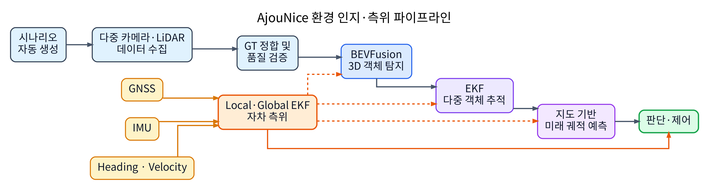
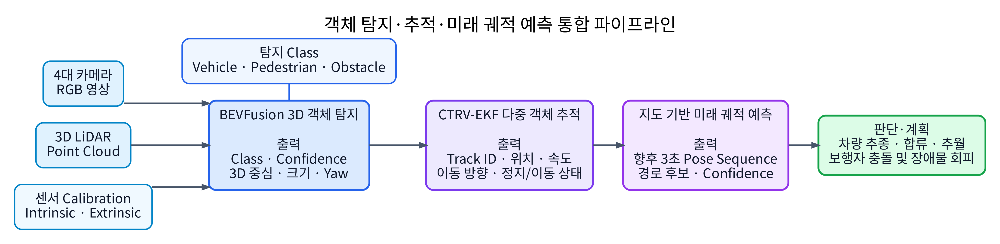
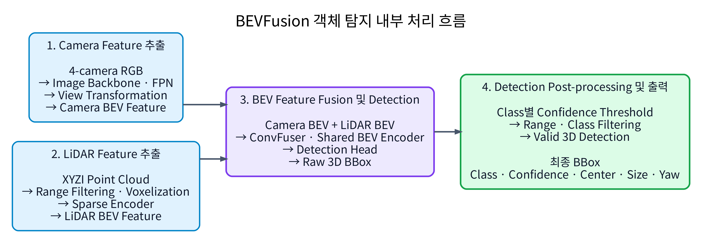
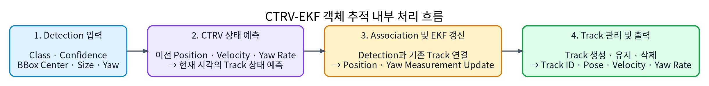
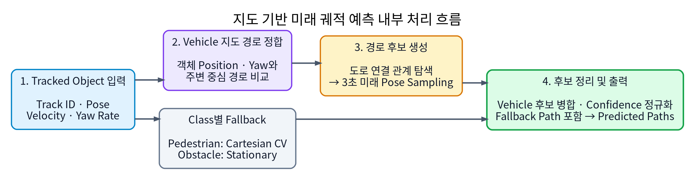

# 환경 인지 및 측위 연구보고서 개정안

> 작성 범위: 데이터셋 구축, 3차원 객체 탐지, 다중 객체 추적, 미래 궤적 예측, 측위
> 기준 시스템: 2026년 9월 23일 AjouNice production 구성
> 문서 용도: 최종 기술보고서의 환경 인지·측위 장에 반영하기 위한 원고

## 1. 연구 개요

본 연구의 목표는 MORAI K-City 대회 환경에서 주변 차량, 보행자 및 정적 장애물을
실시간으로 인지하고, 연속 프레임에서 객체 상태를 추적하여 미래 이동 경로를 예측하며,
자율주행 차량의 위치와 자세를 판단·제어 모듈에 안정적으로 제공하는 것이다.

연구 범위는 단일 객체 탐지 모델의 정확도 향상에 한정하지 않았다. 대회 미션을 반영한
데이터 분포 설계, 자동 수집 및 품질 검증, 멀티모달 객체 탐지, 시간적 추적, 지도 기반
미래 경로 예측, GNSS·IMU 기반 측위, ROS 통합과 실시간 운용까지 전체 파이프라인을
하나의 시스템으로 설계하고 검증하였다.



### 1.1 핵심 성과

| 구분 | 핵심 성과 |
|---|---|
| 데이터셋 | 대회 미션과 객체 분포를 반영한 Base3-Static 10,902 frame 구축 |
| 자동화 | 시나리오 생성, 로드, 센서 캡처, 품질 검증, 실패 scene 재수집 자동화 |
| 데이터 품질 | 30 m 이내 LiDAR GT box 29,545개를 point와 교차 검증하고 sparse GT 정책 수립 |
| 객체 탐지 | 4-camera와 LiDAR를 결합한 BEVFusion 3-class 검출기 구축 |
| 객체 추적 | CTRV-EKF 기반 다중 객체 추적과 정적 장애물 stationary 정책 구현 |
| 미래 예측 | 정밀 도로 지도의 연결성을 이용한 3초 지도 기반 다중 경로 예측 구현 |
| 측위 | GNSS 양자화를 고려한 Q/R 튜닝으로 횡방향 frame jump p95 73.4% 감소 |
| 실시간성 | BEVFusion 약 12.5–12.8 Hz, 추적 30 Hz, 측위 50 Hz 처리 확인 |

### 1.2 보고서 구성 원칙

객체 탐지, 추적, 미래 예측은 서로 다른 문제와 평가지표를 가지지만 실제 시스템에서는
연속된 하나의 파이프라인이다. 따라서 3장에서는 세 기술의 공통 목표와 입출력 관계를 먼저
정의하고, 4–6장에서 각 알고리즘을 개별적으로 설명한다. 이후 통합 성능 평가에서는 탐지
AP뿐 아니라 최종 추적 속도와 미래 경로 오차까지 함께 제시하여 각 단계가 판단 입력으로
어떻게 연결되는지 보여준다.

---

## 2. 대회 환경 전용 데이터셋 구축

### 2.1 구축 배경

공개 자율주행 데이터셋은 MORAI K-City의 도로 구조, 센서 배치, 객체 asset 및 대회
미션 분포를 직접 반영하지 않는다. 특히 정적 장애물 회피, 보행자 횡단, 회전교차로,
고속주행도로 합류와 같이 대회에 특화된 상황을 충분히 포함하기 어렵다. 이에 따라
4대의 카메라와 1대의 LiDAR로 구성된 대회 센서 환경에 맞는 전용 데이터셋을 직접
설계하였다.

### 2.2 자동 수집 및 검증 절차

```text
미션·객체 분포 설계
  → 시나리오 JSON 자동 생성
  → MORAI ScenarioLoad 및 Ego 이동
  → 4-camera·LiDAR·GT 동기 캡처
  → frame/scene metadata 생성
  → 센서 artifact·동기·GT 품질 검증
  → 실패 scene 격리 및 동일 quota 재수집
  → scene 단위 Train/Validation/Test 분할
```

단순 무작위 배치 대신 다음 조건을 통제하였다.

- 일반 도로, 횡단보도, 회전교차로, 고속주행도로 합류 및 본선 구간
- 객체 class, asset, Ego 기준 위치, 거리와 방위
- 객체 간 충돌 및 Ego 예상 경로와의 안전거리
- 주·야간 및 배경 조건
- positive scene뿐 아니라 sparse/empty hard-negative scene
- 같은 시나리오가 서로 다른 split에 포함되지 않는 scene-level 분할

수집 이후에는 목표 센서 파일 수, timestamp, 객체 이동 여부, point-in-box, 객체별
LiDAR point 수 및 비정상 BBox를 자동 검사하였다. 실패 scene만 같은 family와 split
비율을 유지한 replacement scene으로 재수집하여 전체 데이터 분포가 변하지 않도록 했다.

### 2.3 Base3-Static 구성

| 항목 | 결과 |
|---|---:|
| 최종 scene/clip | 3,634 |
| 최종 동기 frame | 10,902 |
| frame당 카메라 수 | 4 |
| 카메라 영상 수 | 43,608 |
| 기본 Train/Validation/Test clip | 2,334 / 500 / 500 |
| 움직이는 보행자 보강 | 300 clip / 900 frame |
| 최초 primary 수집 성공률 | 99.64% |
| 최종 artifact error | 0 |

기본 10,002 frame은 정차 차량 40%, 정적 장애물 30%, 정지 보행자 15%, sparse/empty
background 15%로 구성하였다. 여기에 걷기와 뛰기 자세를 포함한 움직이는 보행자 900
frame을 보강하였다. 사용한 asset은 Vehicle 43종, Pedestrian 22종, Obstacle 10종으로
총 75종이다.

`10,902 frame`은 멀티센서가 동기화된 학습 sample의 수이다. 카메라별 이미지를 각각
세면 43,608장이지만, 모델 학습 단위와 혼동하지 않도록 두 수치를 구분하였다.

### 2.4 LiDAR GT 품질 정책

30 m 이내의 LiDAR GT box를 실제 point cloud와 교차 검증하였다.

| Class | GT box | LiDAR point 5개 이상 | 비율 |
|---|---:|---:|---:|
| Vehicle | 7,247 | 7,239 | 99.89% |
| Pedestrian | 5,919 | 5,732 | 96.84% |
| Obstacle | 16,379 | 15,175 | 92.65% |
| **전체** | **29,545** | **28,146** | **95.26%** |

LiDAR point가 없거나 지나치게 적은 box는 위치와 크기를 3차원으로 학습하기 어렵다.
원본 annotation은 보존하되, BEVFusion 학습에서는 `num_lidar_pts < 5`인 GT를 positive
supervision에서 제외하였다. 이는 작은 객체 자체를 제거하는 정책이 아니라, 현재 센서가
3차원으로 관측 가능한 target과 관측 불가능한 target을 구분한 것이다.

### 2.5 실제 센서 스트림 보강

동기 캡처 데이터만으로는 UDP 카메라와 LiDAR가 서로 다른 시각에 도착하는 실시간 환경을
완전히 재현하기 어렵다. 이를 보완하기 위해 실제 production과 동일한 UDP→ROS 경로를
rosbag으로 기록하고, LiDAR timestamp를 기준으로 카메라와 Ego/Object pose를 정합하는
변환기를 구축하였다.

고주로 Vehicle 파일럿에서는 334개 scene을 자동 수집하여 983개 학습 frame과 1,814개
Vehicle GT를 확보하였다. 각 LiDAR 시각 전후의 pose를 보간하고 asset origin을 geometric
BBox center로 변환하였다. 고주로 전용 fine-tuning 결과 Vehicle AP가 향상되었으나,
Vehicle-only 학습으로 Obstacle 성능이 하락하였다. 따라서 이 실험은 sensor-domain 보강의
효과를 확인한 연구 결과로 보존하고, 전체 class production 모델은 Base3 E25를 유지하였다.

---

## 3. 객체 탐지·추적·미래 궤적 예측 통합 파이프라인

**Object Detection – Object Tracking – Trajectory Prediction**

### 3.1 구축 배경

자율주행 판단에 필요한 정보는 한 시점의 객체 위치와 종류만이 아니다. 회전교차로와
고속주행도로 같은 대회 미션을 안정적이고 빠르게 수행하기 위해서는 동적 객체의 속도와
미래 궤적 정보를 판단 모듈에 제공하는 것이 중요하다.

이에 따라 본 연구에서는 탐지 결과가 실제 판단 모듈에서 유용하게 사용될 수 있도록 객체
탐지·추적·미래 궤적 예측을 하나의 연속된 파이프라인으로 설계하였다. 객체 탐지 성능만을
독립적으로 높이는 대신, 파이프라인의 결과인 객체 속도와 미래 궤적까지 고려하여 종합적인
성능을 높이고자 하였다.

> **그림 4 삽입 위치:** AjouNice 객체 탐지·추적·미래 궤적 예측 RViz 시각화

### 3.2 기능 개요

본 통합 파이프라인은 차량 주변의 객체를 탐지하고, 연속된 프레임에서 동일 객체를
추적하여 각 객체의 미래 궤적을 예측한 뒤 판단 모듈에 전달하는 역할을 수행한다.

### 3.3 통합 파이프라인 입출력 정의



*그림 5. 객체 탐지·추적·미래 궤적 예측 통합 파이프라인*

객체 탐지 단계에서는 탐지기가 각 객체의 종류, 위치, 크기와 방향을 Bounding Box(이하
BBox) 형태로 confidence와 함께 추정한다. 탐지 class는 판단 모듈이 실제로 구분해 사용하는
Vehicle(차량), Pedestrian(보행자), Obstacle(장애물)의 세 종류로 통합하였다.

객체 추적 단계에서는 추적기가 프레임마다 독립적으로 생성되는 BBox 결과를 연결하여 동일
객체에 track ID와 속도를 부여한다. 미래 궤적 예측 단계에서는 추적에서 구한 속도와 지도
정보를 결합해 각 track에 시간별 pose로 구성된 미래 궤적과 confidence를 추가한다.

---

## 4. BEVFusion 3차원 객체 탐지

**3D Object Detection**

### 4.1 구축 배경

객체 탐지 모델로는 3차원 좌표상 객체 위치를 예측하기 위한 3차원 객체 탐지 모델을
고려하였다. 또한 높은 성능과 판단 모듈로의 전달 용이성을 위해 BEV(Bird's-Eye View)
representation을 사용하고, 강건한 예측을 위해 주어진 Camera-LiDAR 센서를 결합하는
multi-sensor fusion 모델을 검토하였다. 최종적으로 성능과 실시간성을 고려해 MIT HAN
Lab의 BEVFusion[1]을 선택하였다.

### 4.2 BEVFusion 객체 탐지 내부 처리 흐름



*그림 6. BEVFusion 객체 탐지 내부 처리 흐름*

#### 4.2.1 Camera Feature 추출

차량에 장착된 4대의 카메라 영상을 각각 image backbone에 입력하여 영상 feature를
추출한다. 카메라 영상은 Vehicle, Pedestrian, Obstacle의 외형 및 class 구분에 필요한
시각적 정보를 제공한다. 추출된 feature는 카메라 intrinsic과 extrinsic 정보를 이용해
차량 주변을 위에서 바라본 BEV 공간으로 변환한다. 이를 통해 서로 다른 방향을 바라보는
4대 카메라의 feature를 하나의 공통 공간에서 사용할 수 있다.

처리 순서는 `Camera RGB Image → Image Feature Extraction → BEV Coordinate
Transformation → Camera BEV Feature`이다.

#### 4.2.2 LiDAR Feature 추출

LiDAR는 각 point에 대해 x, y, z 위치와 intensity 값을 제공한다. Point cloud는 현재
인지 범위인 X축 -30–30 m, Y축 -30–30 m, Z축 -3–2 m 내부의 데이터만 사용한다. 이후
point cloud를 voxel 단위로 변환하고, voxel feature encoder와 sparse encoder를 이용해
LiDAR BEV feature를 생성한다. LiDAR는 객체까지의 거리와 3차원 위치를 직접 측정하므로
3차원 BBox의 위치와 형상 추정에 중요한 정보를 제공한다.

처리 순서는 `LiDAR Point Cloud → Range Filtering → Voxelization → Voxel Feature
Extraction → LiDAR BEV Feature`이다.

#### 4.2.3 BEV Feature Fusion

카메라에서 생성한 BEV feature와 LiDAR에서 생성한 BEV feature를 동일한 BEV 좌표계에서
결합하여 하나의 fused BEV feature를 구성한다. 결합된 feature는 공통 BEV encoder와
detection head로 전달되며, 각 객체의 class, confidence, 중심 위치, 크기와 yaw를 동시에
추정한다.

즉 카메라와 LiDAR가 각각 독립적으로 객체를 검출한 뒤 결과를 합치는 방식이 아니라, 두
센서의 feature를 먼저 결합한 뒤 하나의 최종 detection 결과를 생성하는 feature-level
fusion 방식이다.

#### 4.2.4 Detection Post-processing

BEVFusion이 출력한 모든 detection을 바로 추적기에 전달하지 않고, 실제 환경 인지에
사용할 객체만 선택하기 위한 후처리를 수행한다. Confidence가 낮은 객체까지 전달하면
false positive가 새로운 track으로 생성될 수 있기 때문이다. 또한 설정된 인지 범위를
벗어난 detection을 제거하고, Vehicle, Pedestrian, Obstacle class만 유지한다.

후처리 흐름은 `Raw Detection → Confidence Filtering → Range Filtering → Class
Filtering → Valid Detection`으로 구성된다. 후처리에서 사용하는 confidence threshold는
모델 자체의 detection 성능뿐 아니라 tracking 결과에도 영향을 주므로 detection 평가와
tracking 결과를 함께 확인하여 설정한다.

### 4.3 객체 탐지 결과 BBox

| Field | 의미 | 단위 또는 값 |
|---|---|---|
| `class` | 객체 종류 | Vehicle / Pedestrian / Obstacle |
| `confidence` | 검출 신뢰도 | 0–1 |
| `x, y, z` | 객체 BBox 중심 위치 | m |
| `width, length, height` | 객체 폭, 길이, 높이 | m |
| `yaw` | 객체가 향하는 방향 | rad |

*표 1. 객체 탐지 결과 BBox field별 의미와 단위*

Confidence threshold는 Vehicle/Pedestrian/Obstacle 순서로 `0.40/0.15/0.10`이다.
Class별 score 분포와 rosbag의 오검출·미검출 사례뿐 아니라 후속 tracking 성능까지 함께
비교하여 값을 선정하였다.

---

## 5. CTRV-EKF 다중 객체 추적 (Multi Object Tracking)

### 5.1 구축 배경

연속된 detection의 위치에는 센서와 모델의 오차로 인한 흔들림이 포함되므로, 이를 그대로
미분하면 속도 추정이 불안정해진다. 이에 따라 이전 상태와 현재 측정을 함께 사용해 위치와
속도를 재귀적으로 추정하면서도, 연산량이 작아 실시간 처리가 가능한 Kalman Filter 계열을
선택하였다. 이 중 CTRV의 상태 전이식은 yaw와 yaw rate에 따른 비선형 운동을 포함하므로,
이를 선형화하여 갱신할 수 있는 EKF(Extended Kalman Filter)를 적용하였다.

EKF 예측에 필요한 운동 모델의 경우 직선·곡선 운동을 하나의 모델로 처리할 수 있는
CTRV(Constant Turn Rate and Velocity)를 선정하였다. CTRV는 yaw rate가 0에 가까우면
직선 등속 운동을, yaw rate가 존재하면 일정한 회전율의 선회 운동을 표현하므로 다양한
차량의 움직임을 처리하기 적합하다.

### 5.2 CTRV-EKF 다중 객체 추적 내부 처리 흐름



*그림 8. CTRV-EKF 객체 추적 내부 처리 흐름*

이전 track의 운동 상태로 현재 위치를 예측하고, 새 detection과 기존 track을 연결한 뒤
측정된 위치와 yaw로 EKF 상태를 갱신한다. 일시적인 미검출 구간에서는 CTRV 예측값으로
track을 유지하며, 연결되지 않은 detection에는 새로운 track ID를 부여한다.

### 5.3 객체 추적기 설정과 정적 장애물 정책

| 항목 | Production 설정 |
|---|---|
| Motion model | CTRV-EKF |
| 최대 association 거리 | 5.0 m |
| Position measurement noise | 0.40 m |
| Tracking 출력 | 30 Hz |
| 최대 measurement age | 0.50 s |
| Vehicle yaw 보정 | 1.0 m/s 이상에서 이동 방향 활용 |
| Obstacle 정책 | 속도, 가속도, yaw rate를 0으로 고정 |

*그림 9. CTRV-EKF 객체 추적기 설정*

정적 Obstacle의 검출 위치가 frame마다 조금씩 흔들리면 tracker가 실제로 존재하지 않는
속도를 생성할 수 있다. 판단 모듈이 이를 움직이는 장애물로 해석하여 불필요하게 주행
경로를 변경하는 문제를 방지하기 위해, Obstacle class는 최신 위치와 BBox는 갱신하되
속도, 가속도와 yaw rate를 0으로 고정하였다. 최종 출력에는 class, BBox, track ID,
속도와 yaw rate가 포함되며 미래 궤적 예측기의 입력으로 사용된다.

---

## 6. 지도 기반 미래 궤적 예측 (Map-based Trajectory Prediction)

### 6.1 구축 배경

객체의 속도만을 등속 직선 운동으로 외삽하면 회전교차로와 곡선·분기 구간에서 실제 주행
가능한 경로를 벗어날 수 있다. 일반적인 구조화 도로 환경에서 차량은 도로의 형상과 연결
관계에 제약을 받으므로, 추적된 운동 상태와 정밀 도로 지도를 함께 사용하는 지도 기반
미래 궤적 예측 방식을 선정하였다. 특정 시나리오의 이동 경로를 하드코딩하지 않고 현재
위치 주변의 지도 연결 관계를 실시간으로 탐색하여, 별도의 학습 모델 없이도 물리적으로
주행 가능한 경로 후보를 생성한다.

### 6.2 지도 기반 미래 궤적 예측 내부 처리 흐름



*그림 10. 지도 기반 미래 궤적 예측 내부 처리 흐름*

먼저 추적된 Vehicle의 현재 위치와 진행 방향을 주변 도로의 중심 경로와 비교한다. 위치가
3.0 m 이내이고 진행 방향의 차이가 45° 이내인 경로만 시작 후보로 선택한다. 각 시작
후보에서는 현재 속도를 유지한다고 가정하고 도로의 연결 관계를 따라 향후 3초 동안 이동
가능한 경로를 생성한다. 현재 위치는 1.5초 동안 중심 경로로 점진적으로 수렴시키고,
공간적으로 거의 같은 경로는 하나의 후보로 병합한 뒤 confidence와 함께 출력한다.

### 6.3 미래 궤적 예측기 설정과 fallback 정책

| 항목 | Production 설정 |
|---|---:|
| Prediction horizon | 3.0 s |
| Time step | 0.1 s |
| 지도 정합 최대 거리 | 3.0 m |
| 지도 정합 최대 yaw 오차 | 45° |
| 중심 경로 수렴 시간 | 1.5 s |
| 시작 경로 후보 | 최대 3개 |
| 최종 경로 후보 | 최대 6개 |
| 중복 경로 판정 거리 | 0.75 m |
| Vehicle 이동거리 | 현재 속력 기준 `s(t) = v·t` |

*그림 11. 지도 기반 미래 궤적 예측기 설정*

각 경로에는 위치·방향 정합 score를 후보 사이에서 정규화한 confidence를 부여한다.
Vehicle은 지도 경로의 형상을 따르되, 경로상 이동거리는 현재 속력이 유지된다는 가정으로
계산한다. 현재 detector는 가속도를 직접 측정하지 않으며, 연속 BBox 위치로부터 가속도를
추정하면 위치를 두 번 미분하는 과정에서 detection 흔들림이 크게 증폭된다. CA·CTRA
운동 모델을 적용한 rosbag 비교에서도 안정적인 순항 구간의 속도와 미래 위치 오차가
악화되어 production 예측에는 가속도를 사용하지 않았다.

Vehicle이 저속이거나 지도 정합에 실패하면 tracker의 속도와 yaw rate를 사용하는 CTRV
예측으로 전환한다. Pedestrian은 도로 중심 경로에 구속하지 않고 tracker의 2차원 속도를
유지하는 Cartesian CV 모델로 예측하며, 이동 중에는 속도 방향을 보행 방향으로 사용한다.
정적 Obstacle은 현재 위치를 유지하는 stationary path를 출력한다. 각 predicted path는
0.1초 간격의 미래 pose와 confidence로 구성되어 판단 모듈에 전달된다.

---

## 7. 환경 인지 성능 평가

### 7.1 평가 원칙

Dataset 내부 test 성능만으로 실제 주행 성능을 판단하지 않았다. 다음 세 단계로
production 모델을 선정하였다.

1. 고정된 Base3 Validation/Test split에서 3D 객체 탐지 성능 확인
2. 대회 미션별 rosbag에서 class별 탐지 AP와 frame coverage 확인
3. 동일 detection을 production tracker와 지도 기반 예측기에 입력하여 속도 및 미래 경로 평가

이 방식은 한 프레임의 AP가 조금 높은 모델보다 최종 planning 입력이 안정적인 모델을
선정하기 위한 것이다.

### 7.2 Base3 offline 평가

Base3-Static으로 40 epoch를 학습하고 실제 downstream 성능이 가장 안정적이었던
`B3-BF0-F40 E25`를 production checkpoint로 선정하였다.

| 지표 | Validation | Test |
|---|---:|---:|
| Center mAP | 98.08% | **97.94%** |
| IoU mAP@0.5 | 95.65% | **96.17%** |

| Test class | Center AP |
|---|---:|
| Vehicle | 96.67% |
| Pedestrian | 98.88% |
| Obstacle | 98.27% |

Offline split은 같은 생성 파이프라인에서 만들어져 실제 UDP 센서 스트림보다 분포가
유사하다. 따라서 위 수치는 학습 수렴과 class별 기본 능력을 확인하는 지표로 사용하고,
실주행 일반화는 별도 rosbag 평가로 판단하였다.

### 7.3 미션 rosbag 객체 탐지 평가

Center AP는 center-distance `0.5/1/2/4 m` 기준 AP의 평균이다. 아래 표는 production
E25를 선정할 때 고정한 rosbag 평가 계약의 결과이며, class threshold
`0.40/0.15/0.10`과 30 m production 범위를 동일하게 적용하였다.

| 주행 시나리오 | 평가 class | Center AP |
|---|---|---:|
| 회전교차로 | Vehicle | 75.65% |
| 고속주행도로 합류 | Vehicle | 57.00% |
| 고속주행도로 순항 | Vehicle | 77.16% |
| 보행자 횡단 | Pedestrian | 99.99% |
| 보행자 거리 변화 | Pedestrian | 98.89% |
| 정적 장애물 왕복 | Obstacle | 60.02% |
| 다중 정적 장애물 | Obstacle | 64.72% |
| **7-bag macro** |  | **76.20%** |

Offline test와 달리 실제 rosbag에서는 고속 합류와 정적 장애물의 성능 하락이 확인되었다.
이는 단일 test score만 제시하는 대신 실제 미션별 취약 조건을 별도로 분석해야 함을
보여준다. 이후 MORAI 측 확인을 통해 동기 캡처 GT는 mesh 기반 geometric BBox이고,
`/Object_topic`은 차량의 후륜 차축 또는 asset origin과 기본 제원을 제공한다는 차이를
확인하였다. 이에 따라 신규 데이터 학습은 동기 캡처 annotation을 기준으로 하고,
rosbag 평가는 asset별 center·size 보정을 적용한다. 위 기존 production 표는 모델 선정
당시의 고정 비교 결과로 사용하고, 서로 다른 GT 계약의 절대 성능처럼 해석하지 않는다.

### 7.4 추적 및 미래 예측 통합 평가

회전교차로, 고속주행도로 합류, 고속주행도로 순항의 세 Vehicle rosbag을 같은 비중으로
평균하였다. AVE는 2차원 속도 vector의 L2 오차이고, FDE는 각 예측 시각의 최종 위치
오차이다.

| 모델 | Tracking F1 ↑ | Center p50 ↓ | Speed MAE ↓ | 2D AVE ↓ | FDE@1s ↓ | FDE@2s ↓ | FDE@3s ↓ |
|---|---:|---:|---:|---:|---:|---:|---:|
| E10 | 93.77% | **0.540 m** | 0.593 m/s | 0.789 m/s | 1.136 m | 2.567 m | 4.717 m |
| **E25** | **93.91%** | 0.546 m | **0.568 m/s** | **0.725 m/s** | **1.085 m** | **2.443 m** | **4.491 m** |

E25의 center p50은 E10보다 5.4 mm 높았으나, Tracking F1과 속도 오차 및 1–3초 FDE가
모두 개선되었다. 이에 따라 offline 최고 epoch가 아니라 E25를 최종 production 모델로
선정하였다.

급가감속과 객체 spawn 구간은 등속 예측의 구조적 한계를 포함한다. 등속 주행이 안정된
CV-stable 구간에서 E25의 FDE@1/2/3s는 각각 `0.846/1.503/2.561 m`였다. 전체 평균과
안정 구간을 함께 제시하여 모델의 일반 성능과 motion-model 가정이 성립하는 범위를
구분하였다.

### 7.5 대표 시각화

최종 보고서에는 다음 조건을 한 화면에서 확인할 수 있는 RViz 캡처를 배치한다.

- 회색 또는 원색 point cloud와 카메라 입력
- BEVFusion detection BBox
- CTRV-EKF tracking BBox와 track ID
- 지도 기반 predicted path
- 비교가 필요한 경우에만 별도 색상의 GT BBox

> 그림 삽입 위치: 고속주행도로에서 Vehicle detection, tracking 및 지도 기반 예측 경로가 동시에
> 표시된 production E25 RViz 화면

---

## 8. GNSS·IMU 센서 융합 측위

### 8.1 측위 구조

측위 시스템은 GNSS 절대 위치, IMU 자세·각속도, Competition Vehicle Status의 heading과
종방향 속도를 융합하여 planning과 control에 50 Hz 차량 상태를 제공한다.

```text
/sensor/gps ───────────────┐
/sensor/imu ───────────────┼─ Local EKF + Global EKF
/Competition_topic ────────┘             ↓
                              /localization/kinematic_state
```

Local EKF는 IMU와 차량 motion으로 `odom → base_link`의 연속적인 상대 운동을 추정하고,
Global EKF는 GNSS로 `map → odom`의 장기 drift를 제한한다. 두 필터 모두 평면 주행에 맞는
2D mode를 사용한다.

대회용 MR은 `/Competition_topic`을 사용하며 heading에 K-City 지도 기준 `-1.347°`
보정을 한 번만 적용한다. 개인용 MRP는 `/Ego_topic`을 사용하며, transport와 launcher의
heading convention 차이를 분리하여 중복 보정을 방지하였다.

### 8.2 GNSS 양자화와 Q/R 튜닝

MORAI NMEA 위·경도는 K-City 부근에서 동서 약 14.8 cm, 남북 약 18.5 cm 간격으로
양자화된다. GNSS 측정을 과도하게 신뢰하면 cell 경계를 지날 때 차량 위치가 계단 형태로
변하고, 이 변화가 제어기의 조향 채터링으로 전달될 수 있다.

Raw GPS·IMU·차량 motion을 동일하게 유지하면서 GNSS measurement covariance R과
Global EKF process noise Q를 비교하였다. 최종 설정은 GNSS horizontal sigma 0.10 m,
Global EKF x/y process-noise diagonal 0.0005이며, 50 Hz 출력을 유지하였다.

| Moving 구간 p95 | 초기 설정 | Production | 개선 |
|---|---:|---:|---:|
| 횡 위치 오차 | 7.524 cm | **6.945 cm** | 7.7% |
| 횡 frame jump | 5.432 cm | **1.444 cm** | **73.4%** |
| 종 위치 오차 | 22.098 cm | **20.489 cm** | 7.3% |
| 종 frame jump | 7.234 cm | **2.416 cm** | **66.6%** |
| Yaw 오차 | 0.120° | **0.114°** | 5.1% |
| State rate | 49.999 Hz | 50.001 Hz | 유지 |

별도 경량 폐루프 장주행에서도 242.72초 동안 50 Hz를 유지했으며, moving 구간 횡 위치
오차 p95 5.56 cm, 횡 frame jump p95 1.31 cm를 기록하였다. 이 결과는 측위 출력을
단순히 부드럽게 만든 것이 아니라 위치 오차와 frame 간 불연속을 동시에 줄였음을 보여준다.

---

## 9. 실시간 통합 및 재현성

### 9.1 실시간 처리

BEVFusion은 ROS1과 분리된 Docker inference server로 실행하고, ROS bridge가 4-camera와
LiDAR를 동기화하여 요청한다. 처리 속도보다 입력이 빠른 경우 오래된 frame을 누적하지
않고 가장 최신 관측을 처리하는 latest-only queue를 사용하였다.

RTX 5060 Ti 기준 동일 architecture의 처리 용량은 약 12.5–12.8 Hz였으며 end-to-end
latency p50/p95는 각각 약 78/84 ms였다. 이는 12 Hz 수준의 LiDAR 입력을 실시간으로
처리할 수 있는 수준이다. 대회용 RTX 4090 PC에서는 MORAI가 별도 컴퓨터에서 실행되므로
GPU와 CPU 자원을 인지 파이프라인에 집중할 수 있다.

### 9.2 재현 가능한 운영 환경

- CUDA, PyTorch 및 MMDetection3D 의존성을 팀 공용 Docker image로 고정
- checkpoint SHA-256으로 동일 가중치 사용 여부 확인
- dataset split과 metadata schema를 고정하여 팀원 PC 간 학습 재현
- detector, tracker, prediction 및 localization의 canonical ROS topic 통일
- rosbag replay로 동일 센서 입력에 대한 회귀 평가 반복
- offline 점수, rosbag 정량평가와 MORAI 폐루프 주행을 단계적으로 분리

---

## 10. 한계와 후속 연구

### 10.1 확인된 한계

1. 같은 생성기로 구성한 offline test는 실제 UDP rosbag보다 학습 분포와 유사하여 성능을
   낙관적으로 평가할 수 있다.
2. 고속 합류와 정적 장애물은 offline 성능에 비해 rosbag AP 하락이 크다.
3. 현재 E25는 7D detector이므로 객체 속도는 detector가 직접 출력하지 않고 tracker의
   위치 변화로 추정한다.
4. 지도 기반 예측기는 등속 가정을 사용하므로 급가감속과 차선 변경 초기에 3초 오차가 커질 수 있다.
5. `/Object_topic`은 asset origin과 기본 제원을 제공하고, 센서 캡처 annotation은 실제
   mesh를 감싸는 geometric BBox를 제공하므로 두 GT를 그대로 혼용할 수 없다.

### 10.2 후속 연구 방향

- 실제 UDP 센서 스트림과 동기 캡처 데이터를 혼합한 general-domain rehearsal
- 여러 class를 유지하면서 고주로 Vehicle domain을 보강하는 fine-tuning
- 연속 LiDAR sweep과 ego-motion 정합을 이용한 causal temporal BEV
- 객체 query memory와 displacement consistency를 이용한 속도 예측 안정화
- 새 held-out 고주로 rosbag을 통한 최종 일반화 검증
- tracker history와 도로 연결성을 결합한 경로 후보 Top-1 정확도 개선

Base4-Temporal 연구에서는 single-frame 9D, causal 3-sweep 및 lightweight temporal BEV를
단계적으로 비교하고 있다. 초기 실험에서 속도 label의 학습 가능성은 확인했으나, 제한된
데이터와 인접 frame 속도 jitter 때문에 production은 E25를 유지하였다. 검증이 완료되지
않은 temporal 모델 성능을 본 보고서의 최종 성과로 과장하지 않고 후속 연구로 구분한다.

---

## 11. 결론

본 연구에서는 MORAI K-City 대회 환경을 위한 데이터 구축부터 객체 탐지, 추적, 미래
궤적 예측과 측위까지 이어지는 환경 인지 시스템을 구축하였다. Base3-Static 10,902개
동기 frame을 자동 수집·검증하고, 4-camera와 LiDAR를 융합하는 BEVFusion으로 Vehicle,
Pedestrian, Obstacle을 통합 검출하였다.

Production 모델은 offline AP만으로 선정하지 않고 실제 미션 rosbag에서 CTRV-EKF 추적과
지도 기반 미래 궤적 예측까지 연결해 평가하였다. 최종 E25는 Tracking F1 93.91%, 2D AVE
0.725 m/s, FDE@1/2/3s 1.085/2.443/4.491 m를 기록하였다. 정적 장애물에는 stationary
정책을 적용하여 검출 흔들림이 가짜 미래 경로로 전달되지 않도록 하였다.

측위에서는 GNSS 양자화가 제어 채터링으로 전달되는 원인을 분석하고 Local·Global EKF의
Q/R을 조정하여 횡방향 frame jump p95를 5.432 cm에서 1.444 cm로 줄였다. 이 과정에서도
50 Hz 상태 출력을 유지하였다.

본 연구의 핵심 성과는 특정 모델의 단일 점수가 아니라, **대회 미션에 맞는 데이터 분포를
직접 설계하고 멀티모달 객체 탐지, 시간적 추적, 지도 기반 예측과 센서 융합 측위를 하나의
재현 가능한 production pipeline으로 통합·검증한 것**에 있다.

---

## 참고문헌

[1] Z. Liu, H. Tang, A. Amini, X. Yang, H. Mao, D. Rus, and S. Han,
“BEVFusion: Multi-Task Multi-Sensor Fusion with Unified Bird's-Eye View
Representation,” ICRA, 2023. <https://hanlab.mit.edu/projects/bevfusion>
