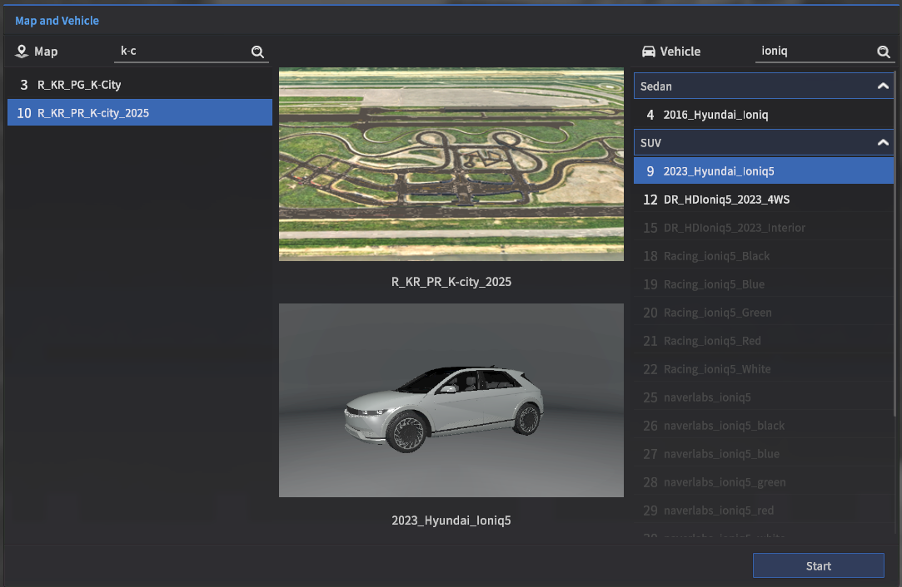
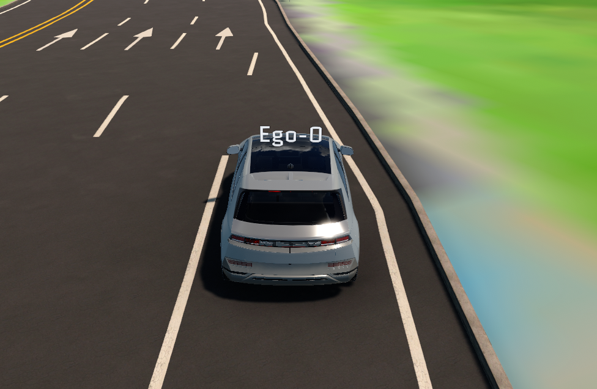
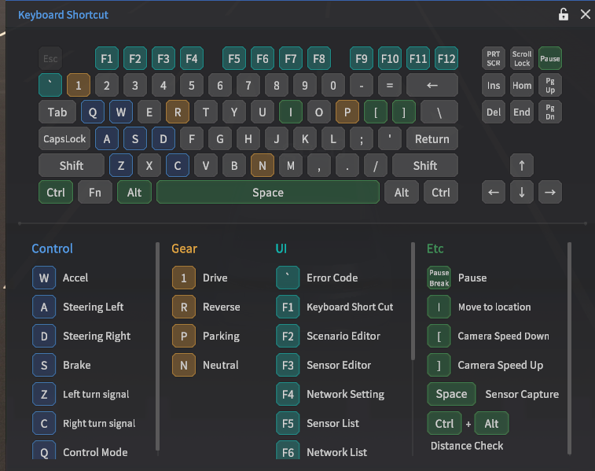
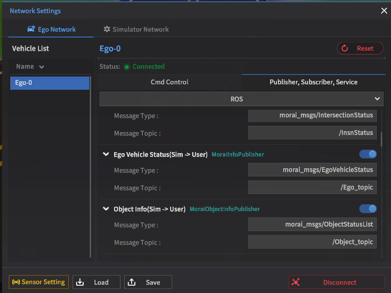
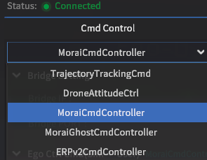
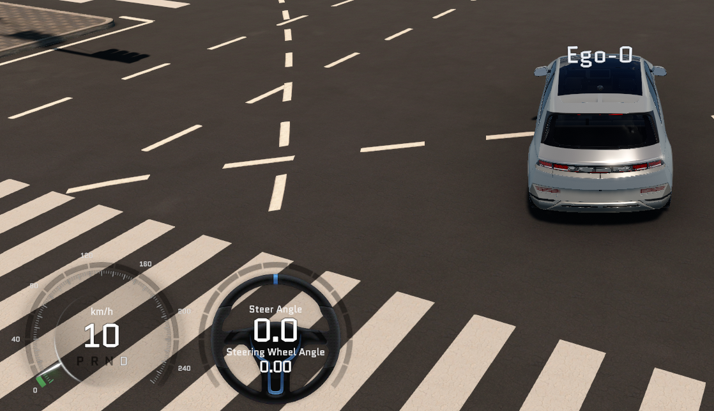
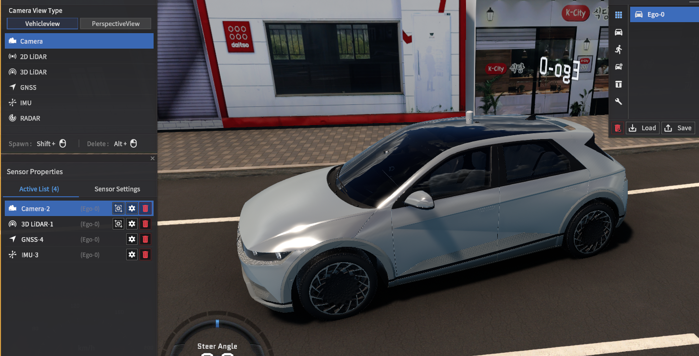
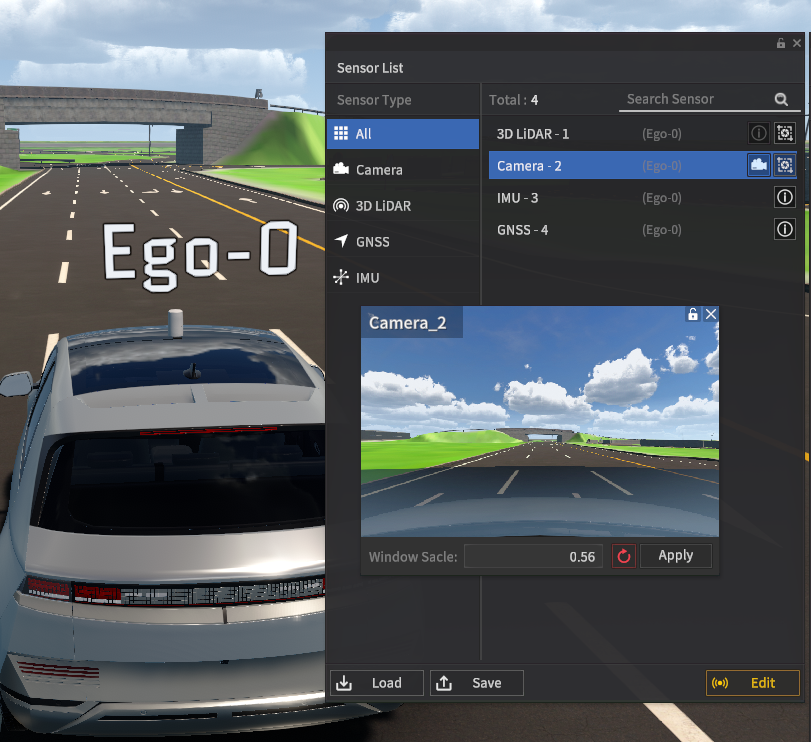
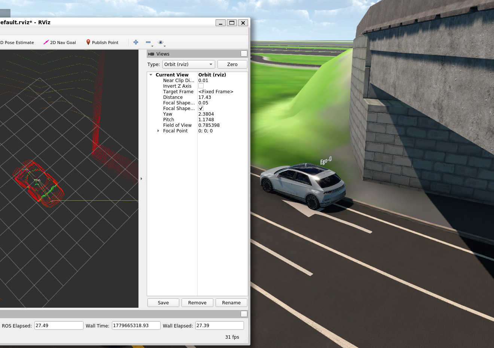

# local PC에서 Morai를 설치하고 통신하는 법
- doc: https://help-morai-sim.scrollhelp.site/ko/morai-sim-drive/24.R1.0/-25
## Enviroments
- OS for MORAI: Windows 11
- OS for ROS: Ubuntu 20.04 in WSL2
- MORAI Version: 26R1

## 목적
- MORAI를 WSL2에서 실행하기엔, GPU 자원 사용에 있어서 문제가 생길 가능성이 있음.
- WINDOWS 11에 설치 후 대회 허용 UDP로 연결한다.
- 이렇게 할 수 있는 근거:
    1. [carla의 경우 이렇게 구성한 사례](https://github.com/carla-simulator/carla/issues/5806#issuecomment-1659755944)가 있었음.
    2. [morai test 예제 문서](https://github.com/MORAI-Autonomous/MORAI-SensorExample/blob/main/README.md)에도 그렇게 wsl로 구성해서 테스트했다고 함.
    - 근데 나중에 (아마도) UDP 통신에서 터질 수도?

## 계획
- Windows 11
    - MORAI 설치
    - MORAI Launcher 로그인
    - 시뮬레이터로 GUI 조작해보기
- WSL2 Ubuntu 20.04
    - `Sensor.json`, `ego_network_1.json`을 MORAI에 로드
    - `morai_udp_interface.launch`로 UDP 패킷을 ROS 메시지로 변환
    - `sensing.launch`로 센서 static TF와 선택적인 RViz/차량 모델을 실행

## Windows MORAI 설치
- [다운로드 링크 접속](https://help-morai-sim.scrollhelp.site/ko/morai-sim-drive/24.R1.0/-25?utm_source=chatgpt.com)
- 윈도우 런처 다운로드
- `MoraiLauncher_Win.exe` 실행 후, id 및 password 입력
- 우측 아래 "install" 클릭
- 설치가 완료되었으면, 우측 아래 "Start" 클릭

## MORAI GUI 조작해보기
- map: ` R-KR_PG_K-City_2025`
    - 우리 대회 사용 map
- vehicle: `2023_Hyundai_ioniq`
    - 우리 대회 사용 차량





- start를 누르면, 위 사진처럼 map과 차량이 로딩됨.


- 조작법
- w: 직진
- a, d: 왼쪽, 오른쪽 스티어링(조향)
- s: 브레이크
- 1, R, P, N: Drive, Reverse, Parking, Neutral 기어 모드 변경(완전히 멈췄을 때만 변경 가능)

## WSL2 ROS쪽에서 통신 준비
### morai_msgs 설치
```bash
rospack find morai_msgs # 확인

# 아무것도 안 나오면 없는 거니 설치
cd ~/AjouNice2026/base_ws/src
git clone https://github.com/MORAI-Autonomous/MORAI-ROS_morai_msgs.git morai_msgs
bs # (build, source)

rospack find morai_msgs # 확인
```
### UDP 인터페이스 빌드 및 실행
```bash
cd ~/AjouNice2026/base_ws
source /opt/ros/noetic/setup.bash
catkin_make
source devel/setup.bash
roslaunch sensor_interface morai_udp_interface.launch

# 별도 터미널
source /opt/ros/noetic/setup.bash
source ~/AjouNice2026/base_ws/devel/setup.bash
roslaunch bringup sensing.launch start_rviz:=false enable_vehicle_model:=false
```

- 센서 설정: `configs/sensors/Sensor.json`
- Ego Network 설정: `configs/network/ego_network_1.json`
- rosbridge/WebSocket 9090은 실행하지 않는다.

## WSL2 IP 확인
```bash
# 아래 명령어 결과 기억해 두기
hostname -I 
# docs/local_notes.md에 저장해 두는 것을 추천
# private IP 범위 내 값이기에 들켜도 별로 상관없긴 함.
# wsl2는 재부팅 시마다 저 값 변경될 수 있음.
```

## MORAI에서 UDP 설정 로드
- Sensor 설정에서 `configs/sensors/Sensor.json`을 로드한다.
- Network Settings > Ego-0에서 `configs/network/ego_network_1.json`을 로드한다.
- MORAI와 ROS가 같은 PC이면 현재 파일의 `127.0.0.1`을 그대로 사용한다.
- 다른 PC/WSL2이면 두 JSON의 host/destination IP를 실제 양쪽 IP로 바꾼다.

## 센서 붙이기 전에, 기본 ROS topic 잘 연결되는지 테스트
```bash
$ rostopic list
/VehicleCollisionData
/client_count
/clock
/connected_clients
/ego_setting
/rosout
/rosout_agg
/sim/process/state/msg/MoraiSimProcStatus
# bridge_server 관련 토픽과, morai 관련 토픽이 새로 생겼음을 볼 수 있음.
# 근데 아래와 같은 토픽들은 아직 없음 - 일부는 센서를 배치하지 않았기 때문
# 그리고 Ego Network에서 각 항목들을 안 켰기 때문.
# 각 토픽들 정리한 내용들은 topic_interface.md에 기록

# /Ego_topic
# /Object_topic
# /ctrl_cmd
# /lidar3D
# /sensor/imu
# /sensor/gps
# /image_jpeg/compressed
```

## MORAI에서 Ego Network 항목 켜서 토픽들 받기
- Edit > Network Settings > Ego Network
- 목표: /Ego_topic, /Object_topic, /ctrl_cmd 키기


- 이미 toggle이 on되어 있으므로, cmd control만 MoraiCmdController로 변경 후, ROS로 변경
- 후 connect 하면 됨.
- 이 때, bridge ip를 내 wsl2 hostname으로 하니까 안 나오고, 기본값인 `127.0.0.1`로 하니까 cmd topic이 제대로 나왔음.
- 왜 그런지는 모르겠음. 왜 자기 자신 ip를 입력하니 저렇게 되지? 일단 잘 되니까 넘어가자.


```bash
$ rostopic list
/CollisionData
/Ego_topic
/GetTrafficLightStatus
/InsnControl
/InsnStatus
/IntscnTL_topic
/Object_topic
/ReplayInfo_topic
/SaveSensorData
/ScenarioLoad
/SensorPosControl
/SetTrafficLight
/SyncModeInfo
/VehicleCollisionData
/client_count
/clock
/connected_clients
/ctrl_cmd
/ego_setting
/lamps
/rosout
/rosout_agg
/sim/process/state/msg/MoraiSimProcStatus
/tf
```

## 횡단보도 동적 객체 시나리오 행렬 생성

`Dynamic_kid_10.json`(전방 횡단 위치)과 `dynamic_test_1.json`(반대편 횡단
위치)을 템플릿으로 사용한다. 생성기는 두 파일의 좌표·방향·웨이포인트는
그대로 보존하고, 대상 모델·보행 속도·MORAI 활성 거리만 바꾼다.

```bash
cd ~/Desktop/AjouNice2026

# 먼저 2,100개 씬(6 객체 × 두 위치 × 5 객체 속도 × 5 활성 거리 × 7 에고 속도)을 검증만 한다.
python3 scripts/runtime/generate_morai_dynamic_crosswalk_scenarios.py --dry-run

# MORAI SaveFile/Scenario/R_KR_PR_K-city_2025에 JSON과 matrix index를 생성한다.
python3 scripts/runtime/generate_morai_dynamic_crosswalk_scenarios.py
```

기본 조합은 보행 속도 `2,3,5,10,15 km/h`, MORAI 활성 거리
`7,10,12,15,17 m`, 에고 플래너 속도 `5,10,20,30,40,50,60 km/h`이다. 에고 속도는
MORAI JSON의 값이 아니라 플래너 실행 인자이므로,
`dynamic_crosswalk_matrix_index.json`에 각 씬의 실행 속도 조합으로 기록된다.
따라서 현재 생성되는 2,100개 JSON은 각각 정확히 하나의 검증 케이스를 의미한다.
파일명은 `dynamic_장애물_장소_장애물속도_앞뒤횡단보도_차량속도_act활성거리_pos001.json`
형식이다. 예를 들어
`dynamic_kid_loc01_obj02_front_crosswalk_ego05_act12_pos001.json`은 전방 횡단
위치(`loc01`)에서 어린이가 `2 km/h`, 활성 거리 `12 m`, 에고 플래너 속도
`5 km/h`인 경우다.

기본 대상은 어린이·성인·자전거·사슴·개·사람+개다. 새 대상은 해당 MORAI
동적 객체가 하나만 든 JSON으로 저장한 뒤 다음처럼 대상 템플릿을 추가한다.
사람+개처럼 MORAI가 하나의 동적 모델로 저장한 경우도 하나의 대상 템플릿으로
처리한다.

```bash
python3 scripts/runtime/generate_morai_dynamic_crosswalk_scenarios.py \
  --actor-template kid=~/Desktop/MoraiLauncher_Lin/MoraiLauncher_Lin_Data/SaveFile/Scenario/R_KR_PR_K-city_2025/Dynamic_kid_10.json \
  --actor-template adult=~/Desktop/MoraiLauncher_Lin/MoraiLauncher_Lin_Data/SaveFile/Scenario/R_KR_PR_K-city_2025/dynamic_test_1.json \
  --actor-template bicycle=/path/to/bicycle_template.json
```

생성 파일은 이름에 `*_pos001.json`을 포함하므로 기존 MORAI 검증 러너의
기본 시나리오 패턴으로 선택할 수 있다.

## 교차로 NPC 차량 시나리오 행렬 생성

`1_trigger.json`, `2_trigger.json`, `3_trigger.json`은 각각 정지선 이전,
화살표 끝, 첫 번째 점선의 에고 시작 위치로 사용한다.
`left_spawnpoint.json`과 `right_spawnpoint.json`은 각각 좌·우에서 진입하는
대상 NPC Spawn Point 경로다. 모든 파일에서 대상 NPC의 `UNIQUEID`는 `14`,
전용 Spawn Point의 `UNIQUEID`는 `18`이어야 한다. 생성기는 전용 Spawn Point를
대상 차량 모델로 고정하고, 주기를 `3초`, 최대 동시 생성 수를 `50`으로 설정한다.

```bash
cd ~/Desktop/AjouNice2026

# 216개 조건을 만들기 전 템플릿 구조만 점검한다.
python3 scripts/runtime/generate_morai_vehicle_intersection_scenarios.py --dry-run

# Spawn Point 템플릿도 고정 차량·3초 주기로 동기화하고, 대상 차량 10~60 km/h,
# 에고 플래너 10~60 km/h 조건으로 216개 JSON을 생성한다.
python3 scripts/runtime/generate_morai_vehicle_intersection_scenarios.py --sync-template-spawns
```

파일명 예시는 `dynamic_car_left_obj10_before_stopline_ego10_pos001.json`이다. 파일의
좌측 Spawn Point는 `3초`마다 `10 km/h` 대상 차량을 생성하며, `ego10`은 플래너를
`default_velocity_kph:=10`으로 실행해야 한다는 뜻이다.

## MORAI 동적 시나리오 자동 검증 및 결과표

MORAI를 열어 K-City 맵을 선택한 뒤 `Edit > Network Settings > Ego Network`를
연결하고, Ego 제어 모드를 `AV-ExternalCtrl`로 둔다. 검증 러너가 ROS master와
플래너·제어기를 직접 시작하므로, 실행 전에 기존 AJOUNICE ROS 스택은 모두 종료해야
한다. MORAI Service Model의 시나리오 로드 서비스는 `/Service_MoraiSL`이며,
`/ScenarioLoad`는 같은 기능의 토픽 이름이므로 서비스 인자로 사용하지 않는다.

먼저 한 조건만 자동으로 검증한다. `ego20` 파일은 반드시 `--velocity-kph 20`과
짝지어 실행한다.

```bash
cd ~/Desktop/AjouNice2026

MORAI_SCENARIO_DIR="$HOME/Desktop/MoraiLauncher_Lin/MoraiLauncher_Lin_Data/SaveFile/Scenario/R_KR_PR_K-city_2025" \
  scripts/runtime/run_morai_scenario_validation.sh \
  --execute \
  --scenario dynamic_kid_loc01_obj02_front_crosswalk_ego20_act12_pos001.json \
  --velocity-kph 20
```

러너는 각 파일을 MORAI 서비스로 로드하고, UDP·인지·위치추정·플래너·경로 발행기·제어기를
순서대로 실행한다. 동적 `dynamic_*` 시나리오는 다음을 모두 만족해야 통과한다.

- MORAI의 NPC·보행자·장애물 목록 중 하나가 실제로 수신됨
- 에고와 객체가 기본 `18 m` 안에서 만난 뒤, 에고가 `0.3 m/s` 이하로 정지함
- 객체 정지 뒤 에고가 `0.7 m/s` 이상으로 다시 출발함
- 충돌·차선 이탈·목표 미도달이 없음

기본값은 보행자 대기 자체를 실패로 처리하지 않는다. 장시간 멈춤도 별도 실패로
확인하려면 `--stopped-duration 10`처럼 지정한다. 객체가 지나가기 전에 시나리오가
끝나는 특수 케이스는 `--dynamic-no-require-resume`을 사용한다.

전체 검증은 플래너 속도별로 ROS 스택을 새로 띄운다. 기본 실행은 모든 속도
`5,10,20,30,40,50,60 km/h`를 대상으로 하고, 디스크 사용량을 줄이기 위해 rosbag은
기록하지 않는다. 처음에는 한 속도만 실행하는 편이 좋다.

```bash
# 실행 계획만 출력
scripts/runtime/run_morai_scenario_batch_validation.sh

# ego20 조건(보행자 300개 + 차량 36개)을 실제 실행
scripts/runtime/run_morai_scenario_batch_validation.sh --execute --speed 20

# 전체 2,316개 조건 실행. 실패해도 다음 속도 묶음으로 계속 진행한다.
scripts/runtime/run_morai_scenario_batch_validation.sh --execute
```

배치가 끝나면 `artifacts/morai_scenario_validation/batches/<실행시각>/`에 다음 결과가
자동 생성된다.

- `results.csv`: 조건별 통과·충돌·정지·재출발·실패 사유 표
- `summary.md`: 통과/실패/충돌/동적 객체 반응 실패 집계
- `summary.json`: 다른 분석 도구에서 읽을 수 있는 집계값
- 각 속도 세션의 `summary.json`, `results.csv`, `logs/` 및 선택 시 `topics.bag`

모든 케이스의 rosbag이 필요할 때만 배치 명령에 `--with-rosbag`을 추가한다. 먼저
rosbag 없이 전체 표를 만들고 실패 시나리오만 단일 러너로 다시 실행해 bag을 남기는
방식을 권장한다.

## 실제 토픽 값 잘 나오고, 잘 변하는지 테스트

### /Ego_topic/position 테스트
```bash
# 정적인 환경에서
rostopic echo /Ego_topic/position
x: -280.66424560546875
y: -451.48529052734375
z: 27.88851547241211
# 잘 나온다.
```
```bash
# 동적인 환경에서
rostopic echo /Ego_topic/position
# 한 후에, wasd로 이동
x: -281.288330078125
y: -358.34039306640625
z: 28.396656036376953
# MORAI 상의 topic 변화가 잘 수신되고 있다!
```
### /Object_topic 테스트
```bash
rostopic echo /Object_topic
num_of_npcs: 0
num_of_pedestrian: 0
num_of_obstacle: 0
npc_list: []
pedestrian_list: []
obstacle_list: []
# 현재 MORAI가 ROS로 보내는 주변 객체 목록에
# NPC 차량 0개, 보행자 0개, 장애물 0개이다!
# 아직은 아무것도 배치 안했고, 시나리오도 로드하지 않았으니까
```

### /ctrl_cmd 테스트
- 이건 자율주행 모드로 바꿔야 되니까, MORAI에서 Q 눌러서 `AV-ExternalCtrl`로 모드 전환해야 함.
- 제어 모드는 Manual Keyboard, Manual GameWheel, AV-MORAI Built-In, AV-ExternalCtrl가 있음.
- Q 세 번 누르면 됨.

- 아래 코드를 입력해 속도 10으로 등속도 운동을 하도록 제어 명령을 보내보면, 
- 실제로 속도 10으로 차량이 움직임을 볼 수 있음.
```bash
rostopic pub /ctrl_cmd morai_msgs/CtrlCmd "longlCmdType: 2
accel: 0.0
brake: 0.0
front_steer: 0.0
rear_steer: 0.0
velocity: 10.0
acceleration: 0.0" -r 10
```



## MORAI에서 센서 배치
```bash
# MORAI ROS1 센서 기본 정보들
3D LiDAR
  Topic: /lidar3D
  Type: sensor_msgs/PointCloud2
  FrameID: Lidar3D-1
Camera
  Topic: /image_jpeg/compressed
  Type: sensor_msgs/CompressedImage
  FrameID: Camera-1
IMU
  Topic: /sensor/imu
  Type: sensor_msgs/Imu
  FrameID: imu
GPS
  Topic: /sensor/gps
  Type: morai_msgs/GPSMessage
  FrameID: gps
```
- Edit > Sensor > Sensor Edit Mode
- 센서 추가:
    - 3D LiDAR 선택
    - Shift + 마우스 좌클릭으로 Ego 차량에 배치
    - Active List에서 해당 센서 설정 아이콘 클릭
- 센서 위치/pose는 일단 기본으로 두고, 나중에 BEVFusion, FAST-LIO2 실제로 붙일 때 정확한 extrinsic 맞추기!
- 센서 config들은 config/sensor_layout.yaml 에 임시로 작성



- 센서들이 잘 추가된 모습


- camera 2d image 센싱된 사진w

## 센서들 ROS에서 연결 확인
- tl을 찍어 봐도 `/sensor/lidar1`, `/sensor/lidar2`, `/sensor/imu`, `/sensor/camera`, `/sensor/gps`가 나옴.
- 자세한 내용은 `config/sensor_layout.yaml` 참고
- 카메라 4대는 MORAI UDP JPEG 패킷으로 받고, `/sensor/camera/*/compressed` `sensor_msgs/CompressedImage`로 publish한다.
- acture rate는 10초 정도 측정한 average rate 값을 적음.

```bash
# 측정 결과(Windows 11 + wsl2)
LiDAR   target 10 Hz → actual 5.63 Hz  약 56%
Camera  target 30 Hz → actual TBD (`rostopic hz /sensor/camera`로 재측정)
IMU     target 50 Hz → actual 33.88 Hz 약 68%
GNSS    target 20 Hz → actual TBD (`rostopic hz /sensor/gps`로 재측정)
```
- 보면 대부분 센서가 target rate의 2/3 수준에 미치고, LiDAR는 거의 절반밖에 안나오는 걸 볼 수 있음.
- 데이터가 크거나 주기가 높은 센서일수록 target보다 더 많이 떨어졌음.
- 특히 메시지 하나하나 크기가 큰 LiDAR가 부담이 컸다.

- morai_fps는 최대 60을 기점으로 55~60 사이 값이 매우 빠르게 진동했음. (settings > show performance로 볼 수 있다)

## rviz 켜서 ROS 상에서 시각화해보기

- 오른쪽 벽으로 막힌 부분이 LiDAR로 장애물로 잘 센싱되고 있다.
- rviz에서 제대로 보려면,
    - map을 LiDAR-1(우리 frame에 맞게)로 바꾸고,
    - Add - tf 키고,
    - Add - By topic 들어가서 pointcloud2를 켜줘야 함 (그냥 category 상에서 선택해 키면 안 나옴).

## 실행 확인
```bash
morai_status
rostopic hz /Ego_topic
rostopic hz /sensor/imu
rostopic hz /sensor/camera/front/compressed
```
