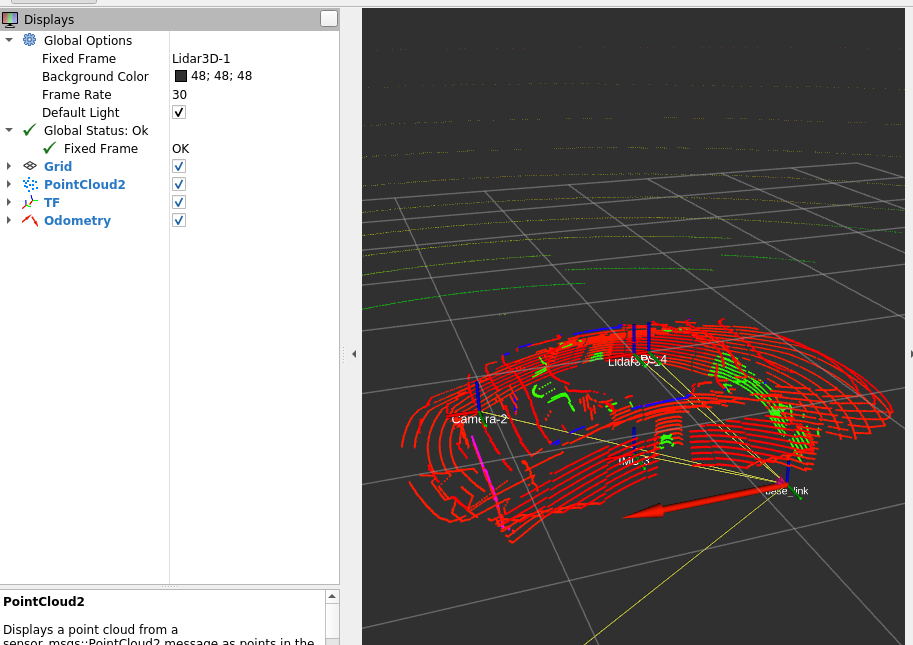

# ego - ros bridge 만들기
## 왜 fast-lio - ros bridge가 아니라 ego - ros를 먼저 만드냐?
- 판단 팀에서 개발을 시작할 수 있도록 하는 목적
- 바로 fast-lio를 붙이면 (아마) 값이 많이 튈 확률이 높음
- 그러니 GT인 /Ego_tipic을 보고 그걸로 판단 단에서 주행 로직 개발 가능
- 즉, 이후 목적은 저 Ego_topic을 fast-lio 기반 loc 결과로 교체한 버전의 bridge를 만드는 것
  - 당연하겠지만 Ego_topic은 GT(정답)이니까 대회에선 거의 무조건 제공 X
## bridge의 목적
- 본격적으로 bridge 제작 착수해서, 우리 스택들이 morai에 종속되지 않게 하고
- 판단 단에서 우리 내부 topic명만 보고 개발 가능하게 만들기
```
입력:
  /Ego_topic
  morai_msgs/EgoVehicleStatus

출력:
  /tf
  morai_map -> base_link
```


### config 만들기
- fast lio 안에 `config/velodyne.yaml`가 있긴 한데 서브모듈로 관리할 거니까 우리 쪽에 config 따로 만들기
```bash
mkdir -p ~/AjouNice2026/configs/localization
gedit ~/AjouNice2026/configs/localization/fast_lio_morai_velodyne.yaml
```
- 나중에 만들자 일단 bridge부터

### fast-lio launch wrapper 만들기
- config 우리쪽 꺼 쓰기로 했으니까 그거에 맞춰서 launch도 새로 만들어줘야 함
- 나중에 일단 ego부터 bridge 만들기

### morai_ego -> base_link TF broadcaster 만들기
- `~/AjouNice2026/base_ws/src/tf_pub/src/ego_tf_broadcaster.cpp`
- notes:
  - morai에서 heading 값이 deg로 들어왔었음(ex. 58.123) -> 이거 ros에선 rad 쓰니까 변환해줘야함.

- `~/AjouNice2026/base_ws/src/tf_pub/launch/ego_tf.launch`
- RViz에서 차량을 맵에 올려 보려면 bringup의 map TF launch를 사용한다.
  - `/Ego_topic`을 그대로 받아서 `morai_map -> base_link` TF만 publish한다.
  - `/localization/odom`은 publish하지 않는다.
  - `tf_pub/map_static_tf.launch`의 `map -> morai_map`까지 같이 켜서 최종 TF는 `map -> morai_map -> base_link`가 된다.
  - MORAI /Ego_topic: `roslaunch bringup maptf_morai.launch`
  - GPS /sensor/gps: `roslaunch bringup maptf.launch`


### bridge test

- rosbag로 bridge 테스트해보자
```bash
# 터미널1
cd ~/AjouNice2026/rosbags
rosparam set use_sim_time true # ROS 노드들이 컴퓨터 현재 시간이 아니라 /clock을 기준 시간으로 사용함
# 이거 우리 rosbag에 /clock이 안 담겼었음 그래서 clock도 새로 만들어서 publish해주게 함
rosbag play morai_local_valid_ego_sensors.bag --clock --loop # loop: 반복
```
```bash
# 터미널2
roslaunch bringup maptf_morai.launch
```

```bash
# 터미널3
rosrun tf tf_echo morai_map base_link
```
- 잘 됐음
- 이제 rviz 테스트

```bash
# 터미널3
rviz
# Fixed Frame: 3D LiDAR-1
# TF, lidar3D
```

- TF 기준으로 차량 방향이 제대로 나와줬음.

### bringup에 통합
- `~/AjouNice2026/base_ws/src/bringup/launch/localization_baseline.launch`
- 이거 해줘야 나중에 fast-lio도 그렇고 저 launch 파일에 하나씩 추가하면서 한 번에 launch 가능
