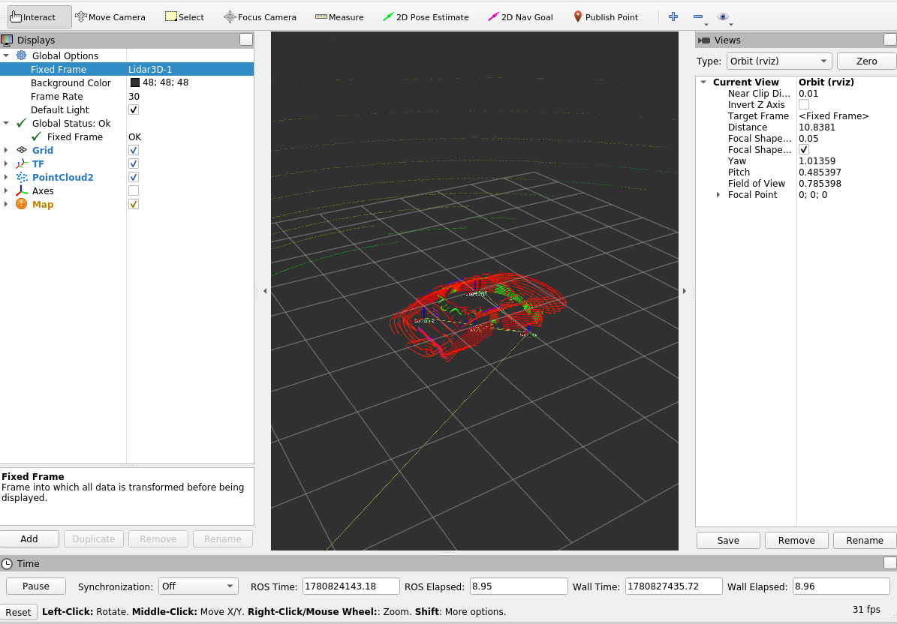

# morai - lidar, imu setup

## 계획

- 일단 FAST-LIO repo를 보고 거기서 어떻게 입력받고있냐를 알아야 bridge 설계가 쉬울 듯 함(그냥 무작정 하는 건 의미없을 듯)'

### FAST-LIO 사용법 분석
- 1. docker vs 2. 직접 소스에 포함시켜서 빌드
    - 위 두 가지 방법이 있는데, 우리 상황에선 2번으로 해서 catkin_make로 같이 build하는 게 나아 보임
    - 지금 docker로 가져가버리면 디버깅이라든지 문제 생길 것 같음
- submodule로 포함시켜서 build하는 게 나을 듯

```bash
# 서브모듈로 일단 추가
cd ~/AjouNice2026
git submodule add https://github.com/hku-mars/FAST_LIO.git base_ws/src/fast_lio
git submodule update --init --recursive
ls base_ws/src/fast_lio
```

### livox_ros_driver 설치
- README에 무조건 `livox_ros_driver` 설치하라고 함.
    - 우린 livox 안 쓸건데... 그래도 의존성 떄문에 일단 설치 
    - 나중에 package.xml에서 그냥 지워버리도록 수정? -> 고민

```bash
cd ~/AjouNice2026/third_party2
git submodule add https://github.com/Livox-SDK/Livox-SDK.git livox_sdk
git submodule update --init --recursive

cd ~/AjouNice2026/third_party2/livox_sdk
mkdir -p build
cd build
cmake ..
make -j$(nproc)
sudo make install
sudo ldconfig

source /opt/ros/noetic/setup.bash
```

```bash
cd ~/AjouNice2026
git submodule add https://github.com/Livox-SDK/livox_ros_driver.git  base_ws/src/livox_ros_driver
git submodule update --init --recursive
ls base_ws/src/livox_ros_driver
```

```bash
cd ~/AjouNice2026/base_ws
catkin build # cb
source ~/AjouNice2026/base_ws/devel/setup.bash # sd
# source /opt/ros/noetic/setup.bash # so
```

### LiDAR 분석
- 공식 repo config 설명:



- 우리는 velodyne LiDAR 쓰니까,
    - `config/velodyne.yaml`에다가 `lid_topic`, `imu_topic` 같은 게 어떻게 들어오는지 적어줘야 함.
    - lid_topic, imu_topic, timestamp_unit, scan_line, extrinsic_T, extrinsic_R

- 저거에 맞춰서, 예를 들어 우리가 morai-ros bridge topic 명을 /sensing/lidar/front/points_raw로 파 놓고 그걸 저기에 입력.

### IMU 분석

### 기초 통신 확인
- 시작 전에, 아래 3개 토픽 받아와지는지 다시 확인
```bash
rostopic list | grep -E "lidar3D|imu|clock"
/lidar3D
/sensor/imu
/clock
```
### fast-lio가 기대하는 필드들을 morai에서 주고 있는지 확인
```bash
rostopic echo -n 1 /lidar3D/fields
x, y, z, intensity, time, ring # 이런 걸 fast lio가 기대함.
# 실제 결과:
ubuntu2004@Yeonwoo-Lee:~$ rostopic echo -n 1 /lidar3D/fields
- 
  name: "x"
  offset: 0
  datatype: 7
  count: 1
- 
  name: "y"
  offset: 4
  datatype: 7
  count: 1
- 
  name: "z"
  offset: 8
  datatype: 7
  count: 1
- 
  name: "intensity"
  offset: 12
  datatype: 7
  count: 1
---
```
- time이랑 ring field 없네...? 와우

### time, ring field가 뭐고 왜 필요하고 우린 왜 없는가
- ring field
  - 이 point가 LiDAR의 몇 번째 laser channel에서 나온 점인지
  - 즉 ring은 point의 수직 scan line 번호임.

- time field
  - 이 point가 한 LiDAR scan 안에서 언제 찍힌 점인지, 즉 scan 시작 기준 상대 시간
  - ex. 10Hz LiDAR면 한 바퀴 도는 데 대략 0.1초 = 100ms 걸리니까, 그 100ms 중에 언제 찍혔냐

- FAST-LIO에서 저 두 field를 요구하는 이유
  - 회전형 LiDAR는 한 프레임의 모든 점이 같은 순간에 찍힌 게 아니기 때문
  - LiDAR 한 프레임 안에서도 점들이 서로 다른 시각에 찍혔다고 보고, IMU로 각 점을 보정하는 deskew 과정을 거쳐야 오차가 줄어드는데,
  - 이걸 하려면 ring, (특히) time이 필요함.

- 사실 ring보단 time이 더 중요

### morai가 /lidar3D에서 ring, time을 안 주는 건 정상인가?
- 정상임. 특히 perception쪽에서는 ring, time은 없어도 되다 보니 그냥 저렇게 정제해서 줄 수 있음.
- 실제 Velodyne driver가 publish하는 raw packet ring, time이 들어있었을 것 같으나,
  - sim 센서 결과를 ROS bridge에서 x,y,z,intensity PointCloud2로 단순화해 내보낸 것 같음.
  - 아마 한 time에서 그냥 time 무시하고 ray casting 결과 다 1프레임에 모아넣어 버린 듯...
- 왜 굳이 그런 선택을 했을까?
    - 아마 sim은 애초에 회전형인걸 구현할 필요가 없이, 그냥 프레임별로 계산해버리면 되니까 사실 이게 더 타당한 방식이긴 한 듯...

### ring, time을 요구하는 게 fast lio만의 특징인가?
- LiDAR-inertial odometry(LIO) 계열 slam들의 특징임.
- 일반 LiDAR 기반 SLAM들은 요구하지 않다고는 하는데, 흠...

### ring, time 없는 이슈를 어떻게 해결할 수 있을까
- 1. MARSIM 모드로 실행하기(이러면 ring, time 없이도 가능하나 오차 커짐) -> 실제 대회에서 쓸 건 아닌 것 같음...
- 2. time, ring 추정하기 -> 이것도 오차 큼 + time은 추정이 가능하긴 하나...? 안 될 듯.
- 3. 드라이버에서 직접 정확한 값 받아오기
    - 안 될 것 같음... sim을 경유할 수가 없음.
- 1 vs 2로 비교했을 땐 1이 더 나을 듯
    - 근데 sim이 그렇게 프레임별로 뭉개서 계산을 했으니, 우리도 time 없이 가도 괜찮지 않을까.
    - 일단 해보고 성능 보자.

### 인터넷에 다른 사람들도 비슷한 고민을 하지 않았을까?
- https://github.com/carla-simulator/ros-bridge/issues/416
    - CARLA SIM: 답변 못 맏고 issue가 그냥 묻혀버림
- https://forums.developer.nvidia.com/t/how-to-include-ring-and-time-fields-in-lidar-pointcloud2-for-lio-sam-compatibility/344754
    - ISSAC SIM: 지원 안 하니까 직접 node 짜서 하라고 함
    - 근데 저 node 짜는 건 추정값 계산 아닌가...

### 중간 결론
- 일단 MARSIM mode로 ring, time 없이 가고,
    - 오차가 심하면 나중에 LIO 기반이 아닌 다른 slam으로 교체도 고민

### imu도 fast lio가 원하는 형식대로 필드가 있는지 확인
```bash
rostopic echo -n 1 /sensor/imu

# angular_velocity랑 linear_acceleration를 봐야 함

header: 
  seq: 93
  stamp: 
    secs: 1780570440
    nsecs: 602000000
  frame_id: "imu"
orientation: 
  x: 0.0
  y: 0.0
  z: 0.0
  w: 0.0
orientation_covariance: [0.0, 0.0, 0.0, 0.0, 0.0, 0.0, 0.0, 0.0, 0.0]
angular_velocity: 
  x: 0.0
  y: 0.0
  z: 0.0
angular_velocity_covariance: [0.0, 0.0, 0.0, 0.0, 0.0, 0.0, 0.0, 0.0, 0.0]
linear_acceleration: 
  x: 0.0
  y: 0.0
  z: 0.0
linear_acceleration_covariance: [0.0, 0.0, 0.0, 0.0, 0.0, 0.0, 0.0, 0.0, 0.0]
---

# 하나씩 찍었을 때
# rostopic echo /sensor/imu/angular_velocity
# rostopic echo /sensor/imu/linear_acceleration
x: 0.0
y: 0.0
z: 0.0

```
- 필드는 다 있는데...
- 값이 좋지 않다... 차를 움직였는데도 둘 다 값이 다 0이 나온다...

### imu 결과가 전부 0인 이슈 해결하기
- 일단 정상은 정지 상태에서 `linear_acceleration.z`가 9.8 근처 값(중력가속도)이 나와야 함.
- 그리고 차가 앞으로 갈 땐 `linear_acceleration.x`가, 좌우로 스티어링할 땐 `angular_velocity.z`가 0이 아닌 값이 나와야 함.

### 일단 Ego_topic(실제 차량 ego 정보들을 담고 있는 GT 토픽)을 보자
```bash
rostopic echo /Ego_topic/angular_velocity
x: 0.0
y: 0.0
z: 0.0
```
```bash
rostopic echo /Ego_topic/acceleration
x: -0.012244097888469696
y: 4.353281110525131e-05
z: -0.0009999488247558475
```
- 뭐지? 차량이 거의 멈춰있는 걸로 나옴

### position, velocity, heading을 찍어볼까?
```bash
rostopic echo /Ego_topic/position
x: -12.054893493652344
y: -220.17864990234375
z: 28.821514129638672
---
x: -12.054893493652344
y: -220.17864990234375
z: 28.821514129638672
```
- 차를 움직여도 position이 안 바뀜
- 뭐지... 통신 문젠가?
```bash
rostopic echo /Ego_topic/velocity
x: 0.0011129230260849
y: 6.663904059678316e-06
z: 1.5197627362795174e-05

rostopic echo /Ego_topic/heading
58.86518859863281
```
- 차를 움직여도 속도가 여전히 0에 가까운 수준에, heading도 바뀌지 않음.
- 결론: 내가 morai에서 주행하는 차를 지금 ros에서 보고 있지가 않음. 뭐지...

- wsl --shutdown 및 morai 재부팅 후 재시도
  - 여전히 해결 안 됨 -> 단순 통신 문제는 아닌가?

```bash
rostopic echo /sensor/gps
header: 
  seq: 83
  stamp: 
    secs: 1780818514
    nsecs: 960000000
  frame_id: "gps"
latitude: 37.24729860724102
longitude: 126.76991422515982
altitude: 29.975679397583008
eastOffset: 302595.0
northOffset: 4124145.0
status: 1
```

- 심지어 GPS도 안 바뀜...

### 다시 재부팅 -> 해결됨!
- 다시 wsl --shutdown 후에, ros에서 먼저 roscore, roslaunch 후에 
- morai에서 센서 연결 안 하고 테스트하니,
- 잘 됨! position이랑 velocity 잘 바뀜.
- ctrl_cmd test도 잘 됨.
- 아마 morai에서 disconnect 후 connect하는 걸 안 하고 바로 하니까 잘 되는듯?
  - disconnect 후 connect 다시 하는 거 하지 말자
- 결론: ros 통신 문제였던 것 같다.

- imu, gps도 잘 작동함.
  - imu /sensor/imu/linear_acceleration z 값 9.8로 중력가속도 근처 나옴 -> good
