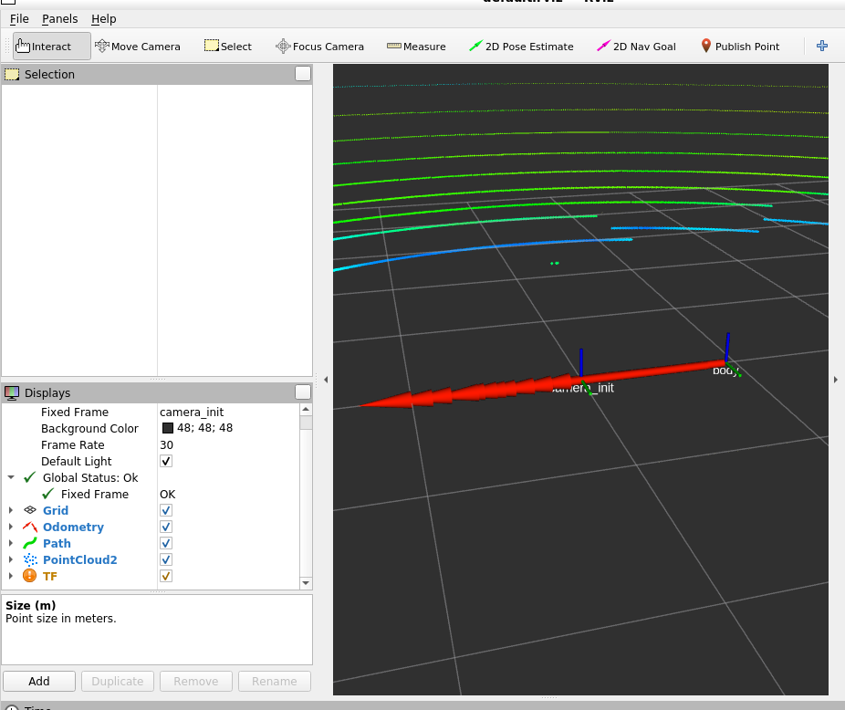
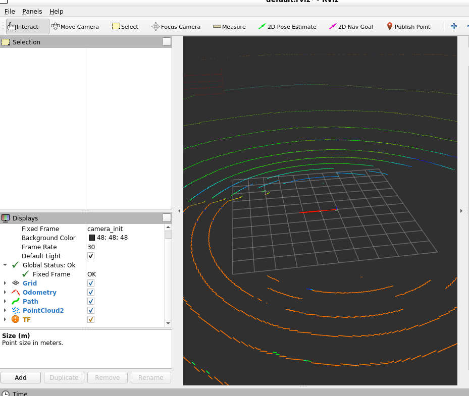

# fast lio - ros bridge 만들기
## 목적
- 앞서 설명했듯 실제 대회에서는 /Ego_topic이 없음
- 그래서 fast lio로 loc(+mapping)을 하게 됨
- 일단 loc부터 하자

# fast lio 분석
## config
- fast lio velodyne LiDAR은 아래 yaml config를 우리가 설정해줘야 함.
- 원본 경로: `config/velodyne.yaml`
- 그러나 아마 우리 repo config/ 에 보관할 듯
```bash
lid_topic
imu_topic
timestamp_unit
scan_line
extrinsic_T
extrinsic_R
```


## 필요 입력
```bash
입력 1:
  LiDAR PointCloud2 -> /lidar3D ?
  sensor_msgs/PointCloud2

입력 2:
  IMU -> /sensor/imu
  sensor_msgs/Imu
```


## 출력 topic이랑 msgs(repo docs 확인)
```bash
/Odometry
  nav_msgs/Odometry
  # FAST-LIO가 추정한 현재 pose/odom
  # -> /localization/odom_lio로 연결

/path
  nav_msgs/Path
  # FAST-LIO odometry 궤적
  # -> /localization/path_lio로 연결

/cloud_registered
  sensor_msgs/PointCloud2
  # 추정 pose 기준으로 정합된 현재 point cloud
  # -> /localization/cloud_registered로 연결

/Laser_map
  sensor_msgs/PointCloud2
  # FAST-LIO map/local map 계열 point cloud
  # -> /mapping/local_map로 연결
```

## fast lio marsim mode rosbag으로 실행

- `~/AjouNice2026/configs/localization/fast_lio_morai_marsim.yaml`
  - docs/3.md에 올린 대로, 우린 ring/time이 없으므로 marsim mode를 써야 함
  - 기존 yaml은 velodyne mode

- `~/AjouNice2026/base_ws/src/bringup/launch/fast_lio_morai.launch`

- rosbag --loop 시켜놓고,
```bash
# 터미널3
roslaunch bringup fast_lio_morai.launch
```

```bash
# 터미널4
$ rostopic list | grep -E "Odometry|path|cloud_registered|Laser_map"
/Laser_map
/Odometry
/cloud_registered
/cloud_registered_body
/path

$ rostopic hz /Odometry
subscribed to [/Odometry]
WARNING: may be using simulated time
no new messages
# 이거 loop 돌리니까 
# [ERROR] [1780836802.030010769, 1780824136.510319333]: lidar loop back, clear buffer 
# 라고 나오면서, odom을 만들 만한 충분한 데이터가 버퍼에 안 쌓여서 저런 것 같음
# rosbag을 괜히 10초만 찍었다... 다음엔 더 길게 하고, 일단은 --pause 쓰고 --loop 지울까?
# rosbag play morai_local_valid_ego_sensors.bag --clock --pause
# loop 빼도 똑같이 clear buffer가 나오네? 흠...

$ rostopic echo -n 1 /Odometry
```

### rosbag 안에 LiDAR아 loop back하는 이슈
- `scripts/experiments/rosbag_legacy/lidar_loop_back_test.py`
```bash
/lidar3D: count=72, backward=19
/sensor/imu: count=107, backward=0
```
- 스크립트를 짜서 확인해보니까, 하나의 rosbag 안에서도 LiDAR에서 loop back이 발생함
- /lidar3D의 `header.stamp` 기준
- 이전 LiDAR 메시지 시간보다 다음 LiDAR 메시지 시간이 더 과거다
- FAST-LIO는 LiDAR scan 시간이 계속 증가해야 한다고 가정하는데, 그렇지 못하고 loop back이 일어나니까 clear buffer를 한 것

- 아마 이유를 생각해 보면
- rosbag은 bag_time이랑 header.stamp를 따로 기록하는데,
- rosbag 재생 순서는 bag_time, fast-lio가 보는 건 header.stamp 순서라서 불일치가 발생하는 듯
- IMU는 그런 일이 없는데 LiDAR만 그런 걸 봐선, LiDAR 메시지가 크니까 통신 과정에서 지연이 생겨서 순서가 섞였다? -> 이게 맞는 듯

### 해결 방법 생각
- 일단, 나중에 morai에서 실제로 돌릴 때도 이런 일이 일어날수도 있긴 함 -> 지금 rosbag 수정하는게 임시방편일 수도 있다는 말
- 순서가 항상 일정하도록 받는 방법은 없어보이고,
  - 일단 offline test에서는 rosbag 자체를 수정하고 나중에 생각
  - header.stamp = bag record time로 바꿔버리자

- 아마 나중에 online test에서도 뭔가 노드 하나 만들어서 header.stamp 값 현재 시간값 등으로 덧씌우는 방법 되지 않을까?
  - 나중에 생각

### valid rosbag 생성
- `scripts/experiments/rosbag_legacy/valid_rosbag_maker.py`
- `~/AjouNice2026/rosbags/morai_local_valid_ego_sensors_fixed_time.bag`

- `scripts/experiments/rosbag_legacy/valid_rosbag_check.py`

```bash
/lidar3D: count=72, backward=0
/sensor/imu: count=107, backward=0
```
- 오! 순서 재정렬됐음.

### valid rosbag으로 fast-lio 실행
- `rosbag play morai_local_valid_ego_sensors_fixed_time.bag --clock`

- in-loop back 사라졌음.
```bash
$ rostopic hz /Odometry
average rate: 18.462
        min: -8.380s max: 0.277s std dev: 0.81360s window: 110
average rate: 16.627
        min: -8.380s max: 0.277s std dev: 0.78570s window: 118

$ rostopic echo -n 1 /Odometry
header: 
  seq: 24
  stamp: 
    secs: 1780824138
    nsecs: 512292624
  frame_id: "camera_init"
child_frame_id: "body"
pose: 
  pose: 
    position: # 이거 map 전체 기준이 아니라, fast lio 시작 시점 기준 local odom이라서 숫자 작은 거임
      x: -0.257904270496682
      y: -0.0029690180777939175
      z: -0.0015170527739935189
    orientation: 
      x: -2.8087129562079956e-06
      y: -6.538742650932147e-05
      z: 0.0003072679945442162
      w: 0.9999999506514866
  covariance: [3.16862190348835e-10, 2.1398923755463942e-12, 3.2942834589119414e-11, 8.836586496360885e-10, -2.571978727710838e-09, -2.202358889891875e-09, 2.1398925585981603e-12, 2.4693346260991345e-10, 6.933868909604204e-11, 5.207666841675605e-09, -1.9463946970139362e-10, 4.1822025819060957e-10, 3.294283411416624e-11, 6.933868924040031e-11, 6.120754165658826e-09, 1.5762747143606352e-07, -1.5665492242348332e-08, 3.244444913265927e-10, 8.836585324806776e-10, 5.207666852530544e-09, 1.5762747146688096e-07, 1.814442127961467e-05, -9.02850866621165e-07, 7.547063463198753e-08, -2.571979071359622e-09, -1.9463947903915623e-10, -1.5665492244757945e-08, -9.028508666218519e-07, 5.158360353433969e-06, -1.2829832874770513e-08, -2.20235890897509e-09, 4.1822029648404846e-10, 3.244444922348904e-10, 7.547063463147129e-08, -1.2829832874685889e-08, 3.20774016475073e-07]
twist: 
  twist: 
    linear: 
      x: 0.0
      y: 0.0
      z: 0.0
    angular: 
      x: 0.0
      y: 0.0
      z: 0.0
  covariance: [0.0, 0.0, 0.0, 0.0, 0.0, 0.0, 0.0, 0.0, 0.0, 0.0, 0.0, 0.0, 0.0, 0.0, 0.0, 0.0, 0.0, 0.0, 0.0, 0.0, 0.0, 0.0, 0.0, 0.0, 0.0, 0.0, 0.0, 0.0, 0.0, 0.0, 0.0, 0.0, 0.0, 0.0, 0.0, 0.0]
---
```
- 정상적으로 fast-lio 돌고 있다!

```bash
$ rostopic echo /Odometry/pose/pose/position
x: -0.052692670309491985
y: 0.0023371277436988673
z: -0.00047135594602941113
---
x: -0.06225662918123424
y: 0.003932975448593868
z: -0.0004451346270252606
---
x: -0.06285703318998895
y: 0.004124047387686946
z: -0.00042810273943628984
```
- 이동함에 따른 loc 결과 pos 변화도 잘 나옴 

```bash
# FAST-LIO가 자기 localization 결과를 이용해서 LiDAR point cloud를 월드 좌표계에 정합해서 publish한 결과물
$ rostopic hz /cloud_registered
subscribed to [/cloud_registered]
WARNING: may be using simulated time
average rate: 7.795
        min: 0.000s max: 0.276s std dev: 0.07910s window: 8
average rate: 7.701
        min: 0.000s max: 0.276s std dev: 0.07013s window: 15
```

- 참고) `subscribed to [/cloud_registered]`는 우리가 아까 use_sim_time true로 하고 갔으니까,
  - 이거 loop back이나 시간 멈추는 등 sim time이 잘못 기록됐을 경우, hz 계산 이상해질 수 있다고 그냥 안내해주는 거임
  - 문제 X

- 나중에 시간될 때 path도 보자(poses 나올 듯)

### rviz에서 보기
- loop 못 쓰니까, 일단 임시로 느리게 재생하자 ㅠ
- `rosbag play morai_local_valid_ego_sensors_fixed_time.bag --clock -r 0.2 --pause`
- `rviz`
- By topic에서 /Odometry, /path, /cloud_registered 토픽 키기



- rviz에 loc 결과 및 path, pcd가 출력됨
