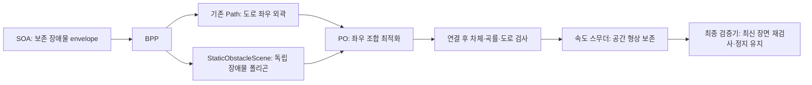

# SOA 장애물 폴리곤 분리와 PO 회피 후보 검증

작업 기준: `632b1268` 이후 로컬 변경. 아래 결과는 `final_native_v14`의 동결 소스·설치 바이너리로 검증했다.

## 최종 재생 결과: `final_native_v14`

- 한 바퀴 백을 제외한 최근 회피 백 **15개 전체**, 별도 `rosbag play`의 **1배속 입력·200Hz 시계**, BPP → BVP → EB → PO → MVP → 속도 스무더 → 검증기까지 재생했다.
- **15/15 형상·장면 동기화·출력 수·실제 발행 간격 검사 통과**. PO **2,577개**, 최종 출력 **2,602개**.
- 실제 검사 장면과 연결한 최종 양수 속도 구간의 **관측 장애물 침범 0, 도로 이탈 0, 진행 방향 역전 0**. 독립 기록기의 최신 장면 기준으로도 침범 0이다. 장애물 활성 구간의 PO 초기 자세·전방 10m 곡률 위반도 0이다.
- 노드 비정상 종료, 장면 누락, 잘못된 장애물 폴리곤, PO/최종 출력의 검사 기록 연결 누락 0.
- 실제 PO 발행 간격의 보수적 상한 **최대 249.001ms**. PO 계산 최대 **248.572ms**. 기록기 수신 간격 최대는 **500.689ms**로 별도 보존했다. 100ms 이내 계산을 보장하는 결과는 아니다.
- **20:42:01과 01:09:55의 PO·최종 정지 모두 0프레임**. 15:10:18도 최종 정지 0프레임이다.
- 전체 최종 정지 출력은 **297프레임**이다. 이 중 **207프레임은 기록된 현재 차체가 관측 하드 여유와 이미 겹친 경우**, **90프레임은 현재 마진 겹침이 없는 경우**다. 후자는 선행 단계·최신 관측·차체-마진 거리·경로 정렬을 따로 기록했다. 현재 차체가 겹치지 않는 것만으로 전방의 경로가 안전하거나 감속 여유가 충분하다는 뜻은 아니다.
- 검증기 경고는 **최소 종가속 6, 횡저크 11, trajectory shift 131프레임**이다. 경고 임계값을 완화하거나 경고를 통과 수에 숨기지 않았다.
- **15개 전부 무정지 주행 성공이라는 뜻은 아니다.** 기록된 자차 위치·속도는 새 회피/감속 명령에 따라 바뀌지 않는다. 관측 형상에 대한 계획 검증과 실제 GT 차체 회피·조향 추종·제동 완료를 구분한다.

[백별 결과·정지 구간·주요 로그](../../planner_logs/obstacle_scene_regression/final_native_v14/report.md) · [마진 비중첩 정지 상세](../../planner_logs/obstacle_scene_regression/final_native_v14/nonoverlap_stops.md) · [최종 집계 JSON](../../planner_logs/obstacle_scene_regression/final_native_v14/overview.json)

### 남은 정지의 구체적 근거

현재 차체가 관측 마진과 겹치지 않은 90프레임을 같은 출력 header의 선행 단계와 비교했다. 최초 0 속도 관측은 **PO 83, 최종 검증기 7, 속도 스무더 0, MVP 0**이다. 이는 단계별 관측 집계이며, throttle된 인접 로그만으로 모든 프레임의 QP 실패 사유를 증명한 것은 아니다.

| 백 / 구간 | 확인된 사실 | 해석의 범위 |
|---|---|---|
| 19:39:26 +7.251~9.328s | 새 관측으로 기존 경로가 막힘. +7.438s 로그의 기존 경로 clear 7.20m, 필요한 감속 거리 7.75m | 1m 정지 여유를 빼면 사용 가능 거리는 6.20m다. 차체가 아직 장애물과 겹치지 않아도 기존 경로로 계속 진행할 근거가 되지 않는다. 다른 모든 비볼록 경로의 부재를 증명한 것은 아니다. |
| 16:34:47 +11.271~16.104s | 첫 부분은 clear 7.20m에서 1m를 뺀 6.20m가 감속 필요 거리 6.98m보다 작음. 뒤에는 기록 위치와 출력 경로 간 거리 최대 2.275m | 기존 경로의 정지 여유와 현재 자세 정렬을 함께 검사해야 한다. |
| 15:46:31 +14.208~15.315s | 기록 위치와 해당 출력 경로의 최근접 거리 1.775~2.145m. 인접 PO 로그는 `no aligned previous path` | 새로운 경로를 추종하지 않는 기록 위치를 고정 주입하는 조건이다. 속도 스무더가 정지 요청 해제 후 0에 붙잡히는 과거 결함은 이 최종 실행에서 재발하지 않았다. |
| 15:14:18 +9.406~10.917s | 거리 1.407~2.081m. 원본 충돌은 이미 +8.196s에 기록됨 | 수정 경로를 발행해도 원본의 충돌 이후 자차 위치가 바뀌지 않는다. |

기존 emergency 로그의 `clear distance A < B` 표현에서 A는 **1m 여유를 빼기 전 거리**이고, 실제 조건은 `max(0, A - 1m) < B`다. 따라서 A가 B보다 조금 크더라도 정지 분기로 들어갈 수 있다. 위 표는 실제 비교식을 기준으로 해석했다.

## 변경 구조

- SOA의 `optimization_base`는 도로 좌우 경계를 잘라 장애물을 붙이지 않는다.
- BPP는 도로 경계가 있는 기존 Path와, 같은 header stamp의 `StaticObstacleScene`을 발행한다.
- 기존 Path/PathWithLaneId 메시지의 필드와 MD5는 변경하지 않았다.
- PO는 정확히 일치하는 장면을 사용한다. 장면 누락/좌표계 불일치는 정지 처리한다.
- 각 장애물의 좌우 통과 조합을 후보로 풀고, 차량 사각형의 이동 영역과 도로를 검사한다. 시간 예산으로 미룬 조합은 다음 주기에 새 입력으로 순환 검사한다.
- 후보 실패는 채택 경로 이력을 덮어쓰지 않는다. 이전 경로도 최신 장애물로 재검사한다.
- 경로 연결과 재샘플링까지 수행한 결과를 검사한 후 후보를 선택한다. 선형화 오차가 있으면 최대 3회 다시 선형화한다.
- 하드 마진은 부등식 제약, 소프트 마진은 슬랙 비용이다. 기본 장애물 슬랙 가중치는 100이다.

### 입출력 계약



도로에서 장애물을 빼는 의미를 별도 제외 폴리곤 제약으로 표현한다. 도로 경계에 장애물을 연결하는 선을 만들지 않는다. 차량을 점으로 보지 않으며, 하드 제약은 차체 전체를 덮는 원으로 계산하고 최종 경로는 회전하는 사각 차체로 확인한다.

하드 여유는 반드시 만족해야 하는 제약이다. 소프트 여유는 슬랙을 허용하며 비용을 부과한다. 후보는 원래 경로 편차, 소프트 여유 침범, 직전 경로와의 차이를 비교해 선택한다. 장애물이 커졌을 때는 새 제약으로 다시 풀고, 직전 경로 유지 여부도 새 폴리곤으로 다시 판단한다.

## 재현하여 수정한 결함

1. **SOA 형상 확대 시 잘못된 convex hull 출력 사용**
   - 기존 `updated.envelope_poly`에 점이 있는 상태로 Boost convex_hull을 호출했다.
   - 출력 링에 점이 추가되어 자기 교차 폴리곤이 만들어졌다.
   - 20:40:05 백을 재생한 round2의 5.096초 장면에서 12점의 자기 교차 링 확인.
   - 새 빈 폴리곤을 출력으로 사용하며, 20회 연속 확대해도 유효하고 이전/새 관측을 모두 포함하는 회귀 검사 추가.
2. **SOA 활성화와 완료 조건 불일치**
   - 최적화 모드는 shift line이 없는데 활성화가 shift line을 요구했다.
   - 완료 판정도 차량 후단 통과 전에 lanelet/참조 경로 창 변화로 성공 처리할 수 있었다.
   - 활성화·실행·완료를 같은 보존 장애물 수명에 맞췄다.
3. **과거 경로와 현재 자차 상태의 중복 고정**
   - 현재 자차 초기 상태와 이미 지난 구간의 과거 최적화 상태가 동역학 제약에서 충돌했다.
   - 진단 재생에서 도로 하드 제약을 제거해도 불능이지만, 고정 상태 제거 시 해가 나오는 경우 확인.
   - 현재 자차 전의 고정 등식은 해제하고 현재 자차 상태를 고정한다.
4. **최적화 후 형상 변환의 충돌**
   - 최적화의 방향각과 경로 재샘플링이 재구성한 방향각이 달라, 원시 해만 검사하면 모서리 충돌을 놓칠 수 있었다.
   - 실제 발행 형상의 사각 차량 이동 영역으로 검사하고 필요하면 다시 최적화한다.
5. **장애물 모서리의 과도한 보수성**
   - 원형 차량 제약의 금지 구간을 장애물의 전체 사각 범위로 잡지 않는다.
   - 폴리곤과 원의 합집합 확장 영역이 횡단선과 만나는 구간을 선분별 극값으로 구한다.

6. **속도 스무더가 검증된 경로의 형상을 변경**
   - 시간 간격 재샘플링에서 위치 및 방향각을 다시 계산했다.
   - 20:42:01 재생의 4.1초 구간에서 PO→스무더 방향각이 약 0.21rad 달라졌고, 최종 경로의 차체 모서리가 하드 여유 안으로 들어갔다.
   - 종방향 해를 원래 공간 경로에 단조 투영한다. 원래 정점·방향각, 새 정지 지점, 출력 끝점을 보존한다.
   - 해당 백의 최종 침범은 round7 23프레임에서 round8 0프레임으로 감소했다.
7. **도로 경계 갱신의 유효한 빈 구간 삭제 처리**
   - 폴리곤 양 끝이 같은 경계 선분에 있으면 삭제할 기존 정점이 0개다.
   - 이 정상적인 경우를 역전 인덱스로 오인해 폴리곤 전체를 버렸다. 빈 erase 구간을 허용해 정상 삽입한다.
8. **상위 정지 명령을 최종 검증기가 과거 속도로 대체**
   - 현재 궤적 전체가 0 속도여도 형상 연속성 검사 실패 시 이전 경로의 양수 속도로 돌아갈 수 있었다.
   - 정지 요청은 유지하며, 유한값/크기 오류가 있으면 이전 유효 형상에 0 속도를 적용한다.
9. **새 참조 좌표계에 과거 경계 값 복사**
   - 장애물 후보에서는 매 프레임 실제 도로 경계를 사용한다. 기존 cutout 확대·경계 고정 휴리스틱을 적용하지 않는다.
   - 직전 공간 경로도 재선형화의 시작점으로 시도하지만, 현재 장면으로 전체를 검증한 경우만 채택한다.

10. **차체 원 근사가 사각형 전체를 덮지 못함**
    - 폭의 절반 반지름만 쓰면 범퍼 모서리와 인접 원 사이의 차체 가장자리가 빠진다.
    - 각 원이 담당하는 차체 구간의 가장 먼 모서리까지 덮는 반지름을 계산한다. 도로 및 장애물 제약과 실제 차체 검사를 일치시킨다.
11. **초기 상태의 근사 제약과 실제 형상 불일치**
    - 현재 자차는 고정된 상태이므로 실제 사각형으로 도로 하드 마진과 장애물 여유를 직접 검사한다.
    - 이 검사를 통과한 현재 상태에만 중복된 선형 근사 원 제약을 생략한다. 미래 상태의 하드 제약은 유지한다.
12. **원시 MPT 경로를 검증된 직전 경로로 오인하여 재사용**
    - 실제 발행 전의 crop/속도·정지점 삽입/연결/재샘플링을 모두 적용한 형상으로 후보를 검사한다.
    - 실제 발행한 경로를 별도 보관한다. 일시 실패 시 최신 도로·장애물로 재검사하고, 재샘플링 없이 형상을 유지한다.
    - 재샘플링 후 물리 조향 한계를 넘는 곡률도 다시 최적화하거나 안전한 접두 구간에서 정지한다.
13. **시뮬레이션 시간 리셋 후 장면 캐시**
    - 시간이 역행하면 과거의 미래 stamp를 제거한다. 그렇지 않으면 100개 캐시에서 새 장면이 즉시 삭제되어 계속 정지할 수 있다.

14. **도로 이탈 검사와 발행 형상의 불일치**
    - 도로 검사도 연결·재샘플링을 마친 실제 발행 형상에 적용한다.
    - 샘플 수가 아닌 거리로 검사 범위(47.5m)를 유지하여, 0.5m MPT 점과 0.2m 출력 점의 간격 차이를 처리한다.
15. **조향속도 제한을 무효화하거나 과도하게 누적하는 속도 필터**
    - 5m 곡률 계산만으로 짧은 회피 굴곡이 약하게 평가될 수 있어 1m 곡률도 함께 검사한다.
    - 평균 필터로 조향 변화율의 최대값을 없애지 않는다.
    - 조향속도 제한보다 `min_curve_velocity=4.1667m/s` 선호값이 우선하지 않게 한다.
    - 이미 제한된 점을 이웃 평균으로 반복 비례 축소하지 않고 양 끝점에 계산한 상한을 직접 적용한다.
    - 20:42:01 초기 경로의 (70.066, 400.627)m 점: 횡가속 필터 후 6.024m/s, 조향속도 상한 적용 후 0.922m/s. 반복 비례 축소 방식은 같은 점을 불필요하게 0.245m/s까지 낮췄다.
    - 별도 debug 재생 `direct_steer_204201`에서 필터 출력의 설정 조향속도 상한 초과 선분은 0개였다(설정 곡률 활성 기준 0.02, 오차 1e-4rad/s). 이는 필터 단계 검사이며 후속 종방향 최적화 전체의 통과 판정이 아니다.

16. **SOA와 DOA가 같은 UUID를 서로 다른 형상으로 중복 처리**
    - SOA가 독립 제외 폴리곤으로 처리한 객체를 DOA가 예측 경로 기반 cutout으로 다시 도로 경계에 붙였다.
    - 17:51:06 재생의 22.520→22.620초에 같은 차체 위치의 도로 여유가 0.597m에서 일부 침범(0.0024m²)으로 바뀌었다.
    - 정적 교차로 경계와 동적 도로 확장 직후의 별도 진단으로, 도로가 잘리는 지점이 이후의 장애물 cutout 단계임을 확인했다.
    - SOA가 보존하는 동일 UUID의 공간 제약은 SOA가 맡고 DOA의 중복 cutout을 생략한다. 다른 UUID의 동적 회피와 MVP의 예측 기반 속도 안전성 처리는 유지된다.
    - 이 소유권은 SOA의 보존 수명 동안 유지된다. 최초부터 이동 중인 객체와 정적 등록 후 실제로 움직이기 시작한 객체의 주행 검증은 이번 정적 GT 백 범위와 구분해야 한다.
17. **계산 중 새 장면이 생겼을 때 최종 발행 경로가 오래된 장면을 사용**
    - 실제 수신 순서를 기록한 17:51:06 1배속 실행에서 새 관측 후에도 기존 장면의 경로가 후단에서 발행되는 3프레임을 확인했다.
    - 최종 검증기는 새 장면을 받을 때 이미 발행한 경로를 재검사하고, 이후 들어오는 정상/과거 경로에도 같은 최신 장면 검사를 적용한다.
    - 같은 공간 형상에서 제동 가능한 접두 구간을 사용하며, 현재 차체가 이미 겹치거나 제동 거리가 부족하면 0 속도를 요청한다.
    - PO와 동일한 swept rectangle 검사 코드를 motion_utils의 공통 헤더로 옮겨 두 구현의 차이를 방지했다.
    - 새 장면만 수신 / 오래된 양수 속도 경로 재수신 / 안전한 새 우회 경로 / 현재 차체 침범 / 장면 해소 및 출력-검증 장면 연결을 포함한 별도 ROS 검사 7개 통과.
    - 장면을 별도 콜백 큐에서 수신하고 발행 직전에 큐를 비운다. 검증 계산 중 수신된 장면보다 오래된 궤적 콜백이 먼저 발행되는 순서를 막는다. 새 궤적이 없을 때도 10ms wall timer가 장면을 처리해 이전 출력을 재검사한다. 형상 검사 도중 다른 장면이 큐에 도착한 경우도 발행 전에 다시 검사한다.
18. **SOA 종료가 지도상의 교차로 외곽을 축소**
    - `final_realtime_v3`의 17:51:06 백 27.995→28.080초에 SOA 종료로 교차로 확장 플래그가 사라져, 왼쪽 외곽이 x≈66m에서 x≈69.9m로 갑자기 바뀌었다. 직전 경로의 차체 일부가 새 차선 경계 밖으로 분류됐다.
    - 지도상의 교차로 영역 사용을 BPP의 `drivable_area_use_intersection_areas`로 독립시켰다. 통합 설정은 true이며 SOA 실행·종료와 무관하게 지도 교차로 외곽을 사용한다. 기존 개별 모듈의 확장 요청도 유지된다.
    - 설치된 오래된 헤더가 수정한 소스 헤더보다 먼저 선택되는 빌드 경로도 BPP 타깃에서 바로잡았다.

19. **속도 형상 보존에서 자차 뒤의 정지 이력을 전방 정지로 전파**
    - 이번 작업에서 추가한 형상 보존 함수가 전체 속도 프로파일의 첫 정지점을 찾았다. 스무더가 연속성을 위해 복사하는 과거 구간에도 정지점이 있을 수 있다.
    - 16:40:06 백의 9.340/9.470/9.545초에 PO/MVP는 정지점 없이 8.333m/s를 내는데 VS가 현재 위치 이후를 0으로 만드는 3프레임을 확인했다.
    - 단위 검사에서 과거/초기 0을 전방 전체 정지로 잘못 전파할 수 있음을 재현했다. 현재 자차 인덱스를 형상 보존 함수에 전달하고 전방에서만 정지 제약을 찾는다. 과거 정지 후 재출발, 과거 정지와 새로운 전방 정지의 공존, 전방 긴급정지 보존, 현재 위치의 출발 속도 0 및 상위 모듈의 명시적 정지까지 포함해 회귀 검사 5개를 추가했다.

    - 16:40:06 단독 재생에서는 해당 구간이 양수 속도로 나오고 정지 3프레임 모두 입력 마진 침범과 겹쳤다. 다만 비동기 전체 체인의 내부 속도 해가 매 실행에서 같지는 않으므로, 이전 3프레임 전부를 이 단일 원인으로 확정한 것은 아니다.

20. **PO 재샘플링이 전체 경로의 방향각을 반대로 생성**
    - `final_realtime_v7`의 01:09:55 +11.129초에서 점들은 전진 방향으로 이어졌지만 yaw가 약 π만큼 뒤집혔다. 다음 5개 정지 프레임에서 직전 경로와 자차의 위치 차이는 0.004~0.072m인데 방향각 차이는 약 -3.109rad였다.
    - 공통 pose 재샘플링은 첫 두 점으로 전진/후진을 추정한다. 최적화된 뒤쪽 첫 선분이 변형되면 이 추정이 경로 전체 방향각에 적용됐다.
    - 전진 입력만 처리하는 PO의 최종 연결/재샘플링은 이미 확정된 전진 모드로 방향각을 생성한다. 공통 유틸리티의 기본 추론과 명시적 후진 지원은 유지한다.
    - 방향 추정이 잘못될 수 있는 입력으로 전진/후진 명시 모드를 검증했다. 외부 재생 검사에도 전방 양수 속도 구간의 진행 방향·방향각 불일치를 추가했다.
21. **정지 요청 해제 후 과거 속도 0으로 재출발 상태를 고정**
    - `final_realtime_v7`의 15:46:31 +15.089~15.931초에 PO/MVP는 8.333m/s이고 전방 정지점도 없는데 VS는 전방 전체가 0인 8프레임을 출력했다.
    - 초기 상태 계산은 직전 목표 속도를 유지하고, 실제 속도와의 차이가 `replan_vel_deviation=5.53m/s`를 넘어서야 측정 속도로 복귀했다. 이번에는 실제 속도가 약 5m/s여서 전환되지 않았다.
    - 별도 ROS 입력으로 정상 주행→전체 정지 요청→주행 중 정지 해제를 재현했다. 수정 전 해제 출력은 0.0065006m/s, 수정 후 5.0000019m/s였다.
    - 직전 전방 경로 전체가 0이고 상위 정지가 해제됐으며 차가 움직이는 경우는 별도 상태 전이로 처리한다. 측정 속도와 제한 범위 내 측정 가속도로 초기화한다. 실제 정지 상태에서는 기존 engage 처리를 사용한다.
    - 정상 주행 / 움직이는 중 정지 유지 / 움직이는 중 정지 해제 / 정지 상태 유지 / 정지 상태 출발 5개 모두 통과했다.

`final_realtime_v7`은 당시의 형상·출력 검사 15/15를 통과했지만 위 두 결함을 정지 원인 분석에서 발견하여 최종본으로 채택하지 않았다. [당시 결과](../../planner_logs/obstacle_scene_regression/final_realtime_v7/report.md)와 [정지 프레임](../../planner_logs/obstacle_scene_regression/final_realtime_v7/nonoverlap_stops.md)을 보존했다. 01:09:55의 +14.033초 정지는 직전 경로와의 방향각 차이 0.409rad로, π 반전 사례와 구분한다.

22. **새 후보의 최종 형상과 측정 초기 자세 정렬 누락**
    - QP 내부의 현재 상태 고정과, 위치를 재샘플링한 뒤의 방향각은 같지 않을 수 있다.
    - 새 후보도 이전 경로 재사용과 같은 측정 자세 조건(위치 1m, 방향각 0.35rad 이내)을 만족해야 채택한다. 조건을 만족하지 못하면 실제 발행 형상으로 다시 선형화한다.
    - 같은 조건 함수를 신규 후보와 재사용 경로에 적용하며, 방향각 0.5686rad 및 위치 1.01m 차이를 거부하는 검사 추가.
23. **1m 평균 곡률이 0.2m 간격의 짧은 굴곡을 놓침**
    - `final_realtime_v8`의 01:09:55 +14.834초 경로에서 인접 방향각은 1.471→1.886→2.164rad였다. 점 사이 거리는 약 0.2m인데, 1m 범위의 세 점으로 계산한 곡률만 검사해 이 굴곡을 놓쳤다.
    - 당시 최초 발행 위치에서 자차와 방향각 차이는 0.290rad였고, 조금 이동한 뒤 직전 경로의 다음 점과는 약 0.569rad 차이가 났다. 최초 위치 정렬만으로는 충분하지 않았다.
    - 최종 형상의 인접 세 점 곡률도 실제 조향 한계 `tan(40deg)/3.0m ≈ 0.2797/m`와 비교한다. 위반하면 후보를 다시 선형화하고, 한계를 만족한 형상만 채택한다.
    - 1m 곡률에서는 작은 값으로 보이는 0.2m 간격의 짧은 흔들림을 회귀 검사로 추가했다. 외부 재생 검사에서도 활성 장애물 구간 PO의 실제 입력 자세 및 전방 10m 인접 곡률을 독립 검사한다.

`final_realtime_v8`은 이전 형상·방향각 검사 15/15를 통과했지만 위 근접 곡률 문제를 발견하여 최종본으로 채택하지 않았다. 해당 실행에서 스무더가 처음 0을 만든 비침범 정지 프레임은 0개로 줄었으나, PO 정지는 별도로 남았다. 20:42:01의 PO 정지는 +7.820초 이후로 원본의 첫 GT 충돌 +7.713초보다 늦었다. 원본 자차가 새 경로를 따라간 결과로 취급하지 않는다.

## 채택하지 않은 성능 실험

`previous_seed_010955`에서는 이전 발행 경로를 첫 최적화 시작점으로 바꿔 보았다. PO 계산 p95는 `final_realtime_v5`의 175.751ms에서 136.387ms로 줄고 최종 출력은 191→204프레임이었지만, 최종 정지가 2→11프레임으로 증가했다. 이 변경은 되돌렸으며 최종 코드에 포함하지 않는다. 동일한 공유 PC에서도 실행 순서와 스케줄링에 따른 차이가 있으므로 이 수치만으로 성능 향상을 보장하지 않는다.

`final_realtime_v5`의 01:09:55는 최종 191프레임으로 설정한 80% 처리량 기준(최소 195프레임)에 미달했다. 이 실행은 형상 침범 0이어도 처리량 통과본으로 취급하지 않는다.

## 계산 시간과 좌우 선택의 연속성

- `final_realtime_v9`는 형상·진행 방향·초기 자세·근거리 곡률 검사를 통과했지만, 20:00:49의 실제 PO 계산 최대 607.492ms / 출력 공백 607.819ms와 일부 백의 출력 부족 때문에 최종 통과본으로 확정하지 않았다.
- 후보 탐색의 기본 시간 예산을 100ms로 설정했다. 한 후보의 QP·재선형화·검증은 끝까지 수행하고, 다음 후보 비용을 직전 비용으로 추정해 예산을 넘길 경우 다음 주기로 넘긴다. **단일 후보를 중단하지 않으므로 100ms의 강제 실행 상한은 아니다.**
- 미검사 좌우 조합은 다음 주기에서 최신 입력으로 순환 탐색한다. 단순 순환 구현은 한 주기에 한 후보만 허용한 고정 장면 검사에서 11번 좌우 전환을 일으켰다. `final_realtime_v10`은 이 결함 확인 후 중단했다.
- 실제 직전 발행 경로도 최신 장애물·도로·현재 자세·곡률·계획 길이를 다시 검사한 뒤 비교 후보에 포함한다. 비용 비교와 새 관측 검사는 새 후보와 함께 수행한다. 초기 정렬은 비상 정지용 재사용보다 엄격하며, 새로운 큰 관측과 충돌하는 옛 경로는 후보가 될 수 없다.
- `small_unknown` → `grown_car` 검사는 이전의 큰 장애물 장면과 시간 리셋으로 분리한다. 같은 ID의 작은 형상에서 큰 형상으로 바뀌는 두 프레임 묶음 사이에는 리셋하지 않는다. 크기가 줄어든 후에도 안전한 기존 우회 경로를 유지하는 현상과, 형상 확대 후 경계를 갱신하지 않는 결함을 구분한다.

### 반복 도로 계산과 재생 입력 주기

`final_realtime_v12`의 01:09:55는 형상·방향·곡률·발행 간격은 통과했지만 최종 출력 191개로 최소 195개에 미달했다. 이 실패도 보존했다. 도로 폴리곤과 시작선 투영점이 경로 점·차체 원·후보마다 반복 계산되고 있었다. `CircleFootprintRoadChecker`는 현재 장면의 불변 형상을 한 번 준비해 사용한다. 다음 장면은 새로 준비하며, 검사 범위나 허용 여유는 바꾸지 않았다. 직선 도로의 해석적 원 여유와 여러 자세를 비교하고 장면 갱신 시 축소된 도로를 적용하는 단위 검사를 추가했다. 단독 `prepared_road_010955`는 195개, PO 처리 p95 137.6ms, 정지 0개였으나 공유 PC 측정의 변동을 고려해 추가 전체 검증 대상으로 남겼다.

초기 재생 도구는 같은 Python 프로세스에서 입력·`/clock` 발행과 출력 기록을 처리했다. 출력 콜백이 밀리면 입력 시계까지 지연될 수 있었다. 최종 `--native-player`는 입력 토픽만 골라 원래 기록 시각의 임시 백을 만들고, 별도 C++ `rosbag play`가 1배속 입력과 200Hz `/clock`을 발행한다. 원본 백은 수정하지 않는다. 처음 지도/경로는 사전 초기화에서 한 번 넣고 같은 메시지를 다시 넣지 않으며, 이후 갱신 메시지는 보존한다. 시작/끝 시각용 독립 토픽으로 원래 재생 구간을 유지한다. 이 변경은 실제 운용 플래너 설정과 분리된 검증 도구 변경이다. 동일한 코드의 01:09:55 비교에서 BPP 208→244개, PO·최종 출력 195→231개, PO 처리 p95 137.6→138.2ms였다. 입력 시계 분리가 출력 수에 미친 영향과 PO 자체 계산 시간을 구분할 수 있다.

## 재생 범위

목록: `planner_logs/obstacle_scene_regression/manifest.json`.
작업 시작 시점 최근 15개 모두 짧은 장애물 구간이다. 이름·길이를 `selection_audit.json`으로 재확인했다. 22.42초/24.31초 백도 한 바퀴가 아닌 짧은 회피 구간이므로 포함했다. 30.79초 백도 실제 장애물 관측 구간은 19.55~30.12초이며 전체 주행 거리는 73.3m이므로 포함했다.

- `round3`: BPP/SOA → EB → PO, 첫 전체 15개 재생.
- `round4`: 현재 자차 고정 및 진단 입력 위치 기록을 추가한 재생. 일부 결과에 재생 도구의 중복 지도 주입 문제가 있어 최종 판정에 사용하지 않는다.
- `full_round5`: BPP → BVP → EB → PO → MVP → 속도 스무더 → 검증기, 실제 시간 재생 15개.
- `full_round7`: 전체 체인 15개. PO 이후 속도 스무더 형상 변경으로 생기는 침범 확인.
- `full_round8`: 형상 보존 후 전체 15개. 최종 양수 속도 경로의 관측 장애물 마진 침범 0프레임.
- `full_round9`, `full_round10`: 초기 상태·경계 이력·정지 전달·차체 원 근사 보완 후 전체 15개 재생.
- `final_exact_clock`: 실제 발행 경로 캐시 재사용 및 정수 nanosecond 재생 시계. 15개, 2,648 PO 프레임, 누락 0. 01:09:55의 회피 중 PO 정지 0프레임.
- `final_v2_lockstep`: 도로 검사도 최종 발행 형상으로 통일한 전체 15개 재생.
- `final_realtime_v3`: 15개 전체, 14개 형상/출력 검사 통과. 17:51:06의 1프레임 장면 순서 문제와 1프레임 도로 축소 문제를 남긴 진단 실행. 최종 통과본으로 취급하지 않는다.
- `synthetic/results.json`: 양쪽 가능 / 왼쪽 차단 / 오른쪽 차단 / 양쪽 차단 / 작은 UNKNOWN / 같은 ID의 큰 CAR / 시계 역행, 7개 회귀 사례.

초기화에는 백의 첫 입력만 사용한다. 초기화한 지도·경로를 다시 주입하지 않는다. 출력 완료 대기 방식의 ROS 시간 지연 0은 실시간 처리 성능을 뜻하지 않으므로, PO의 별도 wall-clock 처리 시간을 함께 기록한다.

실시간 비교에서는 장면과 궤적의 실제 수신 wall time 순서를 기록한다. 장면 header는 계산 시작 시각이므로 최신 header만으로 비교하면 아직 발행되지 않았던 장면이 검사에 섞일 수 있다. 초기 `final_realtime` 실행은 이 수신 기록이 없어 최종 판정에 사용하지 않으며, `final_realtime_v2` 이후 실행에서 전체를 다시 검사한다. 초기 실행의 경고와 실패 산출물도 보존했다.

## 형상 비교 그림

[최종 수정본: 최근 3개 백의 도로 외곽·장애물 폴리곤·PO 경로 SVG](../../planner_logs/obstacle_scene_regression/figures/final_three_scenes.svg)

각 그림은 PO 입력과 정확히 같은 stamp의 도로/장애물 장면을 사용한다. 회색은 SOA envelope, 주황은 hard 여유, 노랑은 soft 선호, 파랑은 선택된 PO 경로다. 차량 중심선 그림이며 차체 폭을 여유에 중복 포함하지 않는다. 원자료는 같은 이름의 JSON에 저장했다.

[도로 외곽·장애물 구멍·속도 스무더 수정 전후 SVG](../../planner_logs/obstacle_scene_regression/figures/geometry_preservation.svg)

그림은 round7/round8의 속도 스무더 형상 보존 수정 비교이며, 이후 PO 보완본과 구분한다.

## 한계와 판정 원칙

- 후보 탐색은 장애물마다 좌/우 조합을 열거한다. 장애물 6개까지이며 초과 시 명시적으로 정지한다. 이번 백의 동시 보존 장애물 최대 수는 3개였다. 이 탐색은 전역 최적해나 모든 비볼록 경로의 존재 여부를 증명하지 않는다.

- 기록된 자차 위치를 강제로 공급하는 재생이다. 새 회피 경로를 실제 차량이 따라가는 폐루프 시험이 아니다.
- 원본 20:42:01, 20:40:05, 15:48:17, 15:14:18, 15:13:03 백에는 실제 충돌 기록이 있다. 수정 경로를 발행해도 기록된 자차는 원래 충돌 위치로 들어간다.
- 관측 폴리곤에 대한 계획 경로 안전과 GT 물체에 대한 실제 주행 안전을 구분한다. 작은 UNKNOWN 관측만으로 전체 GT 차량 형상을 복구했다고 주장하지 않는다.
- 회피 후보 불능, 현재 자차의 마진 침범, 후단 검증기의 개입을 따로 집계한다. 실패를 숨기거나 임계값을 완화해 통과시키지 않는다.

## 속도 및 폐루프 판정 범위

- 실행되는 `JerkFilteredSmoother`는 속도·가속도·저크 상한에 각각 delta/sigma/gamma 슬랙을 둔다(`jerk_filtered_smoother.cpp:174`, `:255`). 초기 v0/a0는 등식이다. 따라서 조향속도 필터의 상한 통과만으로 후속 QP 출력의 모든 물리 제한 통과를 보장할 수 없다.
- 횡가속·최소 종가속·횡저크 검증기 경고는 형상 검사와 별도다. 기존 `PUBLISH_AS_IT_IS` 정책을 경고가 없도록 바꾸거나 임계값을 완화하지 않았다.
- `direct_steer_204201` 진단에서 백 +6.9초 기록 속도는 8.151m/s이고, 감속 요구가 큰 지점은 자차 앞 1.6m였다. 이는 뒤쪽 경로를 검사해 생긴 가짜 경고가 아니다. 기록된 속도를 새 감속 경로에 대한 차량 반응으로 간주할 수 없다.
- `feasible=0` 또는 QP 실패가 모든 프레임에서 사라진다는 뜻은 아니다. 새 최적화가 실패해도 재검사를 통과한 직전 경로를 사용할 수 있고, 해당 실패 진단은 유지한다. 자동 검사 PASS를 최적화 100% 성공률로 읽으면 안 된다.
- 직전 경로 재사용은 최신 장애물·도로·차체·현재 위치와의 정렬을 통과해야 한다. 기준을 만족하지 못하는 경우까지 무조건 계속 진행시키지 않는다. 해당 경우의 0 속도는 별도 정지 구간으로 보고한다.
- 실제 조향 추종, 제동 거리, SOA가 보존하던 정적 객체의 실제 이동 전환은 MORAI 폐루프에서 후속 확인해야 한다.

## 최종 출력과 장면의 연결 근거

최종 검증기의 `debug/static_scene_check`는 실제 검사한 장면의 정수 nanosecond stamp, 자차 위치·방향·속도, 검증 완료 monotonic 시각을 기록한다. 최종 궤적의 ROS 발행 순번과 직렬화 CRC32를 함께 사용해 같은 stamp가 반복돼도 정확한 출력에 연결한다. 외부 검사는 이 장면과 자차 상태로 별도의 Shapely 사각 차체 검사를 수행한다. 새 형식의 결과에서 검증 기록/장면이 누락되면 통과하지 않는다.

독립 기록기가 가장 최근에 받은 장면에 대한 비교도 `final_against_latest_observer_scene`에 그대로 보존한다. 두 토픽의 TCP 전달과 Python 기록 콜백은 순서가 달라질 수 있으므로, 기록기 수신 순서만으로 검증기가 새 관측을 무시했다고 단정하지 않는다. 차이가 있는 프레임은 후속 안전 출력까지의 수신 지연을 `new_scene_responses`에 남기며, 후속 안전 출력이 없으면 자동 검사에서 실패한다. 이 지연은 실제 제동 완료 시간이 아니다.

`final_realtime_v6`의 15:48:17은 기록기 최신 장면 기준 1프레임 침범으로 실패 처리하고 보존했다. 이후 `snapshot_154817`에서 175개 최종 출력 모두 검증 장면과 연결됐고, 실제 검증 장면 기준 침범 0개였다. 최신 기록 장면 기준 차이가 난 1프레임의 검증 완료 시각은 기록기의 새 장면 수신보다 139.37ms 앞섰다. 후속 안전 출력은 새 장면 수신 후 9.09ms에 기록됐다. 이 별도 재현은 앞선 실행의 원인을 소급해 증명하는 자료는 아니다.

## 출력 간격의 시각 기준

`final_realtime_v5` 20:00:49에서 초기 집계가 0.501초 공백을 보고했다. 이 값은 연속 PO 출력의 **입력 header 시각 차이** 0.500311초를 반올림한 값이었다. 기록된 monotonic 수신 시각으로 계산한 실제 PO 출력 공백은 최대 0.444776초였다. 입력 갱신 간격과 실제 발행/수신 간격을 별도 항목으로 보고해야 한다.

같은 실행에서 PO 계산 최대 440.665ms는 실제로 기록됐다. 수신 간격의 정의를 바로잡아도 이 처리 시간이나 갱신 지연을 없었던 것으로 보지 않는다. 공유 PC 부하에서의 관측값이며 hard real-time 보장이 아니다.

### 기록기 정체와 실제 발행 간격

`final_realtime_v11` 17:51:06에서는 Python 기록기의 PO 수신 간격이 503.211ms였다. 그러나 다음 PO 경로를 받은 최종 검증기의 실제 검증 완료는 직전 PO 기록기 수신 후 200.2ms, 그다음 경로는 317.3ms였다. 두 최종 출력은 기록기에 각각 494.7ms/497.2ms에 도착했다. 당시 백 전체 PO 계산 최대는 182.242ms였다. 따라서 이 구간의 수신 간격을 PO의 발행 정체로 단정할 수 없다. 해당 실행의 기존 실패 결과는 보존한다.

이 모호함을 없애기 위해 PO `debug/publication_evidence`에 각 출력의 순번·CRC32·publish 호출 전후 monotonic nanosecond를 추가했다. 외부 기록기는 실제 궤적 바이트와 연결하며, 연결 누락은 실패다. 연속 출력 간격은 `다음 publish 후 − 직전 publish 전`으로 계산한다. 실제 발행 간격의 보수적 상한이므로 호출 내부 지연까지 포함한다. 원래 기록기 수신 간격도 `max_recorder_output_gap`으로 별도 보존한다. 500ms 기준 자체는 변경하지 않는다.

## 재현 명령

```bash
source scripts/workspace/source_aw149.sh
python3 scripts/evaluation/run_static_obstacle_regression.py \
  --full-pipeline --native-player --port 11474 \
  --manifest planner_logs/obstacle_scene_regression/manifest.json \
  --output planner_logs/obstacle_scene_regression/new_run
```

위 명령은 별도 native player를 사용하는 1배속 전체 체인 재생이다. `--native-player` 대신 `--lockstep`을 사용하면 매 출력 완료를 기다리는 결정적 시계 검사로 바뀐다.

각 실행은 전용 ROS master를 시작하고 자신이 실행한 프로세스만 종료한다. 실제 차량 ROS master에는 재생 입력을 보내지 않는다.

## 검사 범위와 실행본

- 최종 설치본 단위 검사: PO 차체/곡률/경계/방향각/초기 자세·도로 스냅샷 12개, MPT 행렬 4개, SOA 유틸리티 20개, 도로 경계 11개, 속도 프로파일·형상 보존 25개. **72개 통과**.
- SOA의 기존 `DISABLED_fillObjectMovingTime` 1개는 원래 비활성 상태이며 실행·통과 수에 포함하지 않는다.
- 기존 지도 fixture 의존 검사 `IntersectionExpansion.KCityBufferedIntersection` 1개는 `SOA_REGRESSION_MAP` 미지정으로 건너뜀. 해당 결과를 통과로 세지 않았다.
- PO 기본 예산 및 한 후보만 허용하는 제한 예산 각각 7개(좌우 선택·차단·형상 확대·시계 리셋·고정 장면 방향 유지), 최종 장면 갱신·출력 연결 7개, 속도 정지 해제 5개, ROS 통합 사례 **총 26개 통과**. PO 통합 출력 168개는 순번·CRC32·발행 시각 연결까지 확인했다. `final_tests/index.json`에 최종 로그 위치를 고정했다.
- `final_build_fingerprint.json`에 기준 HEAD, 수정 소스 및 설치 실행 파일 SHA256을 저장했다.
- 단위/통합 검사와 백 재생은 별도 master에서 수행했다. 운용 중인 master를 재시작하거나 차량 제어 입력을 보내지 않았다.
- 새로운 메시지와 common 구조체 변경이 있으므로 운용 반영 시 **전체 planning 프로세스를 재시작**해야 한다. 설치 완료와 현재 실행 중인 노드의 적용 완료는 구분한다.
