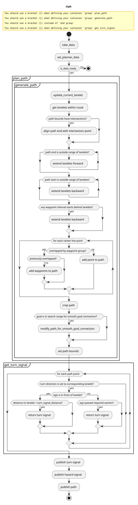

> **Autoware License Notice**
> This file is part of a local planning-reference bundle derived from, summarizing, or reorganizing materials from Autoware Foundation repositories, including Autoware Universe. The upstream Autoware materials are distributed under the Apache License, Version 2.0.
>
> This local copy is kept for AjouNice2026 planning-reference and ROS 1 porting study purposes. Local changes may include pruning, reorganization, format conversion, extracted tables, and generated summaries. This notice does not change the upstream license terms.
>
> See `LICENSE_AUTOWARE_APACHE_2_0.md`, `NOTICE.md`, and `meta/source_repositories.md` in this bundle for license text, attribution notices, and source/version provenance.

# Path Generator

The `path_generator` node receives a route from `mission_planner` and converts the center line into a path.
If the route has waypoints set, it generates a path passing through them.

This package is a simple alternative of `behavior_path_generator`.

## Path generation

When input data is ready, it first searches for the lanelet closest to the vehicle.
If found, it gets the lanelets within a distance of `path_length.backward` behind and `path_length.forward` in front.
Their center lines are concatenated to generate a path.

If waypoints exist in the route, it replaces the overlapped segment of the center line with them.
The waypoints are grouped as shown in the following figure.

## Path cut

If there is a self-intersection on either of the path bounds, the path is cut off a specified distance before the first intersection, as shown in the following figure (path: green, bound: blue).

Depending on the crossing angle, the return path's bound may be closer to the centerline than the outward's one, depicted in the diagram below. To deal with this, intersections of the left and right bounds (mutual intersection) are taken into account as well, and the path is cut at the nearest intersecting point.

Furthermore, in the case of the following figure, the return path goes inside even if mutual intersection is considered. Therefore, path cut is also made when the start edge of the path and the path bounds intersect.

## Goal connection

The path is connected to the goal smoothly in the following way:

(a) The path has not reached the lane where the goal is placed, thus goal connection is not performed.

(b) The path has reached the goal lane and the end is inside the connection section. However, the longitudinal position of the path end is still in front of the goal, so it does not connect the path with the goal.

(c) The path has passed the goal (in terms of longitudinal position). In this case, the original path is cropped up to the connection section, and it is connected to the pre-goal and goal, sequentially. The pre-goal is inserted before the goal with the given offset, which helps align with the goal pose.

(d) If the start of the path is already inside the connection section, it just connects the path start, pre-goal, and goal.

## Turn signal

Turn signal is determined based on the rules defined for behavior\_path\_planner. (See [here](https://autowarefoundation.github.io/autoware_universe/main/planning/behavior_path_planner/autoware_behavior_path_planner_common/docs/behavior_path_planner_turn_signal_design/) for details)

As a general rule, the turn signal is turned on at a specified distance before the lanelet in which a turn is designated, and turned off when the driving direction has changed to the specified degree.

If consecutive turns are required, the turn signal corresponding to the required section or the last section takes precedence.

## Hazard signal

This node always publishes a hazard signal of `autoware_vehicle_msgs::msg::HazardLightsCommand::NO_COMMAND`.

## Flowchart

## Input topics

| Name | Type | Description |
| --- | --- | --- |
| `~/input/odometry` | `nav_msgs::msg::Odometry` | ego pose |
| `~/input/vector_map` | `autoware_map_msgs::msg::LaneletMapBin` | vector map information |
| `~/input/route` | `autoware_planning_msgs::msg::LaneletRoute` | current route from start to goal |

## Output topics

| Name | Type | Description | QoS Durability |
| --- | --- | --- | --- |
| `~/output/path` | `autoware_internal_planning_msgs::msg::PathWithLaneId` | generated path | `volatile` |
| `~/output/turn_indicators_cmd` | `autoware_vehicle_msgs::msg::TurnIndicatorsCommand` | turn signal | `volatile` |
| `~/output/hazard_lights_cmd` | `autoware_vehicle_msgs::msg::HazardLightsCommand` | hazard signal | `volatile` |

## Parameters

| Name | Type | Description | Default | Range |
| --- | --- | --- | --- | --- |
| planning\_hz | float | Planning frequency [Hz] | 10 | ≥0.0 |
| path\_length.backward | float | Length of generated path behind vehicle [m] | 5 | ≥0.0 |
| path\_length.forward | float | Length of generated path in front of vehicle [m] | 300 | ≥0.0 |
| waypoint.connection\_gradient\_from\_centerline | float | Gradient for connecting centerline and user-defined waypoints | 10 | ≥0.0 |
| turn\_signal.search\_time | float | Time to search for start point of desired section [s] | 3 | ≥0.0 |
| turn\_signal.search\_distance | float | Distance to search for start point of desired section [m] | 30 | ≥0.0 |
| turn\_signal.resampling\_interval | float | Resampling interval for section start point interpolation [m] | 1 | ≥0.0 |
| turn\_signal.angle\_threshold\_deg | float | Threshold for determining end point of required section [deg] | 15 | ≥0.0 |
| goal\_connection.connection\_section\_length | float | Length of goal connection section [m] | 7.5 | ≥0.0 |
| goal\_connection.pre\_goal\_offset | float | Offset for pre-goal [m] | 1 | ≥0.0 |

In addition, the following parameters should be provided to the node:

- [nearest search parameters](https://github.com/autowarefoundation/autoware_launch/blob/main/autoware_launch/config/planning/scenario_planning/common/nearest_search.param.yaml)
- [vehicle info parameters](https://github.com/autowarefoundation/autoware_core/blob/main/description/autoware_sample_vehicle_description/config/vehicle_info.param.yaml)
