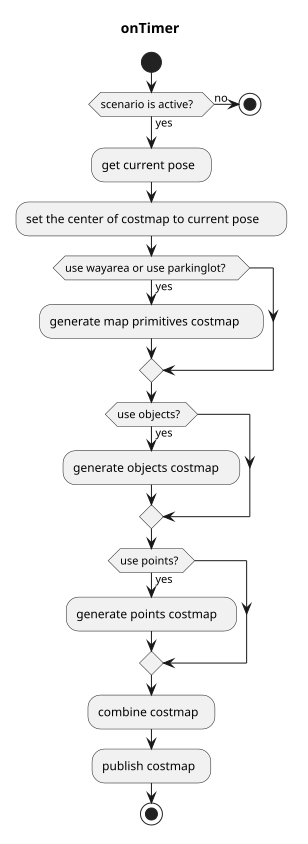

> **Autoware License Notice**
> This file is part of a local planning-reference bundle derived from, summarizing, or reorganizing materials from Autoware Foundation repositories, including Autoware Universe. The upstream Autoware materials are distributed under the Apache License, Version 2.0.
>
> This local copy is kept for AjouNice2026 planning-reference and ROS 1 porting study purposes. Local changes may include pruning, reorganization, format conversion, extracted tables, and generated summaries. This notice does not change the upstream license terms.
>
> See `LICENSE_AUTOWARE_APACHE_2_0.md`, `NOTICE.md`, and `meta/source_repositories.md` in this bundle for license text, attribution notices, and source/version provenance.

# costmap\_generator

## costmap\_generator\_node

This node reads `PointCloud` and/or `DynamicObjectArray` and creates an `OccupancyGrid` and `GridMap`. `VectorMap(Lanelet2)` is optional.

### Input topics

| Name | Type | Description |
| --- | --- | --- |
| `~input/objects` | autoware\_perception\_msgs::PredictedObjects | predicted objects, for obstacles areas |
| `~input/points_no_ground` | sensor\_msgs::PointCloud2 | ground-removed points, for obstacle areas which can't be detected as objects |
| `~input/vector_map` | autoware\_map\_msgs::msg::LaneletMapBin | vector map, for drivable areas |
| `~input/scenario` | tier4\_planning\_msgs::Scenario | scenarios to be activated, for node activation |

### Output topics

| Name | Type | Description |
| --- | --- | --- |
| `~output/grid_map` | grid\_map\_msgs::GridMap | costmap as GridMap, values are from 0.0 to 1.0 |
| `~output/occupancy_grid` | nav\_msgs::OccupancyGrid | costmap as OccupancyGrid, values are from 0 to 100 |

### Output TFs

None

### How to launch

1. Execute the command `source install/setup.bash` to setup the environment
2. Run `ros2 launch costmap_generator costmap_generator.launch.xml` to launch the node

### Parameters

| Name | Type | Description |
| --- | --- | --- |
| `update_rate` | double | timer's update rate |
| `activate_by_scenario` | bool | if true, activate by scenario = parking. Otherwise, activate if vehicle is inside parking lot. |
| `use_objects` | bool | whether using `~input/objects` or not |
| `use_points` | bool | whether using `~input/points_no_ground` or not |
| `use_wayarea` | bool | whether using `wayarea` from `~input/vector_map` or not |
| `use_parkinglot` | bool | whether using `parkinglot` from `~input/vector_map` or not |
| `costmap_frame` | string | created costmap's coordinate |
| `vehicle_frame` | string | vehicle's coordinate |
| `map_frame` | string | map's coordinate |
| `grid_min_value` | double | minimum cost for gridmap |
| `grid_max_value` | double | maximum cost for gridmap |
| `grid_resolution` | double | resolution for gridmap |
| `grid_length_x` | int | size of gridmap for x direction |
| `grid_length_y` | int | size of gridmap for y direction |
| `grid_position_x` | int | offset from coordinate in x direction |
| `grid_position_y` | int | offset from coordinate in y direction |
| `maximum_lidar_height_thres` | double | maximum height threshold for pointcloud data (relative to the vehicle\_frame) |
| `minimum_lidar_height_thres` | double | minimum height threshold for pointcloud data (relative to the vehicle\_frame) |
| `expand_rectangle_size` | double | expand object's rectangle with this value |
| `size_of_expansion_kernel` | int | kernel size for blurring effect on object's costmap |

### Flowchart

