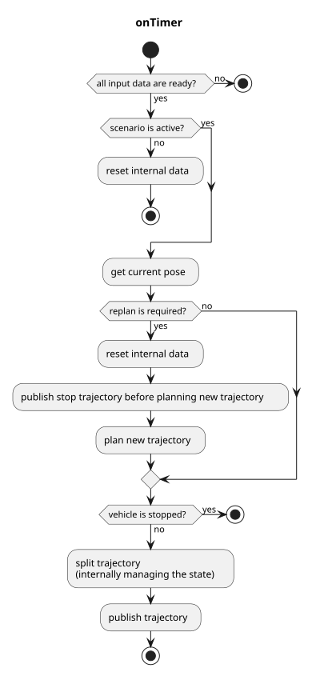

> **Autoware License Notice**
> This file is part of a local planning-reference bundle derived from, summarizing, or reorganizing materials from Autoware Foundation repositories, including Autoware Universe. The upstream Autoware materials are distributed under the Apache License, Version 2.0.
>
> This local copy is kept for AjouNice2026 planning-reference and ROS 1 porting study purposes. Local changes may include pruning, reorganization, format conversion, extracted tables, and generated summaries. This notice does not change the upstream license terms.
>
> See `LICENSE_AUTOWARE_APACHE_2_0.md`, `NOTICE.md`, and `meta/source_repositories.md` in this bundle for license text, attribution notices, and source/version provenance.

# The `autoware_freespace_planner`

## freespace\_planner\_node

`freespace_planner_node` is a global path planner node that plans trajectory
in the space having static/dynamic obstacles. This node is currently based on
Hybrid A\* search algorithm in `freespace_planning_algorithms` package.
Other algorithms such as rrt\* will be also added and selectable in the future.

**Note**
Due to the constraint of trajectory following, the output trajectory will be split to include only the single direction path.
In other words, the output trajectory doesn't include both forward and backward trajectories at once.

### Input topics

| Name | Type | Description |
| --- | --- | --- |
| `~input/route` | autoware\_planning\_msgs::Route | route and goal pose |
| `~input/occupancy_grid` | nav\_msgs::OccupancyGrid | costmap, for drivable areas |
| `~input/odometry` | nav\_msgs::Odometry | vehicle velocity, for checking whether vehicle is stopped |
| `~input/scenario` | tier4\_planning\_msgs::Scenario | scenarios to be activated, for node activation |

### Output topics

| Name | Type | Description |
| --- | --- | --- |
| `~output/trajectory` | autoware\_planning\_msgs::Trajectory | trajectory to be followed |
| `is_completed` | bool (implemented as rosparam) | whether all split trajectory are published |

### Output TFs

None

### How to launch

1. Write your remapping info in `freespace_planner.launch` or add args when executing `roslaunch`
2. `roslaunch freespace_planner freespace_planner.launch`

### Parameters

| Name | Type | Description | Default | Range |
| --- | --- | --- | --- | --- |
| planning\_algorithm | string | Planning algorithm to use, options: astar, rrtstar. | astar | ['astar', 'rrtstar'] |
| waypoints\_velocity | float | velocity in output trajectory (currently, only constant velocity is supported. | 5.0 | N/A |
| update\_rate | float | timer's update rate | 10.0 | N/A |
| th\_arrived\_distance\_m | float | Threshold for considering the vehicle has arrived at its goal. | 1.0 | N/A |
| th\_stopped\_time\_sec | float | Time threshold for considering the vehicle as stopped. | 1.0 | N/A |
| th\_stopped\_velocity\_mps | float | Velocity threshold for considering the vehicle as stopped. | 0.01 | N/A |
| th\_course\_out\_distance\_m | float | Threshold distance for considering the vehicle has deviated from its course. | 1.0 | N/A |
| th\_obstacle\_time\_sec | float | Time threshold for checking obstacles along the trajectory. | 1.0 | N/A |
| vehicle\_shape\_margin\_m | float | Margin around the vehicle shape for planning. | 1.0 | N/A |
| replan\_when\_obstacle\_found | boolean | Replan path when an obstacle is found. | True | N/A |
| replan\_when\_course\_out | boolean | Replan path when the vehicle deviates from its course. | True | N/A |
| time\_limit | float | Time limit for the planner. | 30000.0 | N/A |
| max\_turning\_ratio | float | Maximum turning ratio, relative to the actual turning limit of the vehicle. | 0.5 | N/A |
| turning\_steps | float | Number of steps for turning. | 1 | N/A |
| theta\_size | float | Number of discretized angles for search. | 144 | N/A |
| angle\_goal\_range | float | Range of acceptable angles at the goal. | 6.0 | N/A |
| lateral\_goal\_range | float | Lateral range of acceptable goal positions. | 0.5 | N/A |
| longitudinal\_goal\_range | float | Longitudinal range of acceptable goal positions. | 2.0 | N/A |
| curve\_weight | float | Weight for curves in the cost function. | 0.5 | N/A |
| reverse\_weight | float | Weight for reverse movement in the cost function. | 1.0 | N/A |
| direction\_change\_weight | float | Weight for direction changes in the cost function. | 1.5 | N/A |
| obstacle\_threshold | float | Threshold for considering an obstacle in the costmap. | 100 | N/A |
| astar.search\_method | string | Search method to use, options: forward, backward. | forward | ['forward', 'backward'] |
| astar.only\_behind\_solutions | boolean | Consider only solutions behind the vehicle. | False | N/A |
| astar.use\_back | boolean | Allow reverse motion in A\* search. | True | N/A |
| astar.adapt\_expansion\_distance | boolean | Allow varying A\* expansion distance based on space configuration. | True | N/A |
| astar.expansion\_distance | float | Distance for expanding nodes in A\* search. | 0.5 | N/A |
| astar.near\_goal\_distance | float | Distance threshold to consider near goal. | 4.0 | N/A |
| astar.distance\_heuristic\_weight | float | Weight for the distance heuristic in A\* search. | 1.0 | N/A |
| astar.smoothness\_weight | float | Weight for the smoothness (change in curvature) in A\* search. | 0.5 | N/A |
| astar.obstacle\_distance\_weight | float | Weight for distance to obstacle in A\* search. | 0.5 | N/A |
| astar.goal\_lat\_distance\_weight | float | Weight for lateral distance from original goal. | 0.5 | N/A |
| rrtstar.enable\_update | boolean | Enable updates in RRT\*. | True | N/A |
| rrtstar.use\_informed\_sampling | boolean | Use informed sampling in RRT\*. | True | N/A |
| rrtstar.max\_planning\_time | float | Maximum planning time for RRT\*. | 150.0 | N/A |
| rrtstar.neighbor\_radius | float | Radius for neighboring nodes in RRT\*. | 8.0 | N/A |
| rrtstar.margin | float | Margin for RRT\* sampling. | 0.1 | N/A |

#### Node parameters

| Parameter | Type | Description |
| --- | --- | --- |
| `planning_algorithms` | string | algorithms used in the node |
| `vehicle_shape_margin_m` | float | collision margin in planning algorithm |
| `update_rate` | double | timer's update rate |
| `waypoints_velocity` | double | velocity in output trajectory (currently, only constant velocity is supported) |
| `th_arrived_distance_m` | double | threshold distance to check if vehicle has arrived at the trajectory's endpoint |
| `th_stopped_time_sec` | double | threshold time to check if vehicle is stopped |
| `th_stopped_velocity_mps` | double | threshold velocity to check if vehicle is stopped |
| `th_course_out_distance_m` | double | threshold distance to check if vehicle is out of course |
| `th_obstacle_time_sec` | double | threshold time to check if obstacle is on the trajectory |
| `vehicle_shape_margin_m` | double | vehicle margin |
| `replan_when_obstacle_found` | bool | whether replanning when obstacle has found on the trajectory |
| `replan_when_course_out` | bool | whether replanning when vehicle is out of course |

#### Planner common parameters

| Parameter | Type | Description |
| --- | --- | --- |
| `time_limit` | double | time limit of planning |
| `maximum_turning_ratio` | double | max ratio of actual turning range to use |
| `turning_steps` | double | number of turning steps within turning range |
| `theta_size` | double | the number of angle's discretization |
| `lateral_goal_range` | double | goal range of lateral position |
| `longitudinal_goal_range` | double | goal range of longitudinal position |
| `angle_goal_range` | double | goal range of angle |
| `curve_weight` | double | additional cost factor for curve actions |
| `reverse_weight` | double | additional cost factor for reverse actions |
| `direction_change_weight` | double | additional cost factor for switching direction |
| `obstacle_threshold` | double | threshold for regarding a certain grid as obstacle |

#### A\* search parameters

| Parameter | Type | Description |
| --- | --- | --- |
| `search_method` | string | method of searching, start to goal or vice versa |
| `only_behind_solutions` | bool | whether restricting the solutions to be behind the goal |
| `use_back` | bool | whether using backward trajectory |
| `adapt_expansion_distance` | bool | if true, adapt expansion distance based on environment |
| `expansion_distance` | double | length of expansion for node transitions |
| `near_goal_distance` | double | near goal distance threshold |
| `distance_heuristic_weight` | double | heuristic weight for estimating node's cost |
| `smoothness_weight` | double | cost factor for change in curvature |
| `obstacle_distance_weight` | double | cost factor for distance to obstacle |
| `goal_lat_distance_weight` | double | cost factor for lateral distance from goal |

#### RRT\* search parameters

| Parameter | Type | Description |
| --- | --- | --- |
| `max planning time` | double | maximum planning time [msec] (used only when `enable_update` is set `true`) |
| `enable_update` | bool | whether update after feasible solution found until `max_planning time` elapse |
| `use_informed_sampling` | bool | Use informed RRT\* (of Gammell et al.) |
| `neighbor_radius` | double | neighbor radius of RRT\* algorithm |
| `margin` | double | safety margin ensured in path's collision checking in RRT\* algorithm |

### Flowchart

