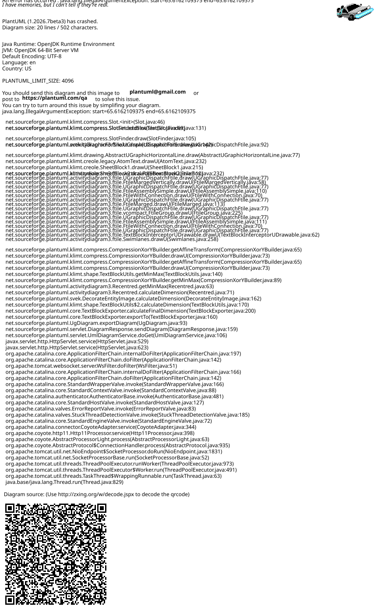
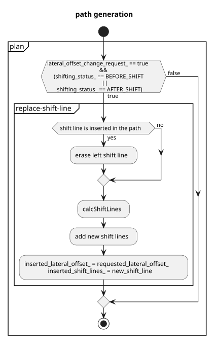
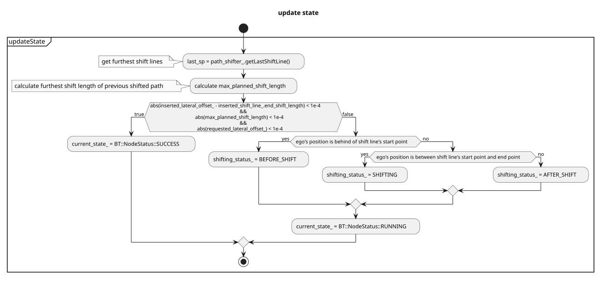

> **Autoware License Notice**
> This file is part of a local planning-reference bundle derived from, summarizing, or reorganizing materials from Autoware Foundation repositories, including Autoware Universe. The upstream Autoware materials are distributed under the Apache License, Version 2.0.
>
> This local copy is kept for AjouNice2026 planning-reference and ROS 1 porting study purposes. Local changes may include pruning, reorganization, format conversion, extracted tables, and generated summaries. This notice does not change the upstream license terms.
>
> See `LICENSE_AUTOWARE_APACHE_2_0.md`, `NOTICE.md`, and `meta/source_repositories.md` in this bundle for license text, attribution notices, and source/version provenance.

# Side Shift design

(For remote control) Shift the path to left or right according to an external instruction.

## Overview of the Side Shift Module Process

1. Receive the required lateral offset input.
2. Update the `requested_lateral_offset_` under the following conditions:
   a. Verify if the last update time has elapsed.
   b. Ensure the required lateral offset value is different from the previous one.
3. Insert the shift points into the path if the side shift module's status is not in the SHIFTING status.

Please be aware that `requested_lateral_offset_` is continuously updated with the latest values and is not queued.

## Statuses of the Side Shift

The side shift has three distinct statuses. Note that during the SHIFTING status, the path cannot be updated:

1. BEFORE\_SHIFT: Preparing for shift.
2. SHIFTING: Currently in the process of shifting.
3. AFTER\_SHIFT: Shift completed.

side shift status

## Flowchart

