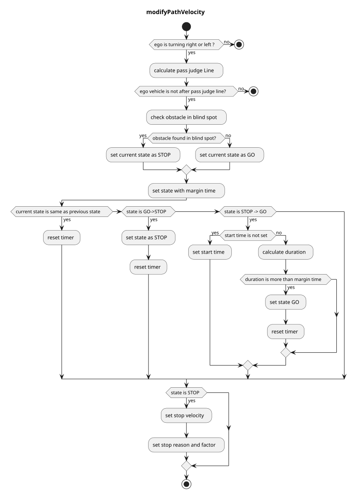

> **Autoware License Notice**
> This file is part of a local planning-reference bundle derived from, summarizing, or reorganizing materials from Autoware Foundation repositories, including Autoware Universe. The upstream Autoware materials are distributed under the Apache License, Version 2.0.
>
> This local copy is kept for AjouNice2026 planning-reference and ROS 1 porting study purposes. Local changes may include pruning, reorganization, format conversion, extracted tables, and generated summaries. This notice does not change the upstream license terms.
>
> See `LICENSE_AUTOWARE_APACHE_2_0.md`, `NOTICE.md`, and `meta/source_repositories.md` in this bundle for license text, attribution notices, and source/version provenance.

# Index

## Blind Spot

### Role

Blind spot module checks possible collisions with bicycles and pedestrians running on its left/right side while turing left/right before junctions.

### Activation Timing

This function is activated when the lane id of the target path has an intersection label (i.e. the `turn_direction` attribute is `left` or `right`).

### Inner-workings / Algorithms

Sets a stop line, a pass judge line, a detection area and conflict area based on a map information and a self position.

- Stop line : Automatically created based on crossing lane information.

- Pass judge line : A position to judge if stop or not to avoid a rapid brake.

- Detection area : Right/left side area of the self position.

- Conflict area : Right/left side area from the self position to the stop line.

Stop/Go state: When both conditions are met for any of each object, this module state is transited to the "stop" state and insert zero velocity to stop the vehicle.

- Object is on the detection area
- Object’s predicted path is on the conflict area

In order to avoid a rapid stop, the “stop” judgement is not executed after the judgment line is passed.

Once a "stop" is judged, it will not transit to the "go" state until the "go" judgment continues for a certain period in order to prevent chattering of the state (e.g. 2 seconds).

### Module Parameters

| Parameter | Type | Description |
| --- | --- | --- |
| `stop_line_margin` | double | [m] a margin that the vehicle tries to stop before stop\_line |
| `backward_length` | double | [m] distance from closest path point to the edge of beginning point. |
| `ignore_width_from_center_line` | double | [m] ignore threshold that vehicle behind is collide with ego vehicle or not |
| `max_future_movement_time` | double | [s] maximum time for considering future movement of object |
| `adjacent_extend_width` | double | [m] if adjacent lane e.g. bicycle only lane exists, blind\_spot area is expanded by this length |

### Flowchart

