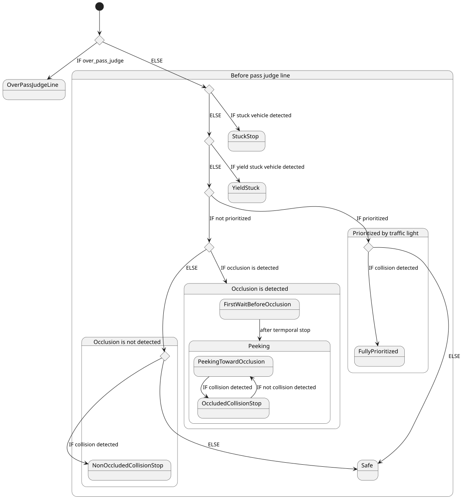
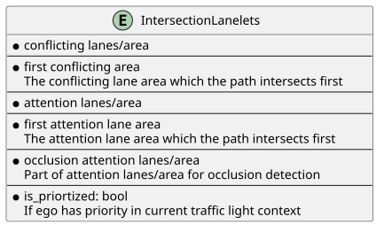
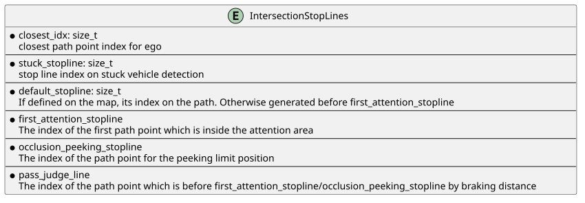
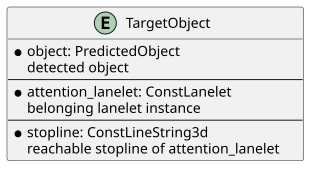
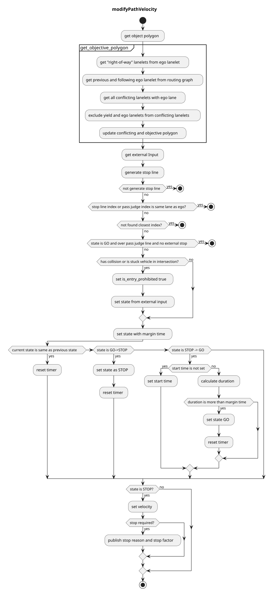

> **Autoware License Notice**
> This file is part of a local planning-reference bundle derived from, summarizing, or reorganizing materials from Autoware Foundation repositories, including Autoware Universe. The upstream Autoware materials are distributed under the Apache License, Version 2.0.
>
> This local copy is kept for AjouNice2026 planning-reference and ROS 1 porting study purposes. Local changes may include pruning, reorganization, format conversion, extracted tables, and generated summaries. This notice does not change the upstream license terms.
>
> See `LICENSE_AUTOWARE_APACHE_2_0.md`, `NOTICE.md`, and `meta/source_repositories.md` in this bundle for license text, attribution notices, and source/version provenance.

# Intersection

## Role

The intersection module is responsible for safely passing urban intersections by:

1. checking collisions with upcoming vehicles
2. recognizing the occluded area in the intersection
3. reacting to each color/shape of associated traffic lights

This module is designed to be agnostic to left-hand/right-hand traffic rules and work for crossroads, T-shape junctions, etc. Roundabout is not formally supported in this module.


## Activation condition

This module is activated when the path contains the lanes with turn\_direction tag. More precisely, if the lane\_ids of the path contain the ids of those lanes, corresponding instances of intersection module are activated on each lane respectively.

## Requirements/Limitations

- The HDMap needs to have the information of turn\_direction tag (which should be one of straight, left, right) for all the lanes in intersections and right\_of\_way tag for specific lanes (refer to [RightOfWay](#how-towhy-set-rightofway-tag) section for more details). See [autoware\_lanelet2\_extension document](https://github.com/autowarefoundation/autoware_lanelet2_extension/blob/main/autoware_lanelet2_extension/docs/lanelet2_format_extension.md) for more detail.
- WIP(perception requirements/limitations)
- WIP(sensor visibility requirements/limitations)

## Attention area

The attention area in the intersection is defined as the set of lanes that are conflicting with ego path and their preceding lanes up to `common.attention_area_length` meters. By default RightOfWay tag is not set, so the attention area covers all the conflicting lanes and its preceding lanes as shown in the first row. RightOfWay tag is used to rule out the lanes that each lane has priority given the traffic light relation and turn\_direction priority. In the second row, purple lanes are set as the yield\_lane of the ego\_lane in the RightOfWay tag.


intersection\_area, which is supposed to be defined on the HDMap, is an area converting the entire intersection.

### In-phase/Anti-phase signal group

The terms "in-phase signal group" and "anti-phase signal group" are introduced to distinguish the lanes by the timing of traffic light regulation as shown in below figure.


The set of intersection lanes whose color is in sync with lane L1 is called the in-phase signal group of L1, and the set of remaining lanes is called the anti-phase signal group.

### How-to/Why set RightOfWay tag

Ideally RightOfWay tag is unnecessary if ego has perfect knowledge of all traffic signal information because:

- it can distinguish which conflicting lanes should be checked because they are GREEN currently and possible collision occur with the vehicles on those lanes
- it can distinguish which conflicting lanes can be ignored because they are RED currently and there is no chance of collision with the vehicles on those lanes unless they violate the traffic rule

That allows ego to generate the attention area dynamically using the real time traffic signal information. However this ideal condition rarely holds unless the traffic signal information is provided through the infrastructure. Also there maybe be very complicated/bad intersection maps where multiple lanes overlap in a complex manner.

- If there is an perfect access to entire traffic light signal, then you can set `common.use_map_right_of_way` to false and there is no need to set RightOfWay tag on the map. The intersection module will generate the attention area by checking traffic signal and corresponding conflicting lanes. This feature is not implemented yet.
- If traffic signal information is not perfect, then set `common.use_map_right_of_way` to true. If you do not want to detect vehicles on the anti-phase signal group lanes, set them as yield\_lane for ego lane.
- Even if there are no traffic lights if the intersection lanes are overlapped in a ugly manner, you may need to set RightOfWay tag. For example if adjacent intersection lanes of the same in-phase group are not sharing the boundary line and overlapped a little bit, you may need to set RightOfWay to each other for them in order to avoid unnecessary stop for vehicle on such unrelated lane.

To help the intersection module care only a set of limited lanes, RightOfWay tag needs to be properly set.

Following table shows an **example** of how to set yield\_lanes to each lane in a intersection w/o traffic lights. Since it is not apparent how to uniquely determine signal phase group for a set of intersection lanes in geometric/topological manner, yield\_lane needs to be set manually. Straight lanes with traffic lights are exceptionally handled to detect no lanes because commonly it has priority over all the other lanes, so no RightOfWay setting is required.

| turn direction of right\_of\_way | yield\_lane(with traffic light) | yield\_lane(without traffic light) |
| --- | --- | --- |
| straight | not need to set yield\_lane(this case is special) | left/right conflicting lanes of in-phase group |
| left(Left hand traffic) | all conflicting lanes of the anti-phase group and right conflicting lanes of in-phase group | right conflicting lanes of in-phase group |
| right(Left hand traffic) | all conflicting lanes of the anti-phase group | no yield\_lane |
| left(Right hand traffic) | all conflicting lanes of the anti-phase group | no yield\_lane |
| right(Right hand traffic) | all conflicting lanes of the anti-phase group and right conflicting lanes of in-phase group | left conflicting lanes of in-phase group |

This setting gives the following `attention_area` configurations.


For complex/bad intersection map like the one illustrated below, additional RightOfWay setting maybe necessary.


The bad points are:

1. ego lane is overlapped with adjacent lane of the in-phase group. In this case you need to set this lane as yield\_lane additionally because otherwise attention area is generated for its preceding lanes as well, which may cause unwanted stop.
2. ego lane is overlapped with unrelated lane. In this case the lane is right-turn only and there is no chance of collision in theory. But you need to set this lane as yield\_lane additionally for the same reason as (1).

## Possible stop lines

Following figure illustrates important positions used in the intersection module. Note that each solid line represents ego front line position and the corresponding dot represents the actual inserted stop point position for the vehicle frame, namely the center of the rear wheel.


To precisely calculate stop positions, the path is interpolated at the certain interval of `common.path_interpolation_ds`.

- closest\_idx denotes the path point index which is closest to ego position.
- first\_attention\_stopline denotes the first path point where ego footprint intersects with the attention\_area.
- If a stopline is associated with the intersection lane on the map, that line is used as default\_stopline for collision detection. Otherwise the point which is `common.default_stopline_margin` meters behind first\_attention\_stopline is defined as default\_stopline instead.
- occlusion\_peeking\_stopline is a bit ahead of first\_attention\_stopline as described later.
- occlusion\_wo\_tl\_pass\_judge\_line is the first position where ego footprint intersects with the centerline of the first attention\_area lane.

## Target objects

For [stuck vehicle detection](#stuck-vehicle-detection) and [collision detection](#collision-detection), this module checks **car**, **bus**, **truck**, **trailer**, **motor cycle**, and **bicycle** type objects.

Objects that satisfy all of the following conditions are considered as target objects (possible collision objects):

- The center of the object is **within a certain distance** from the attention lane (threshold = `common.attention_area_margin`) .
  - (Optional condition) The center of the object is in the **intersection area**.
    - To deal with objects that is in the area not covered by the lanelets in the intersection.
- The posture of object is **the same direction as the attention lane** (threshold = `common.attention_area_angle_threshold`).
- Not being **in the adjacent lanes of ego**.

## Overview of decision process

There are several behaviors depending on the scene.

| behavior | scene | action |
| --- | --- | --- |
| Safe | Ego detected no occlusion and collision | Ego passes the intersection |
| StuckStop | The exit of the intersection is blocked by traffic jam | Ego stops before the intersection or the boundary of attention area |
| YieldStuck | Another vehicle stops to yield ego | Ego stops before the intersection or the boundary of attention area |
| NonOccludedCollisionStop | Ego detects no occlusion but detects collision | Ego stops at default\_stopline |
| FirstWaitBeforeOcclusion | Ego detected occlusion when entering the intersection | Ego stops at default\_stopline at first |
| PeekingTowardOcclusion | Ego detected occlusion and but no collision within the FOV (after FirstWaitBeforeOcclusion) | Ego approaches the boundary of the attention area slowly |
| OccludedCollisionStop | Ego detected both occlusion and collision (after FirstWaitBeforeOcclusion) | Ego stops immediately |
| FullyPrioritized | Ego is fully prioritized by the RED/Arrow signal | Ego only cares vehicles still running inside the intersection. Occlusion is ignored |
| OverPassJudgeLine | Ego is already inside the attention area and/or cannot stop before the boundary of attention area | Ego does not detect collision/occlusion anymore and passes the intersection |



## Stuck Vehicle Detection

If there is any object on the path inside the intersection and at the exit of the intersection (up to `stuck_vehicle.stuck_vehicle_detect_dist`) lane and its velocity is less than the threshold (`stuck_vehicle.stuck_vehicle_velocity_threshold`), the object is regarded as a stuck vehicle. If stuck vehicles exist, this module inserts a stopline a certain distance (=`default_stopline_margin`) before the overlapped region with other lanes. The stuck vehicle detection area is generated based on the planned path, so the stuck vehicle stopline is not inserted if the upstream module generated an avoidance path.


## Yield stuck vehicle detection

If there is any stopped object on the attention lanelet between the intersection point with ego path and the position which is `yield_stuck.distance_threshold` before that position, the object is regarded as yielding to ego vehicle. In this case ego is given the right-of-way by the yielding object but this module inserts stopline to prevent entry into the intersection. This scene happens when the object is yielding against ego or the object is waiting before the crosswalk around the exit of the intersection.


## Collision detection

The following process is performed for the targets objects to determine whether ego can pass the intersection safely. If it is judged that ego cannot pass the intersection with enough margin, this module inserts a stopline on the path.

1. predict the time \(t\) when the object intersects with ego path for the first time from the predicted path time step. Only the predicted whose confidence is greater than `collision_detection.min_predicted_path_confidence` is used.
2. detect collision between the predicted path and ego's predicted path in the following process
   1. calculate the collision interval of [\(t\) - `collision_detection.collision_start_margin_time`, \(t\) + `collision_detection.collision_end_margin_time`]
   2. calculate the passing area of ego during the collision interval from the array of (time, distance) obtained by smoothed velocity profile
   3. check if ego passing area and object predicted path interval collides
3. if collision is detected, the module inserts a stopline
4. if ego is over the [pass\_judge\_line](#pass-judge-line), collision checking is skipped to avoid sudden braking and/or unnecessary stop in the middle of the intersection

The parameters `collision_detection.collision_start_margin_time` and `collision_detection.collision_end_margin_time` can be interpreted as follows:

- If ego was to pass the intersection earlier than the target object, collision would be detected if the time difference between the two was less than `collision_detection.collision_start_margin_time`.
- If ego was to pass the intersection later than the target object, collision would be detected if the time difference between the two was less than `collision_detection.collision_end_margin_time`.

If collision is detected, the state transits to "STOP" immediately. On the other hand, the state does not transit to "GO" unless safe judgement continues for a certain period `collision_detection.collision_detection_hold_time` to prevent the chattering of decisions.

Currently, the intersection module uses `motion_velocity_smoother` feature to precisely calculate ego velocity profile along the intersection lane under longitudinal/lateral constraints. If the flag `collision_detection.velocity_profile.use_upstream` is true, the target velocity profile of the original path is used. Otherwise the target velocity is set to `collision.velocity_profile.default_velocity`. In the trajectory smoothing process the target velocity at/before ego trajectory points are set to ego current velocity. The smoothed trajectory is then converted to an array of (time, distance) which indicates the arrival time to each trajectory point on the path from current ego position. You can visualize this array by adding the lane id to `debug.ttc` and running

```
ros2 run behavior_velocity_intersection_module ttc.py --lane_id <lane_id>
```


### about use\_upstream\_velocity flag

There are some use cases where ego should check collision before entering the intersection considering the temporal stop by walkway/crosswalk module around the exit of the intersection, because their stop position can be inside the intersection and it could bother upcoming vehicles. By setting the flag `collision_detection.velocity_profile.use_upstream` to true and running the walkway/crosswalk module prior to this module, ego velocity profile is calculated considering their velocity and stop positions.

As illustrated in below figure if upstream module inserted a stopline, ego position profile will remain there for the infinite time, thus it leads to the judgement that ego cannot exit the intersection during the interval [\(t\) - `collision_detection.collision_start_margin_time`, \(t\) + `collision_detection.collision_end_margin_time`]. In this way this feature considers possible collision for the infinite time if stoplines exist ahead of ego position (practically the prediction horizon is limited so the collision check horizon is bounded).


## Occlusion detection

If the flag `occlusion.enable` is true this module checks if there is sufficient field of view (FOV) on the attention area up to `occlusion.occlusion_attention_area_length`. If FOV is not clear enough ego first makes a brief stop at default\_stopline for `occlusion.temporal_stop_time_before_peeking`, and inserts stopline at occlusion\_peeking\_stopline, thus slowly creeping toward there.

During the creeping if collision is detected this module inserts a stop line in front of ego immediately, and if the FOV gets sufficiently clear the intersection\_occlusion wall will disappear. If occlusion is cleared and no collision is detected ego will pass the intersection.

The occlusion is detected as the common area of occlusion attention area(which is partially the same as the normal attention area) and the unknown cells of the occupancy grid map. The occupancy grid map is denoised using morphology with the window size of `occlusion.denoise_kernel`. The occlusion attention area lanes are discretized to line strings and they are used to generate a grid whose each cell represents the distance from ego path along the lane as shown below.


If the nearest occlusion cell value is below the threshold `occlusion.occlusion_required_clearance_distance`, it means that the FOV of ego is not clear. It is expected that the occlusion gets cleared as the vehicle approaches the occlusion peeking stop line.

### Occlusion source estimation at intersection with traffic light

At intersection with traffic light, the whereabout of occlusion is estimated by checking if there are any objects between ego and the nearest occlusion cell. While the occlusion is estimated to be caused by some object (DYNAMICALLY occluded), intersection\_wall appears at all times. If no objects are found between ego and the nearest occlusion cell (STATICALLY occluded), after ego stopped for the duration of `occlusion.static_occlusion_with_traffic_light_timeout` plus `occlusion.occlusion_detection_hold_time`, occlusion is intentionally ignored to avoid stuck.


The remaining time is visualized on the intersection\_occlusion virtual wall.


### Occlusion handling at intersection without traffic light

At intersection without traffic light, if occlusion is detected, ego makes a brief stop at default\_stopline and first\_attention\_stopline respectively. After stopping at the first\_attention\_area\_stopline this module inserts `occlusion.absence_traffic_light.creep_velocity` velocity between ego and occlusion\_wo\_tl\_pass\_judge\_line while occlusion is not cleared. If collision is detected, ego immediately stops. Once the occlusion is cleared or ego has passed occlusion\_wo\_tl\_pass\_judge\_line this module does not detect collision and occlusion because ego footprint is already inside the intersection.


If the flag `occlusion.request_approval_wo_traffic_light` is `true`, `intersection_occlusion` requests approval from RTC operator. If it is `false`, it does not request approval after tbe brief stop even if occlusion is not sufficiently cleared.

While ego is creeping, yellow intersection\_wall appears in front ego.


### Map-based forced RTC

RTC can be enabled for specific intersection lanelets such that even if approval is not required by default, it will be required before crossing the corresponding intersection lanelets.
The following attribute should be added to the lanelet in intersection in the map file:

```
<tag k='rtc_approval_required_v1' v='intersection' />
```

The value can be set to `intersection`, `intersection_occlusion`, or `intersection,intersection_occlusion`, to adjust which modules will require approvals.

## Traffic signal specific behavior

### Collision detection

TTC parameter varies depending on the traffic light color/shape as follows.

| traffic light color | ttc(start) | ttc(end) |
| --- | --- | --- |
| GREEN | `collision_detection.not_prioritized.collision_start_margin` | `collision_detection.not_prioritized.collision_end_margin` |
| AMBER | `collision_detection.partially_prioritized.collision_start_end_margin` | `collision_detection.partially_prioritized.collision_start_end_margin` |
| RED / Arrow | `collision_detection.fully_prioritized.collision_start_end_margin` | `collision_detection.fully_prioritized.collision_start_end_margin` |

### yield on GREEN

If the traffic light color changed to GREEN and ego approached the entry of the intersection lane within the distance `collision_detection.yield_on_green_traffic_light.distance_to_assigned_lanelet_start` and there is any object whose distance to its stopline is less than `collision_detection.yield_on_green_traffic_light.object_dist_to_stopline`, this module commands to stop for the duration of `collision_detection.yield_on_green_traffic_light.duration` at default\_stopline.

### skip on AMBER

If the traffic light color is AMBER but the object is expected to stop before its stopline under the deceleration of `collision_detection.ignore_on_amber_traffic_light.object_expected_deceleration`, collision checking is skipped.

### skip on RED

If the traffic light color is RED or Arrow signal is turned on, the attention lanes which are not conflicting with ego lane are not used for detection. And even if the object stops with a certain overshoot from its stopline, but its expected stop position under the deceleration of `collision_detection.ignore_on_amber_traffic_light.object_expected_deceleration` is more than the distance `collision_detection.ignore_on_red_traffic_light.object_margin_to_path` from collision point, the object is ignored.

### Occlusion detection

When the traffic light color/shape is RED/Arrow, occlusion detection is skipped.


## Pass Judge Line

Generally it is not tolerable for vehicles that have lower traffic priority to stop in the middle of the unprotected area in intersections, and they need to stop at the stop line beforehand if there will be any risk of collision, which introduces two requirements:

1. The vehicle must start braking before the boundary of the unprotected area at least by the braking distance if it is supposed to stop
2. The vehicle must recognize upcoming vehicles and check safety beforehand with enough braking distance margin if it is supposed to go
   1. And the SAFE decision must be absolutely certain and remain to be valid for the future horizon so that the safety condition will be always satisfied while ego is driving inside the unprotected area.
3. (TODO): Since it is almost impossible to make perfectly safe decision beforehand given the limited detection range/velocity tracking performance, intersection module should plan risk-evasive acceleration velocity profile AND/OR relax lateral acceleration limit while ego is driving inside the unprotected area, if the safety decision is "betrayed" later due to the following reasons:
   1. The situation *turned out to be dangerous* later, mainly because velocity tracking was underestimated or the object accelerated beyond TTC margin
   2. The situation *turned dangerous* later, mainly because the object is suddenly detected out of nowhere

The position which is before the boundary of unprotected area by the braking distance which is obtained by

\[
\dfrac{v\_{\mathrm{ego}}^{2}}{2a\_{\mathrm{max}}} + v\_{\mathrm{ego}} \* t\_{\mathrm{delay}}
\]

plus an additional margin `common.pass_judge_line_margin` is called pass\_judge\_line, and safety decision must be made before ego passes this position because ego does not stop anymore. pass\_judge\_line are illustrated in the following figure(2nd\_pass\_judge\_line is deprecated).


Intersection module will command to GO if

- ego is over pass judge line AND
- ego judged SAFE previously AND

because it is expected to stop or continue stop decision if

1. ego is before pass\_judge\_line OR
   1. reason: it has enough braking distance margin
2. ego judged UNSAFE previously
   1. reason: ego is now trying to stop and should continue stop decision if collision is detected in later calculation

For the 3rd condition, it is possible that ego stops with some overshoot to the unprotected area while it is trying to stop for collision detection, because ego should keep stop decision while UNSAFE decision is made even if it passed pass\_judge\_line during deceleration.

For the 4th condition, at intersections with 2nd attention lane, even if ego is over the pass\_judge\_line, still intersection module commands to stop if the most probable collision is expected to happen in the 2nd attention lane.

Also if `occlusion.enable` is true, the position of pass\_judge line changes to occlusion\_peeking\_stopline if ego passed the original pass\_judge\_line position while ego is peeking. Otherwise ego could inadvertently judge that it passed pass\_judge during peeking and then abort peeking.

## Data Structure

Each data structure is defined in `util_type.hpp`.


### `IntersectionLanelets`



### `IntersectionStopLines`

Each stop lines are generated from interpolated path points to obtain precise positions.



### `TargetObject`

`TargetObject` holds the object, its belonging lane and corresponding stopline information.



## Module Parameters

### common

| Parameter | Type | Description |
| --- | --- | --- |
| `.attention_area_length` | double | [m] range for object detection |
| `.attention_area_margin` | double | [m] margin for expanding attention area width |
| `.attention_area_angle_threshold` | double | [rad] threshold of angle difference between the detected object and lane |
| `.use_intersection_area` | bool | [-] flag to use intersection\_area for collision detection |
| `.default_stopline_margin` | double | [m] margin before\_stop\_line |
| `.pass_judge_line_margin` | double | [m] additional margin for pass\_judge\_line position from first\_attention\_stopline |
| `.stopline_overshoot_margin` | double | [m] margin for the overshoot from stopline |
| `.max_accel` | double | [m/ss] max acceleration for stop |
| `.max_jerk` | double | [m/sss] max jerk for stop |
| `.delay_response_time` | double | [s] action delay before stop |
| `.enable_pass_judge_before_default_stopline` | bool | [-] flag not to stop before default\_stopline even if ego is over pass\_judge\_line |

### stuck\_vehicle/yield\_stuck

| Parameter | Type | Description |
| --- | --- | --- |
| `stuck_vehicle.turn_direction` | - | [-] turn\_direction specifier for stuck vehicle detection |
| `stuck_vehicle.stuck_vehicle_detect_dist` | double | [m] length toward from the exit of intersection for stuck vehicle detection |
| `stuck_vehicle.stuck_vehicle_velocity_threshold` | double | [m/s] velocity threshold for stuck vehicle detection |
| `yield_stuck.distance_threshold` | double | [m/s] distance threshold of yield stuck vehicle from ego path along the lane |

### collision\_detection

| Parameter | Type | Description |
| --- | --- | --- |
| `.consider_wrong_direction_vehicle` | bool | [-] flag to detect objects in the wrong direction |
| `.collision_detection_hold_time` | double | [s] hold time of collision detection |
| `.min_predicted_path_confidence` | double | [-] minimum confidence value of predicted path to use for collision detection |
| `.keep_detection_velocity_threshold` | double | [s] ego velocity threshold for continuing collision detection before pass judge line |
| `.velocity_profile.use_upstream` | bool | [-] flag to use velocity profile planned by upstream modules |
| `.velocity_profile.minimum_upstream_velocity` | double | [m/s] minimum velocity of upstream velocity profile to avoid zero division |
| `.velocity_profile.default_velocity` | double | [m/s] constant velocity profile when use\_upstream is false |
| `.velocity_profile.minimum_default_velocity` | double | [m/s] minimum velocity of default velocity profile to avoid zero division |
| `.yield_on_green_traffic_light` | - | [-] [description](#yield-on-green) |
| `.ignore_amber_traffic_light` | - | [-] [description](#skip-on-amber) |
| `.ignore_on_red_traffic_light` | - | [-] [description](#skip-on-red) |

### occlusion

| Parameter | Type | Description |
| --- | --- | --- |
| `.enable` | bool | [-] flag to calculate occlusion detection |
| `.request_approval_wo_traffic_light` | bool | [-] flag to request RTC approval when occluded without traffic light |
| `.occlusion_attention_area_length` | double | [m] the length of attention are for occlusion detection |
| `.free_space_max` | int | [-] maximum value of occupancy grid cell to treat at occluded |
| `.occupied_min` | int | [-] minimum value of occupancy grid cell to treat at occluded |
| `.denoise_kernel` | double | [m] morphology window size for preprocessing raw occupancy grid |
| `.attention_lane_crop_curvature_threshold` | double | [m] curvature threshold for trimming curved part of the lane |
| `.attention_lane_crop_curvature_ds` | double | [m] discretization interval of centerline for lane curvature calculation |
| `.creep_during_peeking.enable` | bool | [-] flag to insert `creep_velocity` while peeking to intersection occlusion stopline |
| `.creep_during_peeking.creep_velocity` | double | [m/s] the command velocity while peeking to intersection occlusion stopline |
| `.peeking_offset` | double | [m] the offset of the front of the vehicle into the attention area for peeking to occlusion |
| `.occlusion_required_clearance_distance` | double | [m] threshold for the distance to nearest occlusion cell from ego path |
| `.possible_object_bbox` | [double] | [m] minimum bounding box size for checking if occlusion polygon is small enough |
| `.ignore_parked_vehicle_speed_threshold` | double | [m/s] velocity threshold for checking parked vehicle |
| `.occlusion_detection_hold_time` | double | [s] hold time of occlusion detection |
| `.temporal_stop_time_before_peeking` | double | [s] temporal stop duration at default\_stopline before starting peeking |
| `.creep_velocity_without_traffic_light` | double | [m/s] creep velocity to occlusion\_wo\_tl\_pass\_judge\_line |
| `.static_occlusion_with_traffic_light_timeout` | double | [s] the timeout duration for ignoring static occlusion at intersection with traffic light |

## Trouble shooting

### Intersection module stops against unrelated vehicles

In this case, first visualize `/planning/scenario_planning/lane_driving/behavior_planning/behavior_velocity_planner/debug/intersection` topic and check the `attention_area` polygon. Intersection module performs collision checking for vehicles running on this polygon, so if it extends to unintended lanes, it needs to have [RightOfWay tag](#how-towhy-set-rightofway-tag).

By lowering `common.attention_area_length` you can check which lanes are conflicting with the intersection lane. Then set part of the conflicting lanes as the yield\_lane.

### The stop line of intersection is chattering

The parameter `collision_detection.collision_detection_hold_time` suppresses the chattering by keeping UNSAFE decision for this duration until SAFE decision is finally made. The role of this parameter is to account for unstable detection/tracking of objects. By increasing this value you can suppress the chattering. However it could elongate the stopping duration excessively.

If the chattering arises from the acceleration/deceleration of target vehicles, increase `collision_detection.collision_detection.collision_end_margin_time` and/or `collision_detection.collision_detection.collision_end_margin_time`.

### The stop line is released too fast/slow

If the intersection wall appears too fast, or ego tends to stop too conservatively for upcoming vehicles, lower the parameter `collision_detection.collision_detection.collision_start_margin_time`. If it lasts too long after the target vehicle passed, then lower the parameter `collision_detection.collision_detection.collision_end_margin_time`.

### Ego suddenly stops at intersection with traffic light

If the traffic light color changed from AMBER/RED to UNKNOWN, the intersection module works in the GREEN color mode. So collision and occlusion are likely to be detected again.

### Occlusion is detected overly

You can check which areas are detected as occlusion by visualizing `/planning/scenario_planning/lane_driving/behavior_planning/behavior_velocity_planner/debug/intersection/occlusion_polygons`.

If you do not want to detect / do want to ignore occlusion far from ego or lower the computational cost of occlusion detection, `occlusion.occlusion_attention_area_length` should be set to lower value.

If you want to care the occlusion nearby ego more cautiously, set `occlusion.occlusion_required_clearance_distance` to a larger value. Then ego will approach the occlusion\_peeking\_stopline more closely to assure more clear FOV.

`occlusion.possible_object_bbox` is used for checking if detected occlusion area is small enough that no vehicles larger than this size can exist inside. By decreasing this size ego will ignore small occluded area.

#### occupancy grid map tuning

Refer to the document of [autoware\_probabilistic\_occupancy\_grid\_map](https://autowarefoundation.github.io/autoware_universe/main/perception/autoware_probabilistic_occupancy_grid_map/) for details. If occlusion tends to be detected at apparently free space, increase `occlusion.free_space_max` to ignore them.

#### in simple\_planning\_simulator

intersection\_occlusion feature is **not recommended** for use in planning\_simulator because the laserscan\_based\_occupancy\_grid\_map generates unnatural UNKNOWN cells in 2D manner:

- all the cells behind pedestrians are UNKNOWN
- no ground point clouds are generated

Also many users do not set traffic light information frequently although it is very critical for intersection\_occlusion (and in real traffic environment too).

For these reasons, `occlusion.enable` is false by default.

#### on real vehicle / in end-to-end simulator

On real vehicle or in end-to-end simulator like [AWSIM](https://tier4.github.io/AWSIM/) the following pointcloud\_based\_occupancy\_grid\_map configuration is highly recommended:

```yaml
scan\_origin\_frame: "velodyne\_top"

grid\_map\_type: "OccupancyGridMapProjectiveBlindSpot"
OccupancyGridMapProjectiveBlindSpot:
projection\_dz\_threshold: 0.01 # [m] for avoiding null division
obstacle\_separation\_threshold: 1.0 # [m] fill the interval between obstacles with unknown for this length
```

You should set the top lidar link as the `scan_origin_frame`. In the example it is `velodyne_top`. The method `OccupancyGridMapProjectiveBlindSpot` estimates the FOV by running projective ray-tracing from `scan_origin` to obstacle or up to the ground and filling the cells on the "shadow" of the object as UNKNOWN.

## Flowchart

WIP



## Merge From Private

### Role

When an ego enters a public road from a private road (e.g. a parking lot), it needs to face and stop before entering the public road to make sure it is safe.

This module is activated when there is an intersection at the private area from which the vehicle enters the public road. The stop line is generated both when the goal is in the intersection lane and when the path goes beyond the intersection lane. The basic behavior is the same as the intersection module, but ego must stop once at the stop line.


### Activation Timing

This module is activated when the following conditions are met:

- ego-lane has a `private` tag
- ego-lane has a conflict with other no-private lanelets

### Module Parameters

| Parameter | Type | Description |
| --- | --- | --- |
| `merge_from_private_road/stop_duration_sec` | double | [m] time margin to change state |

### Known Issue

If ego go over the stop line for a certain distance, then it will not transit from STOP.

## Test Maps

The intersections lanelet map consist of a variety of intersections including:

- 4-way crossing with traffic light
- 4-way crossing without traffic light
- T-shape crossing without traffic light
- intersection with a loop
- complicated intersection


