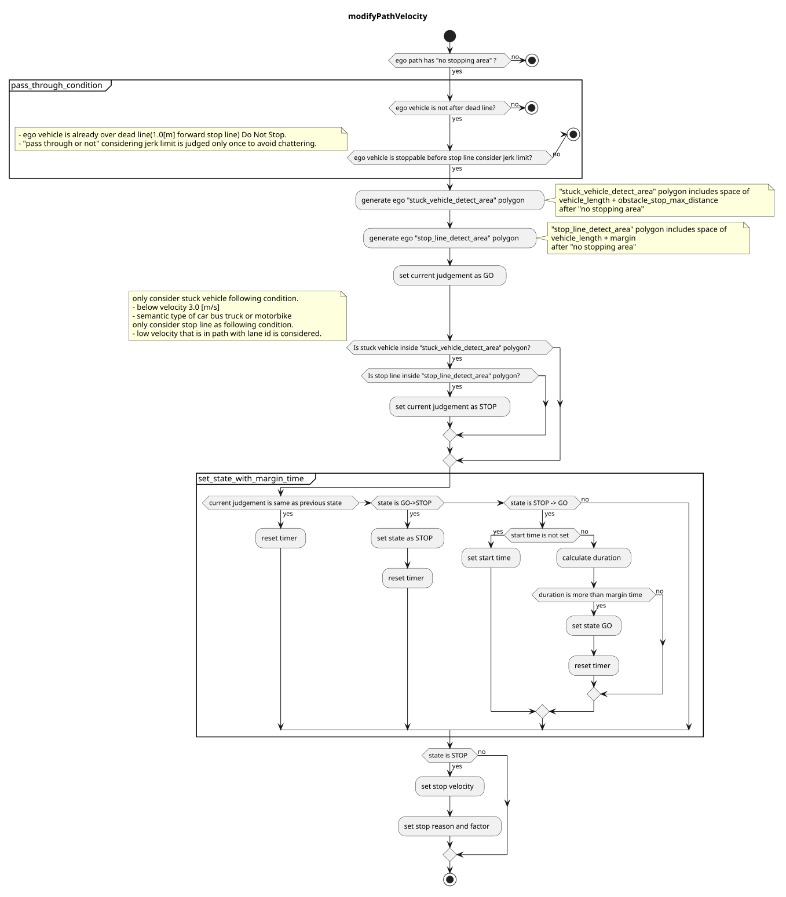

> **Autoware License Notice**
> This file is part of a local planning-reference bundle derived from, summarizing, or reorganizing materials from Autoware Foundation repositories, including Autoware Universe. The upstream Autoware materials are distributed under the Apache License, Version 2.0.
>
> This local copy is kept for AjouNice2026 planning-reference and ROS 1 porting study purposes. Local changes may include pruning, reorganization, format conversion, extracted tables, and generated summaries. This notice does not change the upstream license terms.
>
> See `LICENSE_AUTOWARE_APACHE_2_0.md`, `NOTICE.md`, and `meta/source_repositories.md` in this bundle for license text, attribution notices, and source/version provenance.

# Index

### No Stopping Area

#### Role

This module plans to avoid stop in 'no stopping area`.

- PassThrough case
  - if ego vehicle go through pass judge point, then ego vehicle can't stop with maximum jerk and acceleration, so this module doesn't insert stop velocity. In this case override or external operation is necessary.
- STOP case
  - If there is a stuck vehicle or stop velocity around `no_stopping_area`, then vehicle stops inside `no_stopping_area` so this module makes stop velocity in front of `no_stopping_area`
- GO case
  - else

### Limitation

This module allows developers to design vehicle velocity in `no_stopping_area` module using specific rules. Once ego vehicle go through pass through point, ego vehicle does't insert stop velocity and does't change decision from GO. Also this module only considers dynamic object in order to avoid unnecessarily stop.

#### ModelParameter

| Parameter | Type | Description |
| --- | --- | --- |
| `state_clear_time` | double | [s] time to clear stop state |
| `stuck_vehicle_vel_thr` | double | [m/s] vehicles below this velocity are considered as stuck vehicle. |
| `stop_margin` | double | [m] margin to stop line at no stopping area |
| `dead_line_margin` | double | [m] if ego pass this position GO |
| `stop_line_margin` | double | [m] margin to auto-gen stop line at no stopping area |
| `detection_area_length` | double | [m] length of searching polygon |
| `stuck_vehicle_front_margin` | double | [m] obstacle stop max distance |

#### Flowchart

