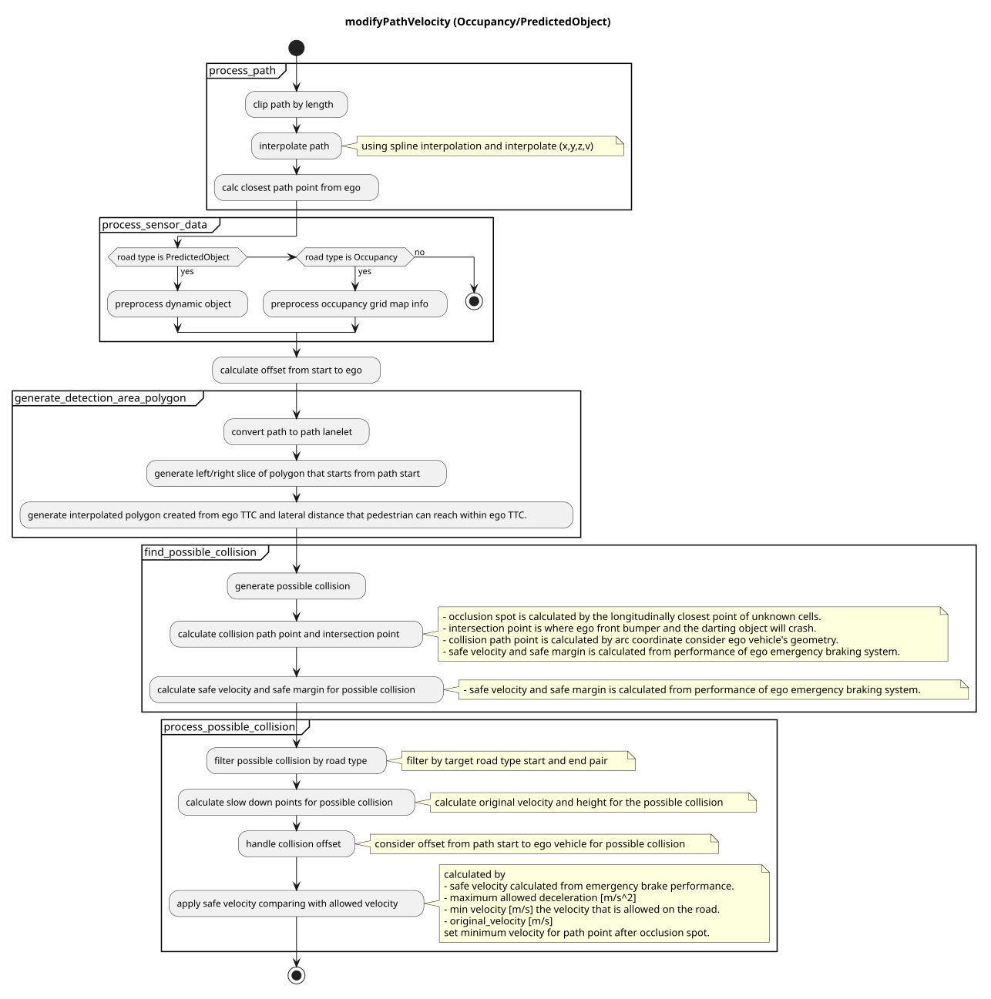
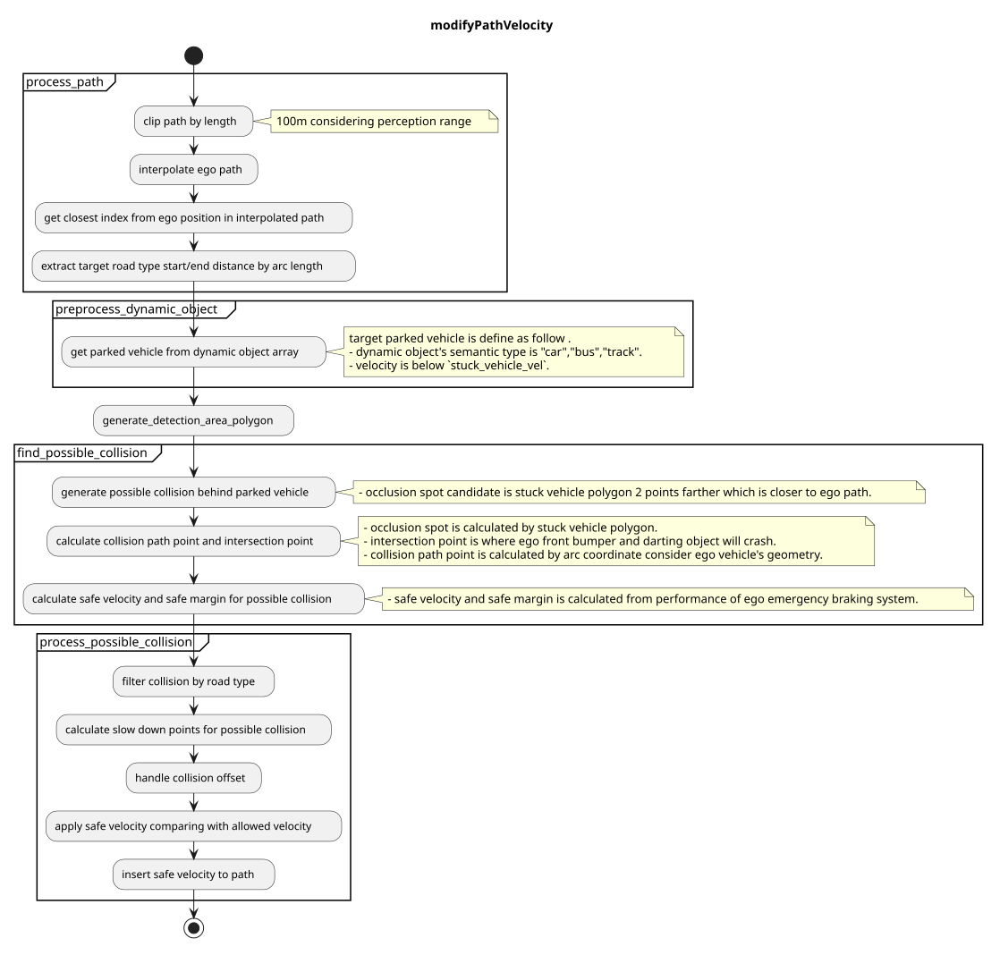
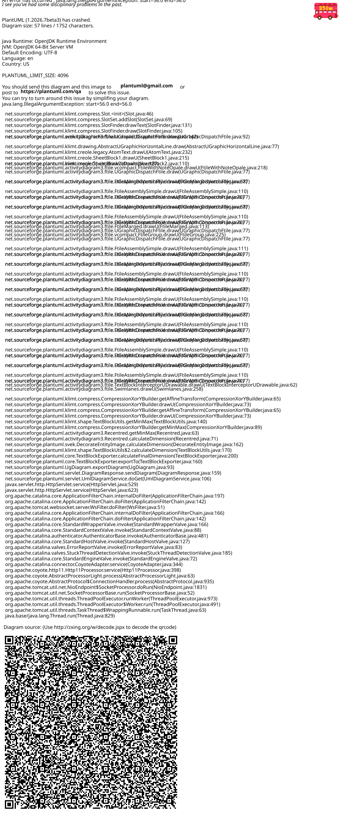

> **Autoware License Notice**
> This file is part of a local planning-reference bundle derived from, summarizing, or reorganizing materials from Autoware Foundation repositories, including Autoware Universe. The upstream Autoware materials are distributed under the Apache License, Version 2.0.
>
> This local copy is kept for AjouNice2026 planning-reference and ROS 1 porting study purposes. Local changes may include pruning, reorganization, format conversion, extracted tables, and generated summaries. This notice does not change the upstream license terms.
>
> See `LICENSE_AUTOWARE_APACHE_2_0.md`, `NOTICE.md`, and `meta/source_repositories.md` in this bundle for license text, attribution notices, and source/version provenance.

# Index

## Occlusion Spot

### Role

This module plans safe velocity to slow down before reaching collision point that hidden object is darting out from `occlusion spot` where driver can't see clearly because of obstacles.

### Activation Timing

This module is activated if `launch_occlusion_spot` becomes true. To make pedestrian first zone map tag is one of the TODOs.

### Limitation and TODOs

This module is prototype implementation to care occlusion spot. To solve the excessive deceleration due to false positive of the perception, the logic of detection method can be selectable. This point has not been discussed in detail and needs to be improved.

- Make occupancy grid for planning.
- Make map tag for occlusion spot.
- About the best safe motion.

TODOs are written in each Inner-workings / Algorithms (see the description below).

### Inner-workings / Algorithms

#### Logics Working

There are several types of occlusions, such as "occlusions generated by parked vehicles" and "occlusions caused by obstructions". In situations such as driving on **road with obstacles**, where people jump out of the way frequently, all possible occlusion spots must be taken into account. This module considers all occlusion spots calculated from the **occupancy grid**, but it is not reasonable to take into account all occlusion spots for example, people jumping out from behind a guardrail, or behind cruising vehicle. Therefore currently detection area will be limited to to use **predicted object** information.

Note that this decision logic is still under development and needs to be improved.

#### DetectionArea Polygon

This module considers TTV from pedestrian velocity and lateral distance to occlusion spot.
TTC is calculated from ego velocity and acceleration and longitudinal distance until collision point using motion velocity smoother.
To compute fast this module only consider occlusion spot whose TTV is less than TTC and only consider area within "max lateral distance".

#### Occlusion Spot Occupancy Grid Base

This module considers any occlusion spot around ego path computed from the occupancy grid.
Due to the computational cost occupancy grid is not high resolution and this will make occupancy grid noisy so this module add information of occupancy to occupancy grid map.

TODO: consider hight of obstacle point cloud to generate occupancy grid.

##### Collision Free Judgement

obstacle that can run out from occlusion should have free space until intersection from ego vehicle

##### Partition Lanelet

By using lanelet information of "guard\_rail", "fence", "wall" tag, it's possible to remove unwanted occlusion spot.

By using static object information, it is possible to make occupancy grid more accurate.

To make occupancy grid for planning is one of the TODOs.

##### Possible Collision

obstacle that can run out from occlusion is interrupted by moving vehicle.

#### About safe motion

##### The Concept of Safe Velocity and Margin

The safe slowdown velocity is calculated from the below parameters of ego emergency braking system and time to collision.
Below calculation is included but change velocity dynamically is not recommended for planner.

- jerk limit[m/s^3]
- deceleration limit[m/s2]
- delay response time[s]
- time to collision of pedestrian[s]
  with these parameters we can briefly define safe motion before occlusion spot for ideal environment.

  

This module defines safe margin to consider ego distance to stop and collision path point geometrically.
While ego is cruising from safe margin to collision path point, ego vehicle keeps the same velocity as occlusion spot safe velocity.

Note: This logic assumes high-precision vehicle speed tracking and margin for decel point might not be the best solution, and override with manual driver is considered if pedestrian really run out from occlusion spot.

TODO: consider one of the best choices

1. stop in front of occlusion spot
2. insert 1km/h velocity in front of occlusion spot
3. slowdown this way
4. etc... .

##### Maximum Slowdown Velocity

The maximum slowdown velocity is calculated from the below parameters of ego current velocity and acceleration with maximum slowdown jerk and maximum slowdown acceleration in order not to slowdown too much.

- \(j\_{max}\) slowdown jerk limit[m/s^3]
- \(a\_{max}\) slowdown deceleration limit[m/s2]
- \(v\_{0}\) current velocity[m/s]
- \(a\_{0}\) current acceleration[m/s]

#### Module Parameters

| Parameter | Type | Description |
| --- | --- | --- |
| `pedestrian_vel` | double | [m/s] maximum velocity assumed pedestrian coming out from occlusion point. |
| `pedestrian_radius` | double | [m] assumed pedestrian radius which fits in occlusion spot. |

| Parameter | Type | Description |
| --- | --- | --- |
| `use_object_info` | bool | [-] whether to reflect object info to occupancy grid map or not. |
| `use_partition_lanelet` | bool | [-] whether to use partition lanelet map data. |

| Parameter /debug | Type | Description |
| --- | --- | --- |
| `is_show_occlusion` | bool | [-] whether to show occlusion point markers. |
| `is_show_cv_window` | bool | [-] whether to show open\_cv debug window. |
| `is_show_processing_time` | bool | [-] whether to show processing time. |

| Parameter /threshold | Type | Description |
| --- | --- | --- |
| `detection_area_length` | double | [m] the length of path to consider occlusion spot |
| `stuck_vehicle_vel` | double | [m/s] velocity below this value is assumed to stop |
| `lateral_distance` | double | [m] maximum lateral distance to consider hidden collision |

| Parameter /motion | Type | Description |
| --- | --- | --- |
| `safety_ratio` | double | [-] safety ratio for jerk and acceleration |
| `max_slow_down_jerk` | double | [m/s^3] jerk for safe brake |
| `max_slow_down_accel` | double | [m/s^2] deceleration for safe brake |
| `non_effective_jerk` | double | [m/s^3] weak jerk for velocity planning. |
| `non_effective_acceleration` | double | [m/s^2] weak deceleration for velocity planning. |
| `min_allowed_velocity` | double | [m/s] minimum velocity allowed |
| `safe_margin` | double | [m] maximum error to stop with emergency braking system. |

| Parameter /detection\_area | Type | Description |
| --- | --- | --- |
| `min_occlusion_spot_size` | double | [m] the length of path to consider occlusion spot |
| `slice_length` | double | [m] the distance of divided detection area |
| `max_lateral_distance` | double | [m] buffer around the ego path used to build the detection\_area area. |

| Parameter /grid | Type | Description |
| --- | --- | --- |
| `free_space_max` | double | [-] maximum value of a free space cell in the occupancy grid |
| `occupied_min` | double | [-] buffer around the ego path used to build the detection\_area area. |

#### Flowchart

##### Rough overview of the whole process

##### Detail process for predicted object(not updated)

##### Detail process for Occupancy grid base

