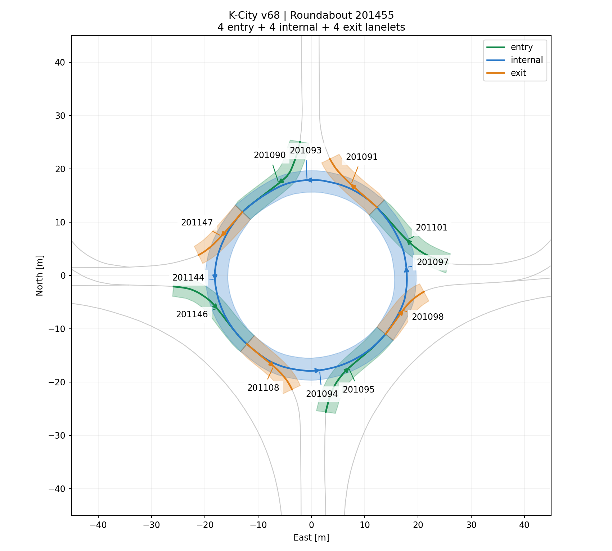

# K-City v68: 회전교차로 201455 수정

기존 201455는 실제 원형 일부를 누락하고 외부 우회·연결도로를 포함했다.
v68은 원형과 직접 맞닿은 진출입로 총 12개만 연결한다.

| 역할 | Lanelet IDs |
| --- | --- |
| entry | 201095, 201101, 201090, 201146 |
| internal | 201094, 201097, 201093, 201144 |
| exit | 201098, 201091, 201147, 201108 |

사용자가 지정한 8개 모두를 포함한다. 추가한 201090/201146은 북쪽/서쪽 직접 진입로,
201091/201098은 북쪽/동쪽 직접 진출로다.
원형의 진행 순서는 201094 → 201097 → 201093 → 201144 → 201094이다.
201093은 exit에서 internal, 201094는 entry에서 internal,
201095는 internal에서 entry, 201098은 internal에서 exit으로 정정했다.

외부 연결도로 200480, 200893, 200968, 201086, 201087, 201089, 201096,
201100을 관계에서 제거했다. Lanelet 자체는 삭제하지 않았다.
Regulatory element의 member와 각 lanelet의 regulatory_element 역참조를 동시에 정리했다.

검증:

- 모든 노드·way·lanelet ID, 형상, 속도, 정지선, 기타 regulatory element와 태그 보존.
- 허용한 변경은 지도 버전과 201455의 양방향 membership뿐임을 XML 전수 비교.
- 원형의 닫힌 방향 연결과 네 진입·네 진출의 중심선 끝점 연결 확인.
- Autoware C++ 지도 로더에서 Roundabout 타입 및 entry/internal/exit 4/4/4 조회 성공.
- 실제 DefaultPlanner로 Route A/B 재생성: 각각 47/57 segments이며 모든 primitives와
  preferred ID가 v67 최종 결과와 동일.
- 지도/SHA/launch 계약 검사 6개, requester 정책 검사 11개 통과.

파일: lanelet2_map_v68.osm

SHA-256: `2d4146537f6fb9c4587d9e5c21de82c36d8b9af330035f7f070622a04b3267dd`

런치·requester의 지도 파일과 SHA를 v68로 전환했다. 이미 실행 중인 프로세스는
planning stack 재시작 및 route 재요청 후 새 지도를 사용한다.
위 검증은 정적 지도/경로 및 로더 검증이며 실제 차량의 양보 동작 주행 검증은 포함하지 않는다.
