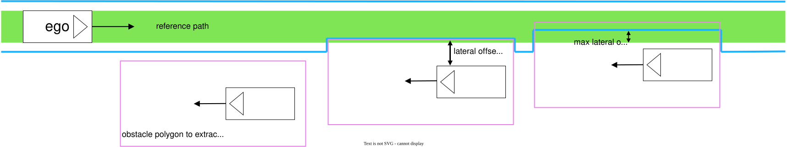
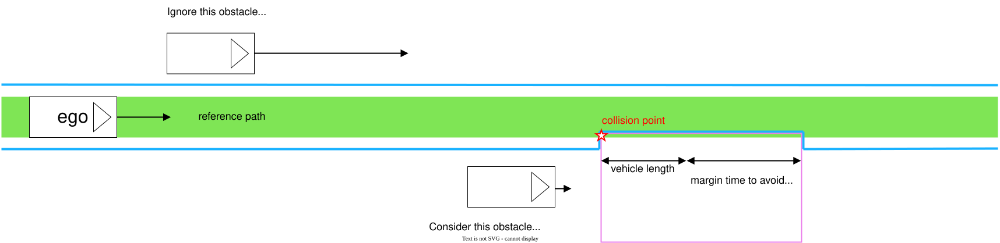
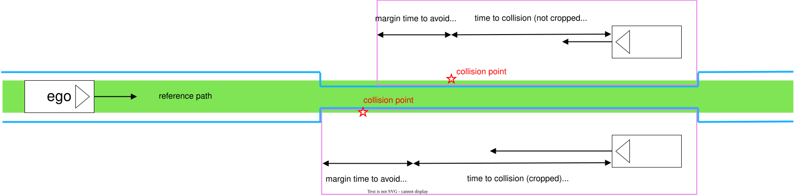
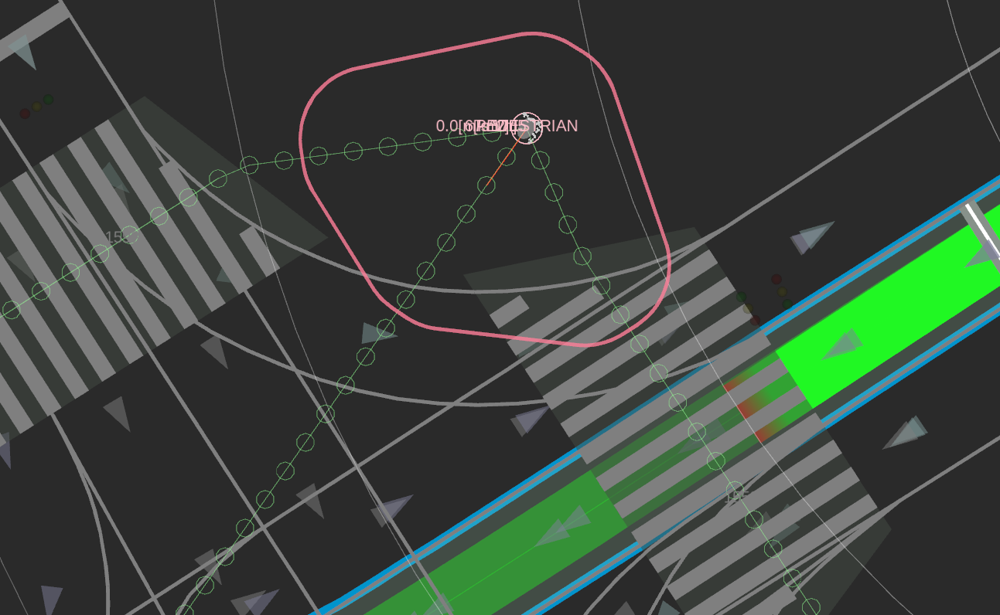
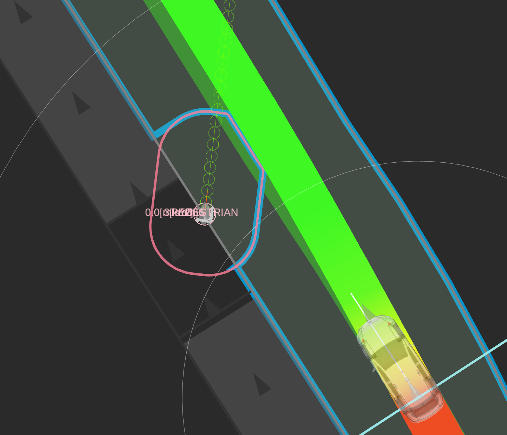
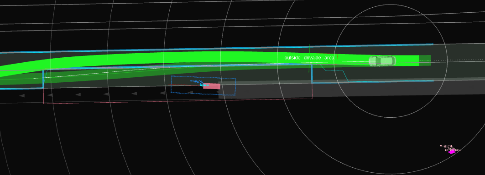
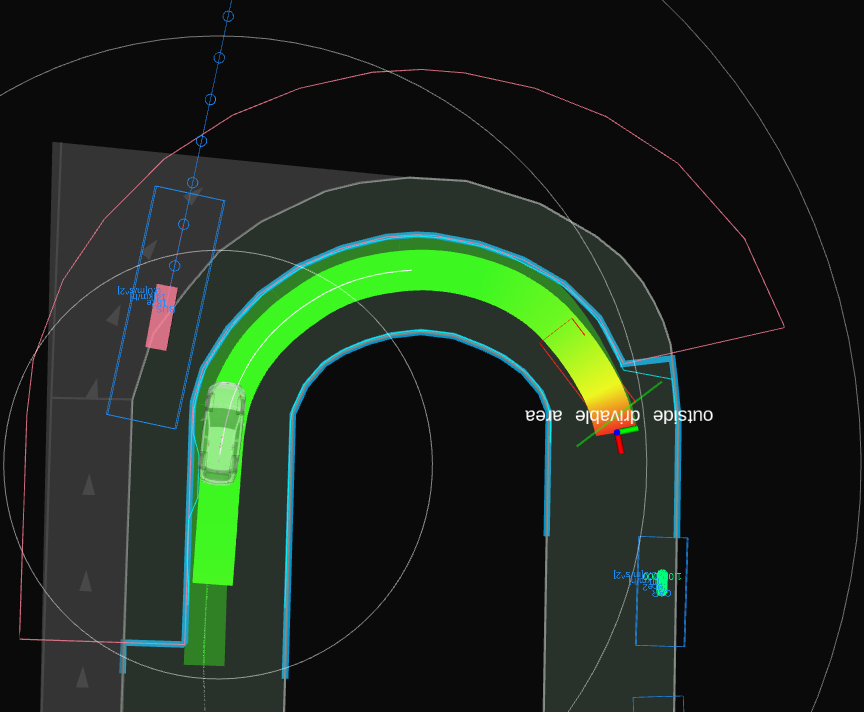
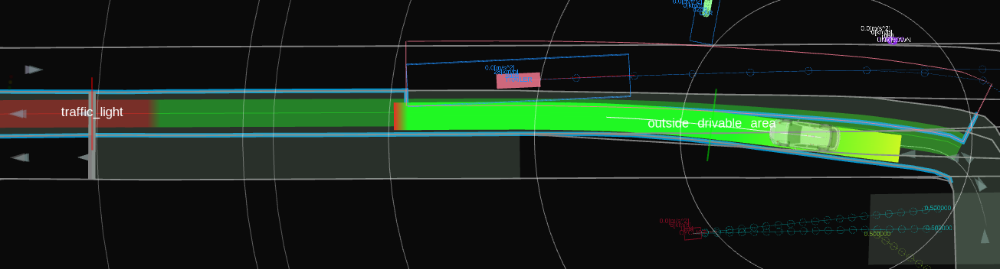
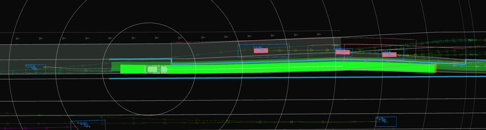

# Avoidance module for dynamic objects

This module is under development.

## AjouNice ROS1 output contract

In `optimization_base`, BPP assigns each perception UUID to one owner using
`avoidance_object_ownership` in `behavior_path_modules.yaml`: generic speed >= 0.5 m/s
enters DOA immediately; an unambiguous pedestrian uses >= 0.7 m/s instead.
Speed <= 0.2 m/s enters SOA immediately; the open interval retains the previous
owner. A new UUID below its entry threshold starts with SOA. Speed is the
planar magnitude of perception velocity, including reverse/crossing motion.
There is no ownership/admission dwell timer, consecutive-update requirement,
position-motion gate, or position-based forecast. Shared ownership is an ingress
filter, not permission to create a lateral detour. Existing regulated/unregulated
selection still rejects crossing traffic, distant objects, following vehicles,
cut-in/cut-out cases, passed objects, out-of-range TTC and unsuitable lateral
coverage. Supplied objects remain available unchanged to longitudinal/roundabout
planners. Shared-mode eligibility is refreshed immediately on each planning update;
legacy non-shared admission counters are unchanged. SOA releases both static
memories on a dynamic handoff; DOA replaces cached upstream constraints for that
UUID. Missing detections retain only the owner decision, without inventing
occupancy; a new route or clock rewind clears ownership. Invalid velocity is
conservatively assigned to DOA. SOA's existing geometry/margins are unchanged.

Selected objects are exported as independent `direct_constraint` obstacles,
alongside SOA obstacles in the BPP path's stamped obstacle scene. DOA does not
indent the road exterior. The existing BPP publisher forwards these polygons to
PO for side selection, optimization, and collision validation.

Each constraint carries the perception UUID. An object already owned by an SOA
direct constraint is not exported twice. Current footprint and accepted predicted
footprints within `predicted_path.end_time_to_consider` form a conservative swept
envelope, refreshed each planning cycle. Ego reservations cannot subtract object
occupancy. The collision polygon has **zero extra clearance padding**. Explicit
message margins are **hard 0.1 m / soft 0.7 m**; PO adds the soft margin to the
hard margin for preferred clearance. The legacy padded regulated-object policy
polygon is used only as an export gate outside the shared ownership mode, not as
collision occupancy. This is a spatial
envelope, not a time-indexed dynamic-obstacle optimizer.

The cutout descriptions below document the upstream policy from which target
selection and regulated-object eligibility originate; they do not describe the
road-boundary output of this checkout. `test_doa_independent_constraints` covers
road preservation, identity/ownership, complete occupancy, explicit margins, and
prediction refresh.

## Purpose / Role

This module provides avoidance functions for vehicles, pedestrians, and obstacles in the vicinity of the ego's path in combination with the [autoware_path_optimizer](https://autowarefoundation.github.io/autoware_universe/main/planning/autoware_path_optimizer/).
Each module performs the following roles.
The upstream Dynamic Avoidance module cuts off the drivable area according to the position and velocity of the target to be avoided; this checkout exports independent constraints instead.
Obstacle Avoidance module modifies the path to be followed so that it fits within the received drivable area.

Static obstacle's avoidance functions are also provided by the [Static Avoidance module](../autoware_behavior_path_static_obstacle_avoidance_module/README.md), but these modules have different roles.
The Static Obstacle Avoidance module performs avoidance through the outside of own lanes but cannot avoid the moving objects.
On the other hand, this module can avoid moving objects.
For this reason, the word "dynamic" is used in the module's name.
The table below lists the avoidance modules that can handle each situation.

|                          |                         avoid within the own lane                          | avoid through the outside of own lanes |
| :----------------------- | :------------------------------------------------------------------------: | :------------------------------------: |
| avoid not-moving objects | Avoidance Module   Dynamic Avoidance Module + Obstacle Avoidance Module |            Avoidance Module            |
| avoid moving objects     |            Dynamic Avoidance Module + Obstacle Avoidance Module            |     No Module (Under Development)      |

## Policy of algorithms

Here, we describe the policy of inner algorithms.
The inner algorithms can be separated into two parts: The first decides whether to avoid the obstacles and the second cuts off the drivable area against the corresponding obstacle.

### Select obstacles to avoid

To decide whether to avoid an object, both the predicted path and the state (pose and twist) of each object are used.
The type of objects the user wants this module to avoid is also required.
Using this information, the module decides to _avoid_ objects that _obstruct the ego's passage_ and _can be avoided_.

The definition of _obstruct the ego's passage_ is implemented as the object that collides within seconds.
The other, _can be avoided_ denotes whether it can be avoided without risk to the passengers or the other vehicles.
For this purpose, the module judges whether the obstacle can be avoided with satisfying the constraints of lateral acceleration and lateral jerk.
For example, the module decides not to avoid an object that is too close or fast in the lateral direction.

### Cuts off the drivable area against the selected vehicles

For the selected obstacles to be avoided, the module cuts off the drivable area.
As inputs to decide the shapes of cut-off polygons, poses of the obstacles are mainly used, assuming they move in parallel to the ego's path, instead of its predicted path.
This design arises from that the predicted path of objects is not accurate enough to use the path modifications (at least currently).
Furthermore, the output drivable area shape is designed as a rectangular cutout along the ego's path to make the computation scalar rather than planar.

#### Determination of lateral dimension

The lateral dimensions of the polygon are calculated as follows.
The polygon's width to extract from the drivable area is the obstacle width and `drivable_area_generation.lat_offset_from_obstacle`.
We can limit the lateral shift length by `drivable_area_generation.max_lat_offset_to_avoid`.

#### Determination of longitudinal dimension

Then, extracting the same directional and opposite directional obstacles from the drivable area will work as follows considering TTC (time to collision).

Regarding the same directional obstacles, obstacles whose TTC is negative will be ignored (e.g., The obstacle is in front of the ego, and the obstacle's velocity is larger than the ego's velocity.).

Same directional obstacles (Parameter names may differ from implementation)

Opposite directional obstacles (Parameter names may differ from implementation)

### Cuts off the drivable area against the selected pedestrians

Then, we describe the logic to generate the drivable areas against pedestrians to be avoided.
Objects of this type are considered to have priority right of way over the ego's vehicle while ensuring a minimum safety of the ego's vehicle.
In other words, the module assigns a drivable area to an obstacle with a specific margin based on the predicted paths with specific confidences for a specific time interval, as shown in the following figure.

<figure>
    
    <figcaption> Restriction areas are generated from each pedestrian's predicted paths</figcaption>
</figure>

Apart from polygons for objects, the module also generates another polygon to ensure the ego's safety, i.e., to avoid abrupt steering or significant changes from the path.
This is similar to avoidance against the vehicles and takes precedence over keeping a safe distance from the object to be avoided.
As a result, as shown in the figure below, the polygons around the objects reduced by the secured polygon of the ego are subtracted from the ego's drivable area.

<figure>
    
    <figcaption> Ego's minimum requirements are prioritized against object margin</figcaption>
</figure>

## Example

<figure>
    
    <figcaption>Avoidance for the bus departure</figcaption>
</figure>

<figure>  
    
    <figcaption>Avoidance on curve </figcaption>
</figure>

<figure>
    
    <figcaption>Avoidance against the opposite direction vehicle</figcaption>
</figure>

<figure>
    
    <figcaption>Avoidance for multiple vehicle</figcaption>
</figure>

## Future works

Currently, the path shifting length is limited to 0.5 meters or less by `drivable_area_generation.max_lat_offset_to_avoid`.
This is caused by the lack of functionality to work with other modules and the structure of the planning component.
Due to this issue, this module can only handle situations where a small avoidance width is sufficient.
This issue is the most significant for this module.
In addition, the ability of this module to extend the drivable area as needed is also required.

## Parameters

Under development

| Name                                                                  | Unit  | Type   | Description                                                | Default value |
| :-------------------------------------------------------------------- | :---- | :----- | :--------------------------------------------------------- | :------------ |
| target_object.car                                                     | [-]   | bool   | The flag whether to avoid cars or not                      | true          |
| target_object.truck                                                   | [-]   | bool   | The flag whether to avoid trucks or not                    | true          |
| ...                                                                   | [-]   | bool   | ...                                                        | ...           |
| target_object.min_obstacle_vel                                        | [m/s] | double | Minimum obstacle velocity to avoid                         | 1.0           |
| drivable_area_generation.lat_offset_from_obstacle                     | [m]   | double | Lateral offset to avoid from obstacles                     | 0.8           |
| drivable_area_generation.max_lat_offset_to_avoid                      | [m]   | double | Maximum lateral offset to avoid                            | 0.5           |
| drivable_area_generation.overtaking_object.max_time_to_collision      | [s]   | double | Maximum value when calculating time to collision           | 3.0           |
| drivable_area_generation.overtaking_object.start_duration_to_avoid    | [s]   | double | Duration to consider avoidance before passing by obstacles | 4.0           |
| drivable_area_generation.overtaking_object.end_duration_to_avoid      | [s]   | double | Duration to consider avoidance after passing by obstacles  | 5.0           |
| drivable_area_generation.overtaking_object.duration_to_hold_avoidance | [s]   | double | Duration to hold avoidance after passing by obstacles      | 3.0           |
| drivable_area_generation.oncoming_object.max_time_to_collision        | [s]   | double | Maximum value when calculating time to collision           | 3.0           |
| drivable_area_generation.oncoming_object.start_duration_to_avoid      | [s]   | double | Duration to consider avoidance before passing by obstacles | 9.0           |
| drivable_area_generation.oncoming_object.end_duration_to_avoid        | [s]   | double | Duration to consider avoidance after passing by obstacles  | 0.0           |
