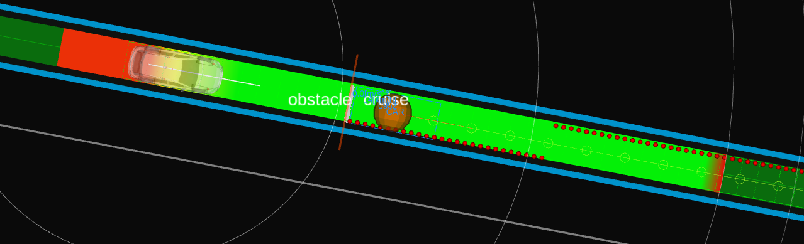

# Obstacle Cruise

## Role

The `obstacle_cruise` module does the cruise planning against a dynamic obstacle in front of the ego.

## Activation

This module is activated if the launch parameter `launch_obstacle_cruise_module` is set to true.

## Inner-workings / Algorithms

### Obstacle Filtering

The obstacles meeting the following condition are determined as obstacles for cruising.

- The lateral distance from the object to the ego's trajectory is smaller than `obstacle_filtering.max_lat_margin`.

- The object type is for cruising according to `obstacle_filtering.object_type.*`.
- The object is not crossing the ego's trajectory (\*1).
- If the object is inside the trajectory.
  - The object type is for inside cruising according to `obstacle_filtering.object_type.inside.*`.
  - The object velocity is larger than `obstacle_filtering.obstacle_velocity_threshold_from_cruise`.
- If the object is outside the trajectory.
  - The object type is for outside cruising according to `obstacle_filtering.object_type.outside.*`.
  - The object velocity is larger than `obstacle_filtering.outside_obstacle.obstacle_velocity_threshold`.
  - The highest confident predicted path collides with the ego's trajectory.
  - Its collision's period is larger than `obstacle_filtering.outside_obstacle.ego_obstacle_overlap_time_threshold`.

#### NOTE

##### \*1: Crossing obstacles

Crossing obstacle is the object whose orientation's yaw angle against the ego's trajectory is smaller than `obstacle_filtering.crossing_obstacle.obstacle_traj_angle_threshold`.

##### Yield for vehicles that might cut in into the ego's lane

It is also possible to yield (cruise) behind vehicles in neighbor lanes if said vehicles might cut in the ego vehicle's current lane.

The obstacles meeting the following condition are determined as obstacles for yielding (cruising).

- The object type is for cruising according to `obstacle_filtering.object_type.*` and it is moving with a speed greater than `obstacle_filtering.yield.stopped_obstacle_velocity_threshold`.
- The object is not crossing the ego's trajectory (\*1).
- There is another object of type `obstacle_filtering.object_type.side_stopped` stopped in front of the moving obstacle.
- The lateral distance (using the ego's trajectory as reference) between both obstacles is less than `obstacle_filtering.yield.max_lat_dist_between_obstacles`
- Both obstacles, moving and stopped, are within `obstacle_filtering.yield.lat_distance_threshold` and `obstacle_filtering.yield.lat_distance_threshold` + `obstacle_filtering.yield.max_lat_dist_between_obstacles` lateral distance from the ego's trajectory respectively.

If the above conditions are met, the ego vehicle will cruise behind the moving obstacle, yielding to it so it can cut in into the ego's lane to avoid the stopped obstacle.

### Cruise Planning

The role of the cruise planning is keeping a safe distance with dynamic vehicle objects with smoothed velocity transition.
This includes not only cruising a front vehicle, but also reacting a cut-in and cut-out vehicle.

The module calculates the minimum safe braking distance dynamically by using the following equation:

$$
d_{braking} = v_{ego} t_{idling} + \frac{v_{ego}^2}{2 a_{ego}} - \frac{v_{obstacle}^2}{2 a_{obstacle}} + l_{margin},
$$

assuming that $d_{braking}$ is the calculated safe distance, $t_{idling}$ is the idling time for the ego to detect the front vehicle's deceleration, $v_{ego}$ is the ego's current velocity, $v_{obstacle}$ is the front obstacle's current velocity, $a_{ego}$ is the ego's acceleration, $a_{obstacle}$ is the obstacle's acceleration, and $l_{margin}$ is the safety margin.
These values are parameterized as follows. Other common values such as ego's minimum acceleration is defined in `common.param.yaml`.

| Parameter                                  | Type   | Description                                                                   |
| ------------------------------------------ | ------ | ----------------------------------------------------------------------------- |
| `cruise_planning.idling_time`              | double | idling time for the ego to detect the front vehicle starting deceleration [s] |
| `cruise_planning.min_ego_accel_for_rss`    | double | ego's acceleration for minimum safe braking distance [m/ss]                   |
| `cruise_planning.min_object_accel_for_rss` | double | front obstacle's acceleration for minimum safe braking distance [m/ss]        |
| `cruise_planning.safe_distance_margin`     | double | safety margin for minimum safe braking distance [m]                           |
| `cruise_planning.pid_based_planner.target_distance_scale` | double | Positive multiplier of the entire PID RSS target, including the margin. Source YAMLs use 0.4; omitted parameter defaults to 1.0. |

For PID cruise, the target is
`max(safe_distance_margin, target_distance_scale * d_braking)`.
The margin is included in `d_braking` and also provides the minimum target gap
after scaling (5 m in the source YAMLs).
This parameter affects both PID output modes and does not alter the optimization planner.
The integrated ROS1 launch currently uses a 3 m floor; the standalone package
YAMLs use 5 m. The loaded `safe_distance_margin` determines the actual floor.

### Relative-speed RSS anticipation (ROS1 PID)

`pid_based_planner.rss_prediction` enables earlier speed reduction for a fast
approach without changing the RSS target or PID gains. For each candidate,
closing speed is ego speed minus the obstacle's **along-trajectory** speed.
The integrated and package YAMLs enable this policy:

| Parameter | Value | Meaning |
| --- | --- | --- |
| `enabled` | `true` | Use relative-speed anticipation; omitted defaults to false. |
| `start_relative_speed_kph` | `30.0` | No anticipation at or below this closing speed. |
| `full_relative_speed_kph` | `80.0` | Reach `max_time` here, with a linear ramp from the start. |
| `max_time` | `1.0` | Maximum anticipation time in seconds. |

For 130/50 km/h, the nominal time is 1 s and nominal approach distance is
22.22 m. Equal-speed and opening targets receive no correction. When disabled,
`time_to_evaluate_rss` supplies a fixed time (currently 0 s); the same distance
guards apply to that fixed-time mode.

Let `d` be the actual signed along-path collision-point distance, `c` the
positive closing speed, `T` the nominal anticipation time, and `A=c*T`.
The nominal projected distance is `d-A`. If `d-A <= 0`, the additional
correction is zero and ordinary actual-distance following remains active.
For `A < d < 2*A`, the correction fades as
`A * smoothstep((d-A)/A)`, where `smoothstep(x)=x*x*(3-2*x)`.
For `d >= 2*A`, the full correction `A` applies. This continuous, zero-slope
fade avoids a step at either boundary; no fixed physical following-gap cutoff
is introduced. Falling below the RSS target alone does **not** disable braking.

Candidate selection uses the smallest corrected error
`d - RSS_target - correction`. Both PID output modes normalize that error by
`max(actual_distance, 0.1 m)`, never by the projected distance. The 0.1 m
denominator floor is numerical protection, not a following-gap setting.
At zero anticipation, positive distances >= 0.1 m retain the original behavior.
The distance LPF and TTC continue to use physical distance. PID/LPF history
still resets on a selected UUID change or lane-change handoff.

The cruise debug array preserves indices 0-14 and appends nominal prediction
time [s] at 15, projected distance before fading [m] at 16, and applied
distance-error correction [m] at 17. These expose whether anticipation was
disabled by low closing speed or by the close-distance guard.
The thresholds, maximum time and fixed time must be finite; times and the
start threshold must be nonnegative, and the full threshold must exceed start.
Source YAML changes take effect on restart; a source build/test is not proof
that the running installed module or a closed-loop MORAI run uses the change.

The detailed formulation is as follows.

$$
\begin{align}
d_{target} & = \max(l_{margin}, scale \cdot d_{braking}) \\
d_{error} & = d - d_{target} - C_{prediction} \\
d_{normalized} & = lpf(d_{error} / \max(d_{obstacle}, 0.1)) \\
d_{quad, normalized} & = sign(d_{normalized}) *d_{normalized}*d_{normalized} \\
v_{pid} & = pid(d_{quad, normalized}) \\
v_{add} & = v_{pid} > 0 ? v_{pid}* w_{acc} : v_{pid} \\
v_{target} & = max(v_{ego} + v_{add}, v_{min, cruise})
\end{align}
$$

| Variable          | Description                                                       |
| ----------------- | ----------------------------------------------------------------- |
| `d`               | actual distance to obstacle                                       |
| `d_{braking}`     | ideal distance to obstacle based on minimum safe braking distance |
| `v_{min, cruise}` | `min_cruise_target_vel`                                           |
| `w_{acc}`         | `output_ratio_during_accel`                                       |
| `lpf(val)`        | apply low-pass filter to `val`                                    |
| `pid(val)`        | apply pid to `val`                                                |

#### Algorithm selection for cruise planner

Currently, only a PID-based planner is supported.
Each planner will be explained in the following.

| Parameter                   | Type   | Description                                                  |
| --------------------------- | ------ | ------------------------------------------------------------ |
| `option.planning_algorithm` | string | cruise and stop planning algorithm, selected from "pid_base" |

#### PID-based planner

In order to keep the safe distance, the target velocity and acceleration is calculated and sent as an external velocity limit to the velocity smoothing package (`velocity_smoother` by default).
The target velocity and acceleration is respectively calculated with the PID controller according to the error between the reference safe distance and the actual distance.

#### Optimization-based planner

under construction

## Debugging

### Obstacle for cruise

Orange sphere which is an obstacle for cruise is visualized by `obstacles_to_cruise` in the `~/debug/marker` topic.

Orange wall which means a safe distance to cruise if the ego's front meets the wall is visualized in the `~/debug/cruise/virtual_wall` topic.

